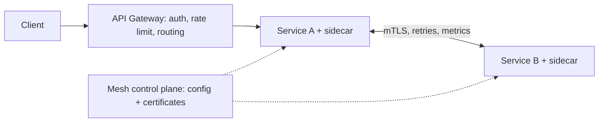

## 1. Core Concept

Hai thành phần giải quyết hai hướng traffic khác nhau trong microservices. **API Gateway** xử lý **north-south** (client bên ngoài → hệ thống): xác thực, rate limit, định tuyến, tổng hợp. **Service mesh** xử lý **east-west** (service ↔ service): mTLS, retry, timeout, circuit breaking, traffic shifting, observability — **không sửa code ứng dụng**. Mental model: *gateway là cổng vào toà nhà; mesh là hệ thống camera + ổ khoá tự động trên mọi hành lang bên trong.*

## 2. How It Works

- **API Gateway** (Kong, NGINX, AWS API Gateway, Envoy Gateway): điểm vào duy nhất — **TLS termination, authN/authZ, rate limiting, request routing, transform, caching, aggregation**. Biến thể **BFF (Backend for Frontend)**: gateway riêng cho từng loại client.
- **Service mesh** gồm **data plane** (proxy chạy cạnh mỗi service — thường **sidecar Envoy**) và **control plane** (Istio, Linkerd, Consul) cấu hình proxy và cấp **chứng chỉ**.
- **Năng lực mesh**: **mTLS tự động** (mã hoá + danh tính giữa service), **retry/timeout/circuit breaker** theo cấu hình, **traffic shifting** (canary 5% → 100%, A/B), **fault injection**, **telemetry** (metrics, trace) đồng nhất.
- **Mô hình triển khai**: **sidecar** (mỗi pod một proxy), **sidecarless/ambient** (proxy theo node, giảm overhead), **eBPF** (Cilium).
- **Thay thế bằng thư viện** (Resilience4j, gRPC interceptor): không thêm hop mạng nhưng phải làm cho **từng ngôn ngữ/service**.

## 3. Visual Diagram

## 4. Rules of Thumb & Trade-offs

- **Luôn cần gateway** khi có client bên ngoài; mesh **chỉ đáng** khi có nhiều service, yêu cầu mTLS/zero-trust, traffic management phức tạp và đội đủ năng lực vận hành.
- Ít service (< vài chục) → thư viện + gateway thường đủ; đừng đưa mesh vào sớm.
- Trade-off: mesh đổi **chính sách thống nhất không sửa code** lấy **độ trễ thêm (hop proxy), tài nguyên sidecar và độ phức tạp vận hành**.

## 5. Must Remember / Production Pitfalls

- **Retry nhân lên**: retry ở mesh + retry trong ứng dụng + retry ở gateway → bão retry; chọn **một tầng** và đặt giới hạn.
- **Sidecar tốn CPU/RAM** và thêm 1–2 hop; ở quy mô lớn chi phí đáng kể.
- **Gỡ lỗi khó hơn**: lỗi có thể do proxy/cấu hình mesh chứ không phải code; cần observability tốt.
- **Xoay chứng chỉ mTLS** và đồng hồ lệch có thể làm cả mesh mất kết nối.
- **Gateway biến thành "monolith mới"** chứa logic nghiệp vụ, hoặc thành điểm lỗi duy nhất → giữ logic mỏng, chạy HA.
- Gateway **không thay** kiểm tra quyền trong từng service (defense in depth).
- Interview trap: "Gateway và mesh có trùng nhau không?" → khác hướng traffic (north-south vs east-west), thường **dùng cùng nhau**.

## 6. Search Hooks

- `API gateway vs service mesh` — hai thành phần cho traffic bắc-nam và đông-tây.
- `sidecar proxy Envoy` — proxy cạnh mỗi service làm data plane.
- `Istio Linkerd control plane` — các service mesh phổ biến.
- `mTLS service-to-service zero trust` — mã hoá và xác thực giữa service.
- `canary deployment traffic shifting` — chuyển dần lưu lượng sang phiên bản mới.
- `backend for frontend BFF pattern` — gateway riêng cho từng loại client.
