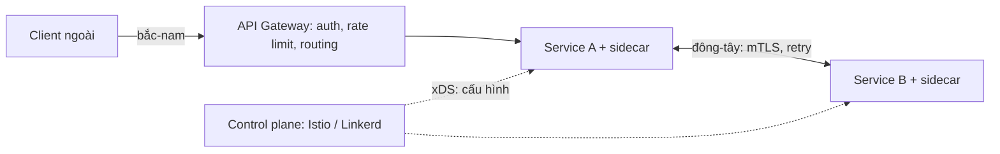

## 1. Core Concept

**API Gateway** và **service mesh** đều là lớp hạ tầng xử lý các vấn đề **xuyên suốt** (xác thực, mã hoá, retry, giới hạn tốc độ, quan sát) để **không phải viết lại trong từng dịch vụ**, nhưng ở **hai hướng lưu lượng khác nhau**: **gateway lo "bắc–nam"** (client bên ngoài → hệ thống), **mesh lo "đông–tây"** (dịch vụ ↔ dịch vụ bên trong). Hiểu ranh giới này tránh dùng sai công cụ và tránh phức tạp không cần thiết.

**Mental model:** gateway là **lễ tân và cổng bảo vệ toà nhà** (kiểm tra khách bên ngoài, chỉ dẫn tới phòng đúng, giới hạn lượt vào); mesh là **hệ thống thang máy, thẻ từ và camera bên trong toà nhà** (mọi người đi lại giữa các phòng đều được xác thực, ghi nhận, điều hướng).

## 2. How It Works

**API Gateway → Bắc–nam**
- Điểm vào duy nhất cho client: **xác thực/uỷ quyền (JWT, OAuth)**, **rate limiting**, **kết thúc TLS**, **định tuyến** theo path/host, **versioning**, **caching**, **chuyển đổi/ghép nối request (aggregation)**, ẩn kiến trúc nội bộ. Ví dụ: Kong, AWS API Gateway, Apigee, Envoy Gateway. **Không đặt logic nghiệp vụ vào gateway.**

**Backend for Frontend (BFF)**
- Mỗi loại client (web, mobile) có **một backend riêng** tổng hợp dữ liệu đúng nhu cầu của nó (giảm over/under-fetch, cho đội frontend tự chủ) thay vì một gateway chung "một cỡ cho tất cả".

**Service mesh → Đông–tây qua sidecar**
- Mỗi Pod có **sidecar proxy (Envoy)** chặn mọi lưu lượng vào/ra → mesh làm **mTLS**, **retry/timeout**, **circuit breaking**, **load balancing nâng cao**, **traffic shifting**, **telemetry (metrics/trace)** **mà không đổi code ứng dụng**. **Control plane** (Istio `istiod`, Linkerd) phân phối cấu hình cho **data plane** (các proxy) qua **xDS**. Có mô hình **ambient mesh** (không sidecar) để giảm chi phí.

**mTLS tự động**
- Mỗi workload có **danh tính (SPIFFE)** và **chứng chỉ ngắn hạn tự xoay**; hai bên **xác thực lẫn nhau** và mã hoá traffic nội bộ → nền của **zero trust**, kèm chính sách "dịch vụ A được gọi B".

**Canary và traffic shifting**
- Chia traffic theo **trọng số** (90% bản cũ / 10% bản mới) hoặc theo **header/người dùng**, tăng dần nếu chỉ số tốt, **rollback tức thì** nếu xấu — triển khai ít rủi ro.

**Cái giá của mesh**
- Thêm **độ trễ mỗi hop** (vài mili-giây), **RAM/CPU mỗi sidecar**, **độ phức tạp vận hành** và debug. Với ít dịch vụ, thư viện (Resilience4j) + gateway thường **đủ**.

```yaml
# Istio: canary 90/10 theo trọng số
apiVersion: networking.istio.io/v1
kind: VirtualService
metadata: { name: reviews }
spec:
  hosts: [reviews]
  http:
  - route:
    - { destination: { host: reviews, subset: v1 }, weight: 90 }
    - { destination: { host: reviews, subset: v2 }, weight: 10 }
```

## 3. Visual Diagram



## 4. Rules of Thumb & Trade-offs

| Tình huống / Nhu cầu | Chọn gì |
| --- | --- |
| Xác thực, rate limit, routing cho client ngoài | API Gateway |
| Mã hoá và xác thực giữa dịch vụ, retry/timeout đồng nhất | Service mesh |
| Mỗi loại client cần dữ liệu khác nhau | BFF |
| Canary/traffic shifting không đổi code | Mesh (hoặc gateway/ingress có weight) |
| Ít dịch vụ, đội nhỏ | Thư viện resilience + gateway, chưa cần mesh |
| Chi phí sidecar quá lớn | Ambient mesh |

- **Được gì:** chính sách đồng nhất, bảo mật và quan sát không sửa code. **Mất gì:** thêm hop/độ trễ, tài nguyên, phức tạp vận hành; gateway/mesh là **điểm lỗi tiềm tàng** cần HA.

## 5. Must Remember / Production Pitfalls

- **Logic nghiệp vụ dồn vào gateway → gateway thành điểm nghẽn và nơi đội nào cũng sửa → gateway chỉ lo cross-cutting, logic ở dịch vụ**.
- **Gateway là điểm lỗi đơn → chạy một instance → nhiều instance sau LB, HA đa AZ**.
- **Dùng mesh cho 5 dịch vụ → chi phí/phức tạp vượt lợi ích → dùng thư viện + gateway cho tới khi cần**.
- **Retry ở cả mesh và ứng dụng → nhân đôi tải (retry amplification) → thống nhất retry ở một tầng, retry budget**.
- **mTLS bật nhưng chứng chỉ hết hạn gây lỗi → xoay vòng không tự động → dùng control plane quản lý chứng chỉ ngắn hạn tự xoay**.
- Interview trap: "gateway vs mesh?" → **gateway lo bắc–nam (client → hệ thống), mesh lo đông–tây (dịch vụ ↔ dịch vụ)**; "sidecar làm gì?" → **proxy Envoy chặn traffic để làm mTLS/retry/telemetry**; "BFF là gì?" → **backend riêng cho từng loại frontend**.

## 6. Search Hooks

- `API gateway vs service mesh` — bắc–nam so với đông–tây.
- `sidecar proxy Envoy` — proxy chặn traffic cạnh mỗi dịch vụ.
- `Istio Linkerd control plane` — mặt phẳng điều khiển của mesh.
- `mTLS mutual TLS service mesh` — xác thực hai chiều giữa dịch vụ.
- `canary deployment traffic shifting` — chuyển traffic dần sang phiên bản mới.
- `backend for frontend BFF` — backend riêng cho từng loại client.
