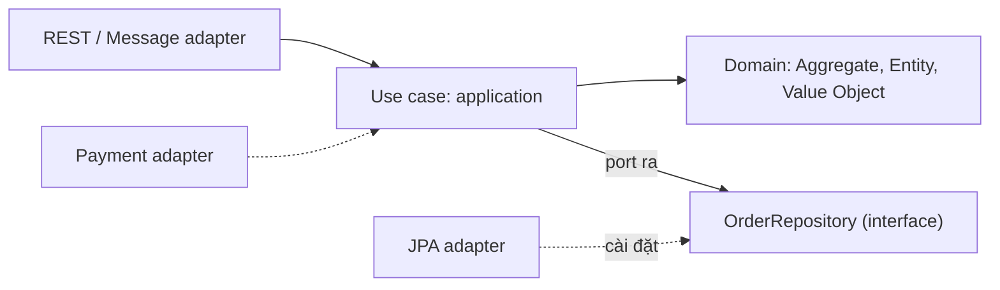

## 1. Core Concept

**Clean/Hexagonal Architecture** đặt **logic nghiệp vụ (domain) ở trung tâm**, độc lập framework, DB, UI; các chi tiết kỹ thuật cắm vào qua **port/adapter**. **DDD** (Domain-Driven Design) bổ sung cách **mô hình hoá domain** bằng Entity, Value Object, Aggregate, ngôn ngữ chung. Cả hai giải quyết: **nghiệp vụ không bị trói vào công nghệ** nên dễ test, dễ đổi DB/framework và không thành "big ball of mud".

**Mental model:** domain là **lõi của củ hành**; các lớp ngoài (use case, adapter, framework) bọc quanh. **Mũi tên phụ thuộc luôn hướng vào trong**: lõi không biết gì về lớp ngoài. DB hay REST chỉ là **chi tiết thay thế được**.

## 2. How It Works

**Dependency Rule**
- Code **chỉ phụ thuộc vào trong**: infrastructure → application → domain. Lõi định nghĩa **interface (port)** như `OrderRepository`; adapter ở ngoài (JPA, REST) **cài đặt** nó (Dependency Inversion). Kết quả: test domain **không cần DB/Spring**.

**Hexagonal (Ports & Adapters)**
- **Port vào** (driving): use case mà bên ngoài gọi (REST controller, message listener). **Port ra** (driven): thứ lõi cần (repository, gửi email, payment gateway). **Adapter** là cài đặt cụ thể cho từng port.

**Entity vs Value Object**
- **Entity**: có **định danh** (`orderId`), bình đẳng theo id, vòng đời thay đổi. **Value Object**: **không có id**, **bất biến**, bình đẳng theo **giá trị** (`Money(100,"USD")`, `Address`), nên tự validate ngay lúc tạo. Ưu tiên Value Object để tránh "primitive obsession".

**Aggregate và Aggregate Root**
- **Aggregate** là cụm đối tượng được xử lý như **một đơn vị nhất quán**, **root** là cổng duy nhất để thay đổi và bảo vệ **invariant** (tổng tiền = tổng các dòng). Quy tắc: **một giao dịch = một aggregate**, tham chiếu aggregate khác **bằng id**, aggregate **nhỏ**. Truy cập qua **repository** theo root.

**Anemic Domain Model**
- Entity chỉ có getter/setter, logic dồn ở "service" → **mất ý nghĩa OOP**, invariant bị rải rác, dễ vi phạm. **Rich domain model**: hành vi nằm trong entity/aggregate (`order.addItem()`, `order.pay()`), setter không công khai.

**Bounded Context và Ubiquitous Language**
- Mỗi **bounded context** có **mô hình và thuật ngữ riêng** (Customer trong Sales ≠ Customer trong Billing); ranh giới thường tương ứng **microservice**. **Ubiquitous language**: dev và chuyên gia nghiệp vụ dùng cùng thuật ngữ, thể hiện trong code.

```java
public class Order {                                  // Aggregate Root: bảo vệ invariant
    private final OrderId id; private final List<OrderLine> lines = new ArrayList<>();
    private Status status = Status.DRAFT;
    public void addLine(ProductId p, int qty, Money price) {
        if (status != Status.DRAFT) throw new IllegalStateException("Order is locked");
        if (qty <= 0) throw new IllegalArgumentException("qty");
        lines.add(new OrderLine(p, qty, price));
    }
    public Money total() { return lines.stream().map(OrderLine::subtotal).reduce(Money.ZERO, Money::plus); }
}
```

## 3. Visual Diagram



## 4. Rules of Thumb & Trade-offs

| Tình huống / Nhu cầu | Chọn gì |
| --- | --- |
| Nghiệp vụ phức tạp, sống lâu | Clean/Hexagonal + DDD |
| CRUD đơn giản | Không cần; tránh over-engineering |
| Có giá trị đo lường (tiền, địa chỉ) | Value Object bất biến |
| Cần bảo vệ invariant | Aggregate Root, một giao dịch/aggregate |
| Nhiều đội, thuật ngữ khác nhau | Bounded Context |
| Domain chỉ có getter/setter | Chuyển sang rich domain model |

- **Được gì:** domain dễ test, thay công nghệ ít đau, nghiệp vụ rõ ràng. **Mất gì:** nhiều lớp, mapping giữa lớp, chi phí khởi đầu cao; không đáng cho ứng dụng CRUD nhỏ.

## 5. Must Remember / Production Pitfalls

- **Domain import annotation của framework/DB → rò rỉ phụ thuộc → giữ domain thuần, ánh xạ ở adapter**.
- **Một giao dịch sửa nhiều aggregate → khoá rộng, khó scale → một giao dịch một aggregate, nhất quán cuối cùng qua domain event**.
- **Aggregate quá lớn (load cả cây) → chậm, xung đột → giữ nhỏ, tham chiếu bằng id**.
- **Service chứa toàn bộ logic, entity chỉ có setter → anemic → đưa hành vi vào aggregate**.
- **Dùng chung một model cho nhiều context → mơ hồ, coupling → bounded context + anti-corruption layer**.
- **Áp DDD đầy đủ cho CRUD → phức tạp vô ích → chỉ dùng ở lõi nghiệp vụ phức tạp**.
- Interview trap: "dependency rule?" → **phụ thuộc chỉ hướng vào trong**; "entity vs value object?" → **có định danh vs bất biến theo giá trị**; "aggregate root để làm gì?" → **bảo vệ invariant, cổng duy nhất thay đổi aggregate**.

## 6. Search Hooks

- `Hexagonal architecture ports and adapters` — domain ở lõi, adapter cắm ngoài.
- `Clean Architecture dependency rule` — phụ thuộc hướng vào trong.
- `DDD aggregate root` — đơn vị nhất quán và bảo vệ invariant.
- `Entity vs Value Object` — định danh so với giá trị bất biến.
- `anemic domain model` — anti-pattern thiếu hành vi.
- `bounded context DDD` — ranh giới mô hình và thuật ngữ.
