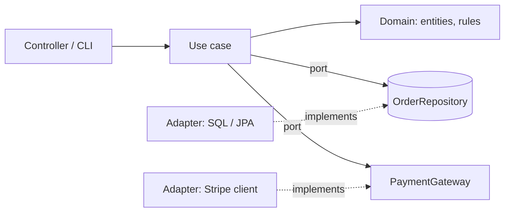

## 1. Core Concept

**Clean/Hexagonal Architecture** đặt **nghiệp vụ (domain) ở trung tâm** và buộc mọi phụ thuộc chỉ hướng **vào trong**, để framework, DB, UI là chi tiết có thể thay. **Domain-Driven Design (DDD)** cung cấp từ vựng để mô hình hoá nghiệp vụ phức tạp: **entity, value object, aggregate, bounded context**. Mental model: *code nghiệp vụ không được biết nó đang chạy trên Spring, Postgres hay Kafka — những thứ đó cắm vào qua "cổng" (port).*

## 2. How It Works

- **Dependency rule**: domain ← application ← infrastructure/interface. Lớp trong **không import** lớp ngoài.
- **Các lớp**: **Domain** (entity, value object, quy tắc nghiệp vụ), **Application/Use case** (điều phối một kịch bản), **Infrastructure** (DB, HTTP client, queue), **Interface** (controller, CLI).
- **Ports & Adapters**: **port** là interface do domain/application định nghĩa (`OrderRepository`, `PaymentGateway`); **adapter** là cài đặt cụ thể (JPA, Stripe) nằm ở ngoài — nhờ **Dependency Inversion**.
- **DDD tactical**:
  - **Entity** có danh tính; **Value Object** bất biến, so sánh theo giá trị (`Money`, `Address`).
  - **Aggregate**: cụm đối tượng có **một root** và là **ranh giới nhất quán** — **một transaction chỉ sửa một aggregate**; tham chiếu aggregate khác bằng ID.
  - **Repository** lưu/lấy aggregate; **Domain Service** cho logic không thuộc entity nào; **Domain Event** ghi nhận điều đã xảy ra.
- **DDD strategic**: **Bounded Context** (ranh giới mô hình và ngôn ngữ), **Ubiquitous Language** (dev và chuyên gia nghiệp vụ dùng chung thuật ngữ), **Context Map** (quan hệ giữa các context) — nền tảng để tách microservices.

## 3. Visual Diagram

## 4. Rules of Thumb & Trade-offs

- Dùng khi **nghiệp vụ phức tạp, sống lâu, nhiều quy tắc**; **CRUD đơn giản** thì kiến trúc này là thừa — ứng dụng nhỏ cứ giữ layered gọn.
- Giữ **aggregate nhỏ**: aggregate to gây tranh chấp khoá và khó scale.
- Thiết kế **bounded context trước**, rồi mới tách service: ranh giới sai thì microservices chỉ nhân bội vấn đề.
- Trade-off: **dễ test và dễ thay công nghệ** đổi lấy **nhiều lớp, nhiều ánh xạ, boilerplate**.

## 5. Must Remember / Production Pitfalls

- **Anemic domain model**: entity chỉ có getter/setter, logic nằm hết trong service → mất ý nghĩa của DDD; đưa quy tắc vào entity/aggregate.
- **Rò rỉ chi tiết hạ tầng vào domain** (annotation ORM, DTO HTTP trong entity) phá dependency rule.
- **Sửa nhiều aggregate trong một transaction** là dấu hiệu ranh giới sai; dùng domain event và eventual consistency.
- **Một mô hình dùng cho mọi nơi** (một `User` cho cả billing, auth, profile) làm mô hình phình to; mỗi bounded context có mô hình riêng.
- **Over-engineering** cho CRUD: hàng chục file cho một bảng.
- Interview trap: "Repository khác DAO?" → Repository là **abstraction của domain** trả aggregate; DAO bám sát bảng/DB.

## 6. Search Hooks

- `hexagonal architecture ports and adapters` — domain ở giữa, hạ tầng cắm vào qua port.
- `Clean Architecture dependency rule` — phụ thuộc chỉ hướng vào trong.
- `DDD aggregate root consistency boundary` — ranh giới nhất quán và một transaction một aggregate.
- `entity vs value object` — danh tính so với so sánh theo giá trị.
- `bounded context context map` — ranh giới mô hình và quan hệ giữa các context.
- `anemic domain model anti-pattern` — domain chỉ chứa dữ liệu, logic nằm ngoài.
