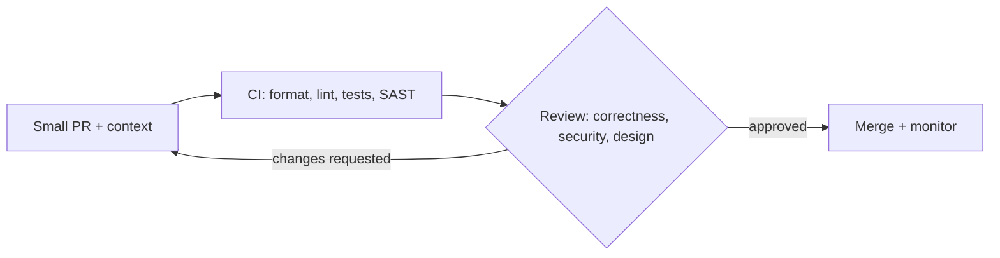

## 1. Core Concept

**Code review** là cơ chế chất lượng quan trọng nhất của đội: bắt lỗi, truyền kiến thức và giữ thiết kế nhất quán. **Refactoring** là cải thiện cấu trúc code **không đổi hành vi**, thực hiện **từng bước nhỏ có test bảo vệ**. Trong thời đại AI sinh code, kỹ năng review còn quan trọng hơn viết: *bạn chịu trách nhiệm cho mọi dòng được merge, dù ai (hay cái gì) viết ra nó.*

## 2. How It Works

- **PR nhỏ, một mục đích** (lý tưởng < 400 dòng thay đổi): dễ review kỹ, ít xung đột, rollback dễ. Mô tả **vì sao** (không chỉ cái gì), kèm cách kiểm tra.
- **Reviewer kiểm tra theo thứ tự**: **đúng đắn** (logic, biên, lỗi, đồng thời) → **bảo mật** (đầu vào, quyền, secret) → **thiết kế** (ranh giới, phụ thuộc, tính mở rộng) → **test** (có kiểm chứng hành vi mới?) → **dễ đọc/bảo trì** → phong cách (để linter/formatter lo).
- **Tự động hoá phần máy làm được**: formatter, linter, type check, SAST, test trong CI để con người tập trung vào phán đoán.
- **Code smell** báo hiệu cần refactor: **long method**, **god class**, **duplicated code**, **feature envy**, **shotgun surgery**, **primitive obsession**, tham số quá nhiều.
- **Refactor an toàn**: có test trước → bước nhỏ (extract method, rename, move) → chạy test sau mỗi bước → commit thường xuyên; tách commit refactor khỏi commit đổi hành vi. Với hệ lớn: **strangler**, **branch by abstraction**.
- **Technical debt**: ghi nhận có chủ đích (ticket, ADR), trả dần theo **Boy Scout rule** (để lại sạch hơn lúc đến).
- **Review code do AI sinh**: kiểm tra nó **thực sự giải bài toán của bạn**, không có lỗi tinh vi (race, N+1, thiếu idempotency), không dùng API/thư viện **không tồn tại**, không phá quy ước dự án.

## 3. Visual Diagram

## 4. Rules of Thumb & Trade-offs

- **Review code, không review người**: nhận xét cụ thể, có lý do, phân biệt "phải sửa" và "gợi ý".
- Đừng refactor và thêm tính năng **trong cùng PR**; đừng refactor khi **chưa có test**.
- Thời gian phản hồi review nhanh (trong ngày) quan trọng hơn review "hoàn hảo".
- Trade-off: **review kỹ** tăng chất lượng nhưng chậm luồng thay đổi; chọn mức kỹ theo **rủi ro** (code thanh toán kỹ hơn trang tĩnh).

## 5. Must Remember / Production Pitfalls

- **PR khổng lồ** → reviewer duyệt qua loa ("LGTM"); chia nhỏ hoặc review theo commit.
- **Rubber-stamping**: approve vì tin người viết (hoặc tin AI) mà không đọc.
- **Refactor không test** thay đổi hành vi âm thầm.
- **Bikeshedding** (tranh luận tên biến) che mất vấn đề thiết kế thật; để công cụ quyết định phong cách.
- **AI "đúng đường vui"**: code chạy tốt demo nhưng sai ở biên, đồng thời và lỗi; luôn hỏi "điều gì xảy ra khi nhiều request đến cùng lúc / dependency chết?".
- Interview trap: "Bạn review gì đầu tiên?" → **PR đang giải quyết đúng vấn đề chưa**, rồi mới đến chi tiết.

## 6. Search Hooks

- `code review best practices` — cách review hiệu quả.
- `code smells refactoring catalog` — danh mục các dấu hiệu code cần cải thiện.
- `Boy Scout rule technical debt` — trả nợ kỹ thuật từng bước.
- `branch by abstraction strangler fig` — refactor hệ lớn an toàn.
- `small pull requests trunk-based development` — PR nhỏ và tích hợp thường xuyên.
- `reviewing AI-generated code checklist` — danh sách kiểm tra code do AI sinh.
