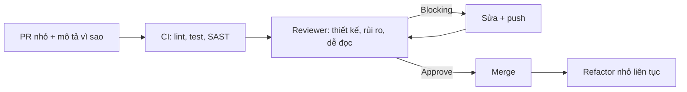

## 1. Core Concept

**Code review** là cơ chế **chia sẻ hiểu biết và bắt lỗi trước khi merge**; **refactoring** là **cải thiện cấu trúc mà không đổi hành vi bên ngoài**, thực hiện **từng bước nhỏ có test bảo vệ**. Cả hai giải quyết **nợ kỹ thuật tích luỹ** và rủi ro "chỉ một người hiểu đoạn code này". Mục tiêu review: **chất lượng & chia sẻ kiến thức**, không phải bắt lỗi nhỏ nhặt hay thể hiện.

**Mental model:** code review như **hai người cùng kiểm tra bản vẽ trước khi đổ bê tông**; refactoring như **dọn bếp trong lúc nấu**: dọn ít một, thường xuyên, không dừng cả nhà bếp để tổng vệ sinh.

## 2. How It Works

**Review hiệu quả**
- **PR nhỏ** (< ~400 dòng; chất lượng review giảm mạnh khi PR lớn), **một mục đích**, mô tả **vì sao** chứ không chỉ cái gì. Người review ưu tiên theo thứ tự: **thiết kế/đúng đắn → bảo mật/rủi ro → dễ đọc/bảo trì → style** (style để **linter/formatter** tự động). Phản hồi **cụ thể, lịch sự**, phân loại **blocking** và **nit**. **Tự động hoá** những gì máy làm được (lint, test, SAST) để người tập trung vào phần cần phán đoán.

**Code smells và refactoring catalog**
- **Smell**: dấu hiệu cấu trúc kém như **long method**, **large class**, **duplicate code**, **feature envy**, **shotgun surgery** (một thay đổi phải sửa nhiều nơi), **primitive obsession**, **long parameter list**. Công cụ: **Extract Method**, **Extract Class**, **Rename**, **Replace Conditional with Polymorphism**, **Introduce Parameter Object**, **Move Method**.

**An toàn khi refactor**
- Có **test bao phủ** (nếu chưa: viết **characterization test** ghi lại hành vi hiện tại trước), bước **nhỏ**, chạy test sau mỗi bước, **tách commit refactor khỏi commit đổi hành vi** (reviewer dễ kiểm). Công cụ IDE tự động hoá refactor an toàn.

**Boy Scout Rule và technical debt**
- **Boy Scout Rule**: để lại code **sạch hơn lúc bạn đến** (dọn nhỏ trong phạm vi đang sửa). **Technical debt**: đường tắt có chủ đích (prudent) hay vô ý; có **"lãi suất"** làm mọi thay đổi sau chậm hơn. Ghi nhận, **ưu tiên theo tác động** (vùng code hay đổi), dành tỷ lệ thời gian định kỳ; không rewrite lớn.

**Review code do AI sinh**
- AI viết nhanh nhưng **đúng cú pháp chưa chắc đúng nghiệp vụ**. Chú ý: **bịa API/thư viện** (hallucination), **bỏ qua edge case và xử lý lỗi**, **lỗ hổng bảo mật** (SQL injection, secret cứng), **trùng lặp**, **test chỉ khẳng định điều hiển nhiên**. Quy tắc: **người nộp chịu trách nhiệm hiểu từng dòng**; chạy và đọc test; yêu cầu giải thích thiết kế.

```diff
- if (order.status == 1 || order.status == 2) { total = order.sum * 0.9; }
+ // Refactor: Replace magic number + Extract Method (hành vi không đổi, test giữ nguyên)
+ if (order.isEligibleForDiscount()) { total = order.discountedTotal(); }
```

## 3. Visual Diagram



## 4. Rules of Thumb & Trade-offs

| Tình huống / Nhu cầu | Chọn gì |
| --- | --- |
| PR rất lớn | Chia nhỏ, stacked PR |
| Tranh luận về style | Linter/formatter, không bàn tay |
| Code cũ chưa có test | Characterization test rồi mới refactor |
| Nợ kỹ thuật tích luỹ | Boy Scout + ngân sách thời gian định kỳ |
| Code AI sinh | Review kỹ edge case, bảo mật, API tồn tại thật |
| Thay đổi cấu trúc và hành vi | Tách commit refactor và feature |

- **Được gì:** ít bug, chia sẻ kiến thức, code dễ bảo trì. **Mất gì:** review tốn thời gian và có thể thành nút cổ chai; refactor quá đà mà thiếu test gây rủi ro.

## 5. Must Remember / Production Pitfalls

- **PR 2.000 dòng được "LGTM" ngay → quá lớn để đọc kỹ → chia nhỏ, giới hạn kích thước**.
- **Cuộc tranh cãi style kéo dài → thiếu chuẩn tự động → formatter/linter trong CI**.
- **Refactor làm hỏng hành vi → không có test bảo vệ → characterization test, bước nhỏ**.
- **Một thay đổi phải sửa nhiều chỗ → shotgun surgery/duplicate → gom logic về một nơi**.
- **Merge code AI không hiểu → bug nghiệp vụ/bảo mật → người nộp phải hiểu và giải thích từng phần**.
- **Review chậm chặn cả team → không có SLA → mục tiêu phản hồi trong ~1 ngày làm việc, chia việc review**.
- Interview trap: "refactoring là gì?" → **đổi cấu trúc, không đổi hành vi, có test**; "tiêu chí review ưu tiên?" → **thiết kế và đúng đắn trước, style sau (tự động)**; "technical debt xử lý ra sao?" → **ghi nhận, ưu tiên theo tác động, trả dần**.

## 6. Search Hooks

- `code review best practices` — thực hành review hiệu quả.
- `code smells refactoring catalog` — dấu hiệu code kém và cách sửa.
- `Boy Scout Rule technical debt` — dọn nhỏ liên tục và quản lý nợ kỹ thuật.
- `characterization tests` — test ghi lại hành vi hiện tại trước khi refactor.
- `reviewing AI-generated code` — điểm cần soát khi code do AI viết.
- `shotgun surgery feature envy` — các smell phổ biến.
