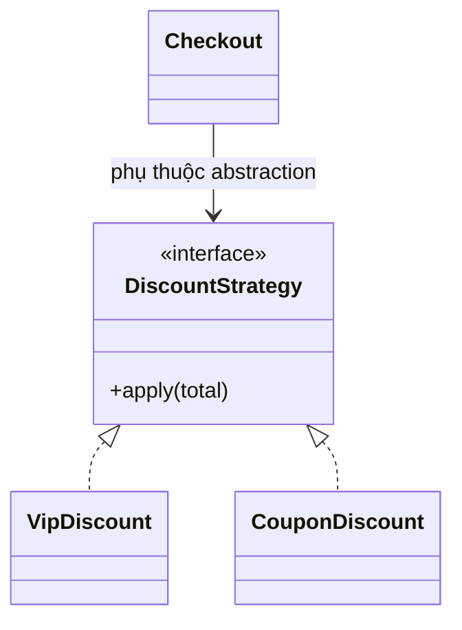

## 1. Core Concept

**SOLID** là năm nguyên tắc thiết kế hướng đối tượng giúp code **dễ đổi mà không vỡ**; **design patterns** là các giải pháp lặp lại cho vấn đề thiết kế quen thuộc (Strategy, Factory, Observer, Decorator…). Chúng giải quyết **chi phí thay đổi**: code tốt là code mà **yêu cầu mới chỉ cần thêm, không cần sửa chỗ cũ**. Nhưng áp dụng sai (trừu tượng sớm) còn tệ hơn không áp dụng.

**Mental model:** như **ổ cắm điện chuẩn**: thiết bị (module) cắm vào qua **giao diện cố định (abstraction)**, thay thiết bị không cần đục tường (sửa code lõi). Nhưng đừng lắp ổ cắm cho mọi chỗ khi chưa ai có nhu cầu cắm gì thêm.

## 2. How It Works

**SOLID thực dụng**
- **S** (Single Responsibility): một lớp **một lý do để thay đổi** (không phải "làm một việc"). **O** (Open/Closed): **mở rộng không sửa** — thêm hành vi bằng code mới. **L** (Liskov): lớp con **thay thế được** lớp cha mà không phá hợp đồng (hình vuông kế thừa hình chữ nhật là phản ví dụ). **I** (Interface Segregation): interface **nhỏ, theo nhu cầu client**, không ép implement method thừa. **D** (Dependency Inversion): module cấp cao **phụ thuộc abstraction**, không phụ thuộc cài đặt cụ thể.

**Dependency Injection vs Dependency Inversion**
- **Inversion** là **nguyên tắc** (phụ thuộc vào abstraction). **Injection** là **kỹ thuật** truyền dependency từ ngoài (constructor) thay vì tự `new`. Injection giúp đạt inversion và **dễ test** (truyền fake).

**Strategy pattern**
- Đóng gói **các thuật toán thay thế được** sau một interface, chọn lúc chạy → thay thế chuỗi `if/else`/`switch` theo kiểu (loại giảm giá, cổng thanh toán). Thêm chiến lược mới = thêm lớp (Open/Closed).

**Composition over Inheritance**
- Kế thừa tạo **gắn kết chặt** (fragile base class), cấu trúc cứng. **Composition** ghép hành vi từ các đối tượng nhỏ (has-a) → linh hoạt, dễ đổi lúc chạy. Dùng kế thừa chỉ khi thật sự **is-a** và ổn định.

**Rule of Three và wrong abstraction**
- **Rule of Three**: đợi **lần lặp thứ ba** mới trừu tượng hoá. Trừu tượng sớm dựa trên **hai ví dụ** thường đoán sai trục biến đổi → **"duplication is far cheaper than the wrong abstraction"**: sau đó mọi người bẻ cong abstraction bằng cờ/tham số.

```java
interface DiscountStrategy { Money apply(Money total); }
class Vip implements DiscountStrategy { public Money apply(Money t){ return t.times(0.9); } }
class Coupon implements DiscountStrategy { public Money apply(Money t){ return t.minus(Money.of(5)); } }

class Checkout {                                   // phụ thuộc abstraction, nhận qua constructor
    private final DiscountStrategy discount;
    Checkout(DiscountStrategy d) { this.discount = d; }
    Money total(Money cart) { return discount.apply(cart); }
}
```

## 3. Visual Diagram



## 4. Rules of Thumb & Trade-offs

| Tình huống / Nhu cầu | Chọn gì |
| --- | --- |
| Nhiều biến thể thuật toán, chọn lúc chạy | Strategy |
| Cần fake khi test | Dependency Injection |
| Chia sẻ hành vi giữa lớp không thật sự is-a | Composition |
| Mới thấy lặp lần 2 | Chấp nhận trùng, chờ lần 3 |
| Interface phình to | Interface Segregation |
| Lớp con phá hợp đồng cha | Xem lại Liskov, dùng composition |

- **Được gì:** thay đổi cục bộ, dễ test, mở rộng an toàn. **Mất gì:** nhiều lớp/gián tiếp hơn, khó đọc nếu trừu tượng hoá quá sớm hoặc thừa.

## 5. Must Remember / Production Pitfalls

- **Mỗi yêu cầu mới phải sửa `switch` ở nhiều nơi → vi phạm Open/Closed → Strategy/polymorphism**.
- **Abstraction đầy cờ boolean/tham số tùy chọn → wrong abstraction → inline lại, trùng lặp rồi trừu tượng hoá đúng**.
- **Lớp con ném `UnsupportedOperationException` → vi phạm Liskov → tách interface/dùng composition**.
- **Lớp "God class" làm mọi thứ → vi phạm SRP → tách theo lý do thay đổi**.
- **Cây kế thừa sâu khó đổi → fragile base class → composition**.
- **Pattern áp dụng cho đủ trò → over-engineering → bắt đầu đơn giản, tái cấu trúc khi có nhu cầu thật**.
- Interview trap: "DI vs DIP?" → **DIP là nguyên tắc, DI là kỹ thuật tiêm phụ thuộc**; "SRP nghĩa là gì?" → **một lý do để thay đổi**; "khi nào nên trừu tượng hoá?" → **Rule of Three**.

## 6. Search Hooks

- `SOLID principles` — năm nguyên tắc thiết kế hướng đối tượng.
- `Strategy pattern` — thuật toán thay thế được sau một interface.
- `dependency injection vs dependency inversion` — kỹ thuật và nguyên tắc.
- `composition over inheritance` — ưu tiên ghép hơn kế thừa.
- `Liskov substitution principle` — lớp con thay thế được lớp cha.
- `wrong abstraction rule of three` — tránh trừu tượng hoá sớm.
