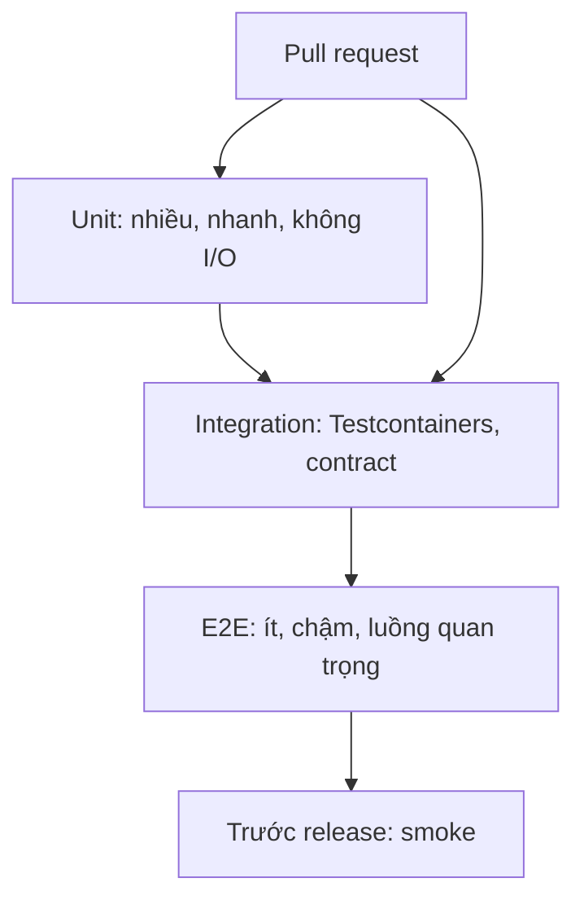

## 1. Core Concept

**Test pyramid** nói rằng nên có **nhiều unit test nhanh, vừa phải integration test, ít E2E test**: càng lên cao càng **chậm, đắt, dễ flaky**, nhưng càng gần hành vi thật. Mục tiêu của chiến lược test không phải "coverage cao" mà là **phản hồi nhanh và tin cậy** khi đổi code, với chi phí bảo trì thấp.

**Mental model:** như **kiểm tra chất lượng ô tô**: kiểm từng bu-lông (unit) rất nhanh và rẻ; lắp động cơ rồi chạy thử (integration) chậm hơn; lái cả xe trên đường (E2E) đáng tin nhất nhưng đắt, lâu và dễ bị thời tiết làm nhiễu. Bạn muốn **bắt lỗi ở tầng rẻ nhất có thể**.

## 2. How It Works

**Ba tầng**
- **Unit**: một hàm/lớp, **không I/O**, chạy mili-giây, hàng nghìn bài/phút. **Integration**: nhiều thành phần thật (DB, queue) — thường dùng **Testcontainers** để chạy DB thật trong Docker. **E2E**: toàn hệ thống qua UI/API, chậm (giây–phút), chỉ giữ cho **luồng quan trọng** (đăng nhập, thanh toán).
- Biến thể: **testing trophy** (nhiều integration hơn khi logic nằm ở "keo dán"), **honeycomb** cho microservices.

**Test doubles**
- **Stub** (trả dữ liệu cố định), **Mock** (xác minh tương tác), **Fake** (cài đặt đơn giản thật như in-memory DB), **Spy** (ghi lại lời gọi). Mock **quá nhiều** làm test gắn với cách cài đặt (brittle): đổi refactor là vỡ test dù hành vi không đổi. Ưu tiên **kiểm hành vi/kết quả** thay vì kiểm lời gọi nội bộ.

**Consumer-Driven Contract Testing (Pact)**
- Với microservices, E2E toàn hệ thống chậm và flaky. **Consumer** mô tả "tôi cần response dạng này" thành **contract**; **provider** chạy contract trong CI của mình. Phát hiện **API không tương thích trước khi deploy** mà không cần dựng toàn bộ môi trường.

**Flaky tests**
- Test lúc qua lúc rớt không do code đổi: **phụ thuộc thời gian/thứ tự/mạng**, dữ liệu dùng chung, race condition, sleep cố định. Flaky **làm mất niềm tin** vào CI → đội bỏ qua đỏ. Cách xử: **cô lập dữ liệu**, **clock có thể điều khiển**, chờ theo điều kiện thay vì `sleep`, **quarantine** rồi sửa gấp, đo tỉ lệ flaky.

**Mutation và property-based testing**
- **Mutation testing** (PIT, Stryker): cố ý **sửa code** (đổi `>` thành `>=`) và xem test có phát hiện không → đo **chất lượng assertion**, không chỉ coverage. **Property-based** (Hypothesis, fast-check): sinh **nhiều input ngẫu nhiên** kiểm tra **tính chất** luôn đúng (ví dụ `decode(encode(x)) == x`), tự **shrink** về ví dụ lỗi nhỏ nhất.

```python
# Property-based: tính chất round-trip, thay vì vài ví dụ cố định
from hypothesis import given, strategies as st

@given(st.text())
def test_roundtrip(s):
    assert decode(encode(s)) == s
```

## 3. Visual Diagram



## 4. Rules of Thumb & Trade-offs

| Tình huống / Nhu cầu | Chọn gì |
| --- | --- |
| Logic nghiệp vụ thuần | Unit test |
| Truy vấn DB, repository, serialization | Integration (DB thật qua Testcontainers) |
| Microservices phụ thuộc nhau | Consumer-driven contract |
| Luồng sống còn (thanh toán) | Vài E2E smoke |
| Coverage cao nhưng bug vẫn lọt | Mutation testing |
| Hàm có nhiều input biên | Property-based |

- **Được gì:** phản hồi nhanh, tự tin refactor. **Mất gì:** integration/E2E chậm và tốn bảo trì; mock quá mức làm test brittle; mutation testing tốn thời gian chạy.

## 5. Must Remember / Production Pitfalls

- **CI luôn đỏ ngẫu nhiên, đội bỏ qua → flaky tests → quarantine, cô lập dữ liệu, clock giả, bỏ `sleep`**.
- **Refactor nhỏ làm vỡ hàng chục test → mock kiểm chi tiết cài đặt → kiểm hành vi/kết quả, dùng fake**.
- **Coverage 90% nhưng vẫn bug → assertion yếu/không có → mutation testing, review assertion**.
- **Bộ E2E mất 40 phút → quá nhiều E2E → đẩy xuống integration/contract**.
- **Test dùng DB mock nhưng prod lỗi query → mock không bắt SQL thật → integration với DB thật**.
- **Test phụ thuộc thứ tự chạy → dữ liệu chia sẻ → mỗi test tự dựng/dọn dữ liệu**.
- Interview trap: "vì sao pyramid?" → **chi phí và tốc độ tăng theo tầng, bắt lỗi ở tầng rẻ nhất**; "mock vs fake?" → **mock xác minh tương tác, fake là cài đặt đơn giản thật**; "coverage cao có đủ?" → **không, cần chất lượng assertion (mutation)**.

## 6. Search Hooks

- `test pyramid unit integration e2e` — chiến lược phân tầng test.
- `test doubles mock stub fake spy` — các loại đối tượng thay thế.
- `consumer-driven contract testing Pact` — kiểm tra hợp đồng API giữa service.
- `flaky tests` — test không ổn định và cách xử lý.
- `mutation testing PIT Stryker` — đo chất lượng assertion.
- `property-based testing Hypothesis` — kiểm tra tính chất với input sinh ngẫu nhiên.
