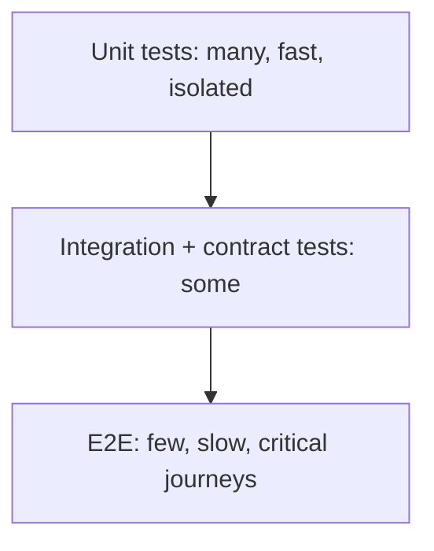

## 1. Core Concept

**Chiến lược test** quyết định bạn tin vào hệ thống đến mức nào với chi phí bảo trì bao nhiêu. **Test pyramid**: nhiều **unit test** nhanh và rẻ ở đáy, ít hơn **integration test** ở giữa, rất ít **end-to-end (E2E)** chậm và dễ vỡ ở đỉnh. Mental model: *mỗi test là một "khoản đầu tư" — test càng gần người dùng càng đáng tin nhưng càng chậm, đắt, hay "flaky"; hãy test mỗi rủi ro ở tầng rẻ nhất có thể bắt được nó.*

## 2. How It Works

- **Unit test**: kiểm tra một đơn vị logic (hàm, class) **tách khỏi I/O**; chạy mili-giây, định vị lỗi chính xác.
- **Integration test**: kiểm tra các thành phần phối hợp (code + DB thật, message broker, HTTP client). Dùng **Testcontainers** để chạy DB/broker thật trong container thay vì mock.
- **E2E test**: đi qua UI/API toàn hệ thống; chỉ giữ cho **luồng nghiệp vụ sống còn** (đăng nhập, thanh toán).
- **Test doubles**: **stub** (trả dữ liệu cố định), **mock** (kiểm tra tương tác), **fake** (cài đặt đơn giản chạy được, ví dụ DB in-memory), **spy**. Ưu tiên fake/DB thật hơn mock dày đặc vì mock gắn chặt vào cách cài đặt.
- **Contract test** (Pact, schema): consumer và provider thoả thuận hợp đồng API, kiểm tra độc lập — thay cho E2E giữa nhiều microservice.
- **Cấu trúc**: **Arrange – Act – Assert**; mỗi test độc lập, xác định (deterministic), tên mô tả hành vi.
- **Kỹ thuật bổ trợ**: **property-based testing** (sinh input ngẫu nhiên kiểm tra bất biến), **mutation testing** (kiểm tra chất lượng bộ test), **snapshot/golden test**.

## 3. Visual Diagram

## 4. Rules of Thumb & Trade-offs

- Test **hành vi quan sát được**, không test chi tiết cài đặt: refactor không được làm vỡ test.
- Logic nghiệp vụ phức tạp → **unit test dày**; "keo dán" (controller, repository) → **integration test** với hạ tầng thật.
- Mỗi lỗi production nên sinh ra **một test tái hiện** trước khi sửa.
- Trade-off: **tốc độ phản hồi và độ ổn định** (unit) vs **độ tin cậy thực tế** (E2E).

## 5. Must Remember / Production Pitfalls

- **Flaky test** (lúc qua lúc hỏng) bào mòn niềm tin vào CI: nguyên nhân thường là **thời gian thực, thứ tự chạy, dữ liệu dùng chung, bất đồng bộ**; cách ly và cố định đồng hồ/ngẫu nhiên.
- **Coverage cao ≠ test tốt**: test không có assertion vẫn tăng coverage; dùng mutation testing để kiểm chứng.
- **Mock quá nhiều** làm test pass dù hệ thống thật hỏng (mock không phản ánh hành vi DB/mạng).
- **Test chậm** khiến lập trình viên bỏ chạy; giữ unit test toàn bộ trong vài chục giây.
- **Code do AI sinh ra** cần test nhiều hơn: nó thường đúng "đường vui" nhưng sai ở biên và đồng thời.
- Interview trap: "100% coverage đảm bảo không có bug?" → không; coverage đo dòng được chạy, không đo hành vi được kiểm chứng.

## 6. Search Hooks

- `test pyramid unit integration e2e` — cân đối ba tầng test.
- `test doubles mock stub fake spy` — các loại đối tượng thay thế khi test.
- `Testcontainers integration testing` — chạy hạ tầng thật trong container khi test.
- `consumer-driven contract testing Pact` — kiểm tra hợp đồng giữa các service.
- `flaky tests root causes` — nguyên nhân test lúc qua lúc hỏng.
- `mutation testing property-based testing` — đo chất lượng bộ test và sinh input ngẫu nhiên.
