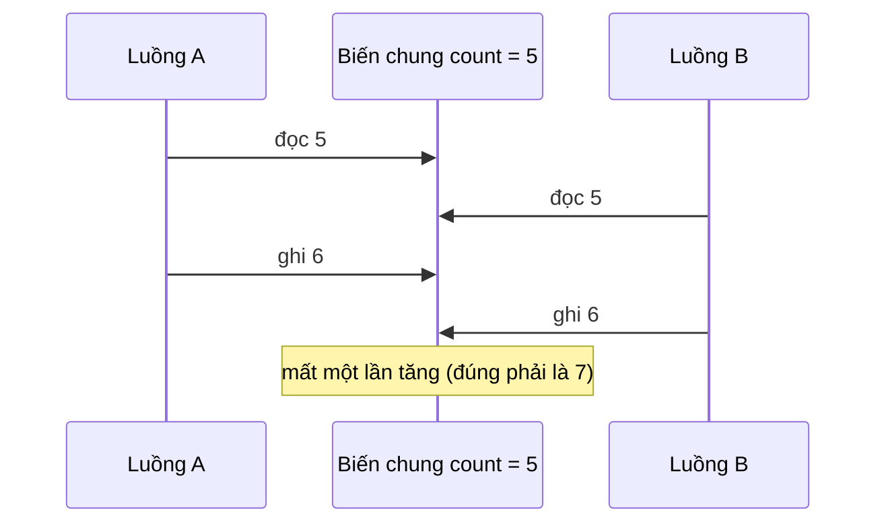

## 1. Core Concept

**Concurrency** là xử lý nhiều việc chồng lấn về thời gian (có thể trên một core, xen kẽ) còn **parallelism** là thực sự chạy cùng lúc trên nhiều core. Khi nhiều luồng **chia sẻ dữ liệu có thể thay đổi**, kết quả phụ thuộc vào **thứ tự thực thi may rủi** — gây **race condition**, **deadlock**, lỗi hiển thị bộ nhớ. Những bug này **khó tái hiện, khó debug** và thường chỉ lộ ở production dưới tải cao.

**Mental model:** nhiều đầu bếp cùng dùng **một cuốn sổ công thức và một ngăn kho**: nếu hai người cùng đọc số lượng muối "còn 1 gói" rồi cùng lấy, kho âm (race condition); nếu A giữ dao chờ thớt còn B giữ thớt chờ dao thì **đứng im mãi mãi** (deadlock).

## 2. How It Works

**Race condition → Check-then-act và read-modify-write**
- **Check-then-act**: kiểm tra điều kiện rồi hành động, nhưng giữa hai bước trạng thái đã đổi (`if (balance >= x) balance -= x`). **Read-modify-write**: `counter++` thực ra là đọc, cộng, ghi — hai luồng đọc cùng giá trị `5` rồi cùng ghi `6` → **mất một lần tăng**. Sửa bằng **khoá (mutex)**, **thao tác nguyên tử (atomic)** hoặc **bất biến/không chia sẻ**.

**Deadlock → Bốn điều kiện Coffman**
- Cần **đồng thời**: **mutual exclusion** (tài nguyên độc quyền), **hold and wait** (giữ một khoá và chờ khoá khác), **no preemption** (không bị giành lại), **circular wait** (vòng chờ). Phá **một** điều kiện là hết deadlock: thực tế là **luôn lấy khoá theo cùng một thứ tự toàn cục**, dùng **timeout/tryLock**, hoặc giảm số khoá lồng nhau. Ngoài ra còn **livelock** (cứ nhường nhau mãi) và **starvation** (đói tài nguyên).

**Compare-and-Swap (CAS) → Lock-free**
- Lệnh CPU nguyên tử: "nếu giá trị hiện tại là `A` thì đặt thành `B`", trả về thành công/thất bại; vòng **retry** khi thất bại. Là nền của `AtomicInteger`, hàng đợi lock-free. Lưu ý **ABA problem** (giá trị đổi `A→B→A` mà CAS không nhận ra).

**Happens-before và hiển thị bộ nhớ**
- Trình biên dịch và CPU **sắp xếp lại lệnh** và có **cache riêng** mỗi core, nên một luồng **không chắc thấy** ghi của luồng khác. **Mô hình bộ nhớ** định nghĩa **happens-before**: `volatile`/atomic (Java), `synchronized`/unlock–lock, acquire/release đảm bảo ghi trước đó **hiển thị** cho luồng sau. Thiếu đồng bộ → **data race** (hành vi không xác định).

**Optimistic vs pessimistic locking**
- **Pessimistic**: khoá trước khi sửa (`SELECT ... FOR UPDATE`) — an toàn khi **tranh chấp cao**, nhưng giảm song song và có nguy cơ deadlock. **Optimistic**: không khoá, kiểm tra **version** khi ghi (`UPDATE ... WHERE version = ?`) và **retry** nếu đã đổi — hợp **tranh chấp thấp**, thông lượng cao.

**Actor model và truyền thông điệp**
- Mỗi **actor** sở hữu trạng thái riêng, chỉ giao tiếp bằng **tin nhắn bất biến**, xử lý **tuần tự** từng tin → không cần khoá (Erlang/Akka). Triết lý: **"đừng giao tiếp bằng cách chia sẻ bộ nhớ; hãy chia sẻ bộ nhớ bằng cách giao tiếp"**.

**Công cụ**
- Race detector (`go test -race`, ThreadSanitizer), thread dump để thấy deadlock, test với nhiều luồng và tải.

```java
// Sai: check-then-act không nguyên tử
if (stock > 0) { stock--; }          // hai luồng cùng thấy stock = 1 → âm kho

// Đúng: nguyên tử với CAS
AtomicInteger stock = new AtomicInteger(1);
boolean ok = stock.updateAndGet(s -> s > 0 ? s - 1 : s) >= 0;  // hoặc dùng compareAndSet
```

## 3. Visual Diagram



## 4. Rules of Thumb & Trade-offs

| Tình huống / Nhu cầu | Chọn gì |
| --- | --- |
| Tránh chia sẻ trạng thái | Bất biến, thread confinement, actor |
| Bộ đếm/cờ đơn giản | Atomic / CAS |
| Bảo vệ vùng quan trọng nhiều bước | Mutex / lock |
| Tranh chấp thấp, thông lượng cao | Optimistic locking + retry |
| Tranh chấp cao | Pessimistic locking |
| Tránh deadlock | Thứ tự khoá cố định, tryLock với timeout |
| Phát hiện race | Race detector, stress test |

- **Được gì:** tận dụng nhiều core, xử lý đồng thời. **Mất gì:** độ phức tạp, bug khó tái hiện; khoá giảm song song và có thể deadlock; lock-free khó viết đúng.

## 5. Must Remember / Production Pitfalls

- **Số liệu sai thỉnh thoảng (đếm thiếu, âm kho) → read-modify-write/check-then-act không nguyên tử → atomic hoặc khoá, hoặc ràng buộc ở DB**.
- **Hệ thống treo dưới tải, thread dump thấy các luồng chờ nhau → deadlock do thứ tự khoá khác nhau → thứ tự khoá cố định, timeout**.
- **Một luồng không thấy cập nhật của luồng khác → thiếu happens-before (cờ không volatile) → volatile/atomic/đồng bộ đúng cách**.
- **Optimistic locking retry vô hạn dưới tranh chấp cao → thông lượng giảm → giới hạn retry, chuyển pessimistic cho điểm nóng**.
- **Chỉ test một luồng nên không thấy lỗi → bug chỉ lộ khi chồng lấn → stress test và race detector**.
- Interview trap: "bốn điều kiện deadlock?" → **mutual exclusion, hold and wait, no preemption, circular wait**; "`count++` có an toàn không?" → **không, là read-modify-write**; "optimistic hay pessimistic?" → **optimistic khi tranh chấp thấp, pessimistic khi cao**.

## 6. Search Hooks

- `race condition check-then-act` — lỗi do thứ tự thực thi may rủi.
- `deadlock Coffman conditions` — bốn điều kiện gây deadlock.
- `compare-and-swap CAS lock-free` — thao tác nguyên tử không khoá.
- `happens-before memory model` — đảm bảo hiển thị giữa các luồng.
- `optimistic vs pessimistic locking` — hai chiến lược kiểm soát đồng thời.
- `actor model message passing` — đồng thời không chia sẻ trạng thái.
