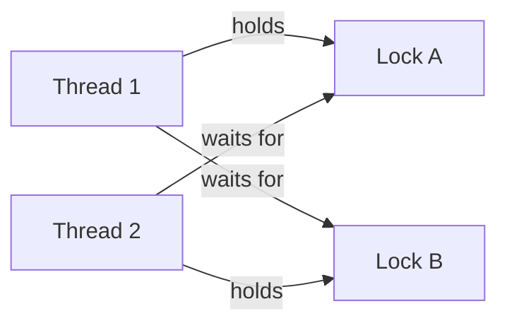

## 1. Core Concept

**Concurrency** là nhiều tác vụ tiến triển xen kẽ trên tài nguyên dùng chung; vấn đề cốt lõi là **shared mutable state** — khi hai luồng cùng đọc-sửa-ghi một dữ liệu, kết quả phụ thuộc vào thứ tự thực thi không đoán được (**race condition**). Đây là gốc rễ của bug oversell tồn kho, trừ tiền sai, và là nền tảng để hiểu transaction và distributed lock. Mental model: *mọi bug concurrency đều là "check-then-act" hoặc "read-modify-write" không nguyên tử (atomic)*.

## 2. How It Works

- **Race condition**: ví dụ `if (stock > 0) stock--` — hai luồng cùng thấy `stock = 1` rồi cùng trừ → `-1` (**check-then-act**).
- **Critical section** được bảo vệ bằng **mutex/lock** để chỉ một luồng vào mỗi lần.
- **Atomic operation / CAS (compare-and-swap)**: cập nhật không cần lock; thất bại thì thử lại (**lock-free**, **optimistic**).
- **Memory visibility**: không có đồng bộ, một luồng có thể không thấy giá trị luồng khác vừa ghi (cache CPU, reorder) → cần `volatile`/lock/atomic để tạo quan hệ **happens-before**.
- **Deadlock** cần đủ 4 điều kiện **Coffman**: mutual exclusion, hold-and-wait, no preemption, **circular wait**. Phá một điều kiện (thường là thứ tự lấy lock cố định) là hết deadlock.
- **Livelock** (cùng nhường nhau mãi) và **starvation** (không bao giờ được chạy).
- **Hướng tránh lock**: **immutable data**, **thread confinement**, **message passing** (actor, channel) — không chia sẻ state thì không có race.

```java
// Sai: check-then-act
if (inventory.get() > 0) { inventory.decrementAndGet(); }

// Đúng: nguyên tử bằng CAS
int cur;
do { cur = inventory.get(); if (cur == 0) return false; }
while (!inventory.compareAndSet(cur, cur - 1));
```

## 3. Visual Diagram



## 4. Rules of Thumb & Trade-offs

- Ưu tiên **không chia sẻ state** (immutable, message passing); nếu bắt buộc thì **thu hẹp critical section** và **lấy lock theo thứ tự cố định**.
- **Pessimistic (lock)**: an toàn khi tranh chấp cao; **optimistic (CAS/version)**: nhanh khi ít tranh chấp, tốn retry khi nhiều.
- Không gọi **I/O chậm hoặc code lạ** khi đang giữ lock.
- Trade-off: lock đơn giản nhưng giảm song song và có nguy cơ deadlock; lock-free nhanh nhưng khó viết đúng.

## 5. Must Remember / Production Pitfalls

- **Thread-safe từng hàm ≠ thread-safe cả thao tác**: gọi `containsKey` rồi `put` trên map "thread-safe" vẫn race (dùng `putIfAbsent`/`compute`).
- **Double-checked locking** sai nếu thiếu `volatile` — thấy object khởi tạo dở.
- Lock **trong một process không bảo vệ** khi chạy nhiều instance: bài toán tồn kho cần **DB atomic update/lock** hoặc distributed lock.
- Race thường **không tái hiện được** ở local; chỉ xuất hiện khi tải cao → thiết kế đúng thay vì "test cho qua".
- Interview trap: "tăng số thread có giải quyết race không?" — ngược lại, làm race xuất hiện nhiều hơn.

## 6. Search Hooks

- `race condition check-then-act` — lỗi khi kiểm tra rồi hành động không nguyên tử.
- `deadlock Coffman conditions` — bốn điều kiện gây deadlock và cách phá.
- `compare-and-swap CAS lock-free` — cập nhật nguyên tử không cần lock.
- `happens-before memory visibility Java memory model` — đảm bảo luồng khác nhìn thấy dữ liệu.
- `optimistic vs pessimistic locking` — hai chiến lược xử lý tranh chấp.
- `actor model message passing` — tránh shared state bằng truyền thông điệp.
