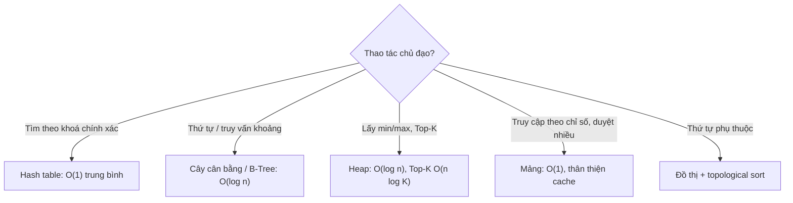

## 1. Core Concept

**Cấu trúc dữ liệu** quyết định **chi phí của mỗi thao tác** (tìm, chèn, xoá, duyệt) và **Big-O** mô tả chi phí đó **tăng thế nào theo kích thước đầu vào `n`**. Chọn đúng cấu trúc khiến một truy vấn từ **hàng giờ xuống mili-giây**; chọn sai làm hệ thống "chạy tốt ở 1.000 bản ghi, chết ở 1 triệu". Đây là nền tảng để thiết kế hệ thống, đọc plan truy vấn DB và phỏng vấn.

**Mental model:** Big-O là **"đồ thị đường dốc"** của chi phí: O(1) là đường phẳng, O(log n) gần phẳng, O(n) tăng đều, **O(n²) là vách đá**. Khi dữ liệu lớn lên 1.000 lần, O(n) chậm 1.000 lần nhưng O(n²) chậm **1.000.000 lần**.

## 2. How It Works

**Big-O phổ biến → Cảm giác về quy mô**
- **O(1)** hằng số, **O(log n)** (chia đôi mỗi bước), **O(n)** tuyến tính, **O(n log n)** (sắp xếp tốt), **O(n²)** (hai vòng lồng), **O(2ⁿ)** (bùng nổ). Máy hiện đại chạy khoảng **10⁸–10⁹ phép đơn giản/giây**: với **n = 10⁶**, O(n log n) ≈ 2·10⁷ phép (mili-giây) còn **O(n²) = 10¹² phép (hàng chục phút đến giờ)**. Nhớ phân biệt **trường hợp trung bình, xấu nhất và amortized**.

**Mảng và dynamic array**
- Truy cập theo chỉ số **O(1)**, chèn/xoá giữa **O(n)** (dịch phần tử). **Dynamic array** (ArrayList, `list` Python) **append amortized O(1)**: thỉnh thoảng cấp phát lại **gấp đôi** và sao chép (tốn O(n)), nhưng chia đều thì mỗi lần thêm vẫn O(1). **Cache locality**: dữ liệu liên tiếp trong bộ nhớ nên CPU duyệt rất nhanh — mảng thường **thắng linked list** trong thực tế dù cùng độ phức tạp.

**Hash table (map/set)**
- Tìm/chèn/xoá **trung bình O(1)**, **xấu nhất O(n)** khi va chạm nhiều. **Xử lý va chạm**: chaining (danh sách tại mỗi ô) hoặc open addressing; **load factor** (thường ~0,75) vượt thì **resize/rehash**. **Rủi ro**: **hash flooding** (kẻ tấn công cố tình tạo khoá cùng hash → O(n²)) → dùng hash có seed ngẫu nhiên; **khoá mutable** (đổi giá trị sau khi chèn → không tìm thấy nữa).

**Cây cân bằng và B-Tree**
- Tìm/chèn **O(log n)** và **giữ thứ tự** → hỗ trợ **truy vấn khoảng** và duyệt có thứ tự mà hash không làm được. **B-Tree** (nhiều khoá mỗi nút, chiều cao thấp) tối ưu cho **đĩa** — nền của **index DB**.

**Heap và priority queue**
- Lấy min/max **O(1)**, thêm/xoá **O(log n)**. **Top-K**: dùng **min-heap kích thước K**, duyệt n phần tử → **O(n log K)** và chỉ tốn O(K) bộ nhớ, tốt hơn sắp xếp toàn bộ O(n log n) khi K ≪ n. Dùng cho scheduler, merge K danh sách đã sắp xếp.

**Đồ thị và sắp xếp topo**
- **BFS/DFS O(V + E)**. **Topological sort** sắp xếp đỉnh của đồ thị **có hướng không chu trình (DAG)** theo thứ tự phụ thuộc — dùng cho **thứ tự build, lịch task, cây prerequisite**; phát hiện **chu trình** là bắt lỗi phụ thuộc vòng.

**Khác**
- **Trie** (tìm theo tiền tố, autocomplete), **Bloom filter** (kiểm tra "có thể có/chắc chắn không có", tiết kiệm bộ nhớ, có false positive không có false negative).

```python
# Sai: O(n*m) vì `in` trên list là O(n)
common = [x for x in a if x in b_list]
# Đúng: O(n + m) nhờ set (hash)
b = set(b_list); common = [x for x in a if x in b]

import heapq
top3 = heapq.nlargest(3, items)          # O(n log 3) thay vì sort toàn bộ
```

## 3. Visual Diagram



## 4. Rules of Thumb & Trade-offs

| Tình huống / Nhu cầu | Chọn gì |
| --- | --- |
| Tìm theo khoá chính xác | Hash map / set |
| Cần thứ tự, truy vấn khoảng | Cây cân bằng / B-Tree |
| Top-K phần tử | Min-heap kích thước K |
| Truy cập theo chỉ số, duyệt nhiều | Mảng / dynamic array |
| Thứ tự phụ thuộc (build, task) | Đồ thị + topological sort |
| Kiểm tra tồn tại tiết kiệm bộ nhớ | Bloom filter |
| Dữ liệu nhỏ (n nhỏ) | Cách đơn giản, đo trước khi tối ưu |

- **Được gì:** đúng cấu trúc cho đúng thao tác. **Mất gì:** hash đánh đổi **thứ tự** lấy tốc độ; cấu trúc nhanh thường tốn **bộ nhớ**; với `n` nhỏ hằng số và cache locality quan trọng hơn Big-O.

## 5. Must Remember / Production Pitfalls

- **API chậm dần khi dữ liệu tăng → vòng lặp gọi hàm O(n) (`list.contains`, truy vấn DB mỗi vòng) thành O(n²) → dùng set/map, gom truy vấn**.
- **Hash map bị tấn công làm CPU 100% → hash flooding → hash có seed ngẫu nhiên, giới hạn kích thước/khoá do người dùng kiểm soát**.
- **Không tìm lại được phần tử đã chèn → khoá mutable bị đổi → dùng khoá bất biến**.
- **Sắp xếp cả tập để lấy Top-K → O(n log n) và tốn bộ nhớ → min-heap kích thước K**.
- **Phụ thuộc vòng làm build/scheduler treo → thiếu phát hiện chu trình → topological sort và báo lỗi chu trình**.
- Interview trap: "HashMap là O(1) hay O(n)?" → **trung bình O(1), xấu nhất O(n) khi va chạm**; "append dynamic array?" → **amortized O(1)**; "array hay linked list?" → **array thường nhanh hơn nhờ cache locality**.

## 6. Search Hooks

- `Big-O notation time and space complexity` — cách chi phí tăng theo n.
- `hash table collision resolution` — xử lý va chạm trong hash table.
- `B-Tree vs balanced binary tree` — cấu trúc nền của index.
- `heap priority queue top-K` — lấy phần tử ưu tiên và Top-K.
- `topological sort dependency graph` — sắp xếp theo thứ tự phụ thuộc.
- `amortized analysis dynamic array` — chi phí trung bình của append.
