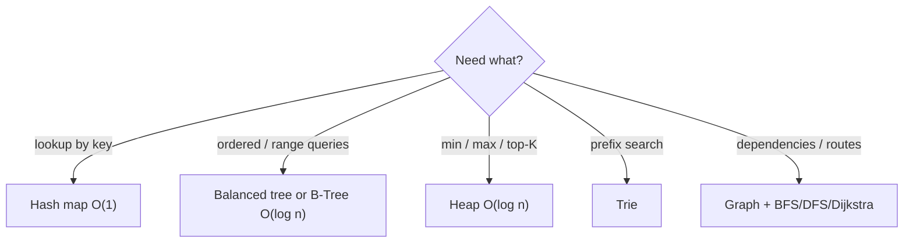

## 1. Core Concept

Chọn đúng **cấu trúc dữ liệu** thường quan trọng hơn tối ưu code: cùng một bài toán, `O(n²)` và `O(n log n)` khác nhau giữa "chạy được" và "sập khi dữ liệu lớn". **Big-O** mô tả cách chi phí **tăng theo kích thước đầu vào**, không phải thời gian tuyệt đối. Mental model: *kỹ sư hệ thống cần biết cấu trúc nào cho thao tác nào nhanh — vì database index, cache, scheduler đều chỉ là các cấu trúc dữ liệu này ở quy mô lớn.*

## 2. How It Works

- **Big-O phổ biến**: `O(1)` hằng số, `O(log n)` (tìm nhị phân, cây cân bằng), `O(n)` tuyến tính, `O(n log n)` (sắp xếp hiệu quả), `O(n²)` (hai vòng lặp lồng), `O(2ⁿ)` (bùng nổ tổ hợp). Phân biệt **trường hợp trung bình** và **xấu nhất**, cả **thời gian** lẫn **bộ nhớ**.
- **Array / dynamic array**: truy cập theo chỉ số `O(1)`, chèn giữa `O(n)`, thêm cuối **amortized `O(1)`**; thân thiện cache CPU.
- **Hash map/set**: tìm/chèn/xoá trung bình `O(1)`, xấu nhất `O(n)` khi va chạm; **không có thứ tự**; cần hàm băm tốt.
- **Cây cân bằng** (red-black, **B-Tree**): `O(log n)`, **có thứ tự** và hỗ trợ **range query** — nền tảng của DB index.
- **Heap / priority queue**: lấy min/max `O(1)`, thêm/xoá `O(log n)` — dùng cho scheduler, top-K, Dijkstra.
- **Linked list**: chèn/xoá `O(1)` khi có con trỏ nhưng truy cập `O(n)` và **kém cache**; ít khi tốt hơn array trong thực tế.
- **Graph**: biểu diễn danh sách kề vs ma trận kề; **BFS** (đường ngắn nhất không trọng số), **DFS**, **topological sort** (thứ tự phụ thuộc), **Dijkstra**.
- **Trie**: tìm theo tiền tố (autocomplete); **Bloom filter**: kiểm tra thành viên xác suất rất tiết kiệm bộ nhớ.

## 3. Visual Diagram

## 4. Rules of Thumb & Trade-offs

- Muốn **tìm theo khoá** → hash map; cần **thứ tự/range** → cây; cần **lấy phần tử ưu tiên** → heap.
- **Đổi bộ nhớ lấy thời gian**: index, cache, memoization; đổi lại tốn RAM và phải giữ đồng bộ.
- Đo trước khi tối ưu: với `n` nhỏ, hằng số và **cache locality** có thể quan trọng hơn Big-O; array thường thắng linked list.
- Trade-off: **tốc độ truy cập** vs **tốc độ cập nhật** vs **bộ nhớ** (mỗi cấu trúc tối ưu một góc).

## 5. Must Remember / Production Pitfalls

- **`O(n²)` ẩn**: vòng lặp gọi hàm `O(n)` (`list.contains`, nối chuỗi trong vòng lặp, truy vấn DB mỗi vòng — N+1) âm thầm thành bậc hai.
- **Hash collision/tấn công hash flooding**: khoá do người dùng kiểm soát có thể ép `O(n)`; dùng hàm băm có seed ngẫu nhiên.
- **Mutable key** trong hash map (đổi giá trị sau khi chèn) làm mất phần tử.
- Interview trap: "HashMap là `O(1)` hay `O(n)`?" → **trung bình `O(1)`, xấu nhất `O(n)`**; nêu rõ điều kiện.

## 6. Search Hooks

- `Big-O notation time and space complexity` — cách chi phí tăng theo kích thước đầu vào.
- `hash table collision resolution` — xử lý va chạm trong bảng băm.
- `B-Tree vs balanced binary tree` — cấu trúc nền tảng của index cơ sở dữ liệu.
- `heap priority queue top-K` — lấy phần tử ưu tiên và bài toán top-K.
- `topological sort dependency graph` — sắp xếp theo thứ tự phụ thuộc.
- `amortized analysis dynamic array` — chi phí trung bình của thao tác thêm cuối.
