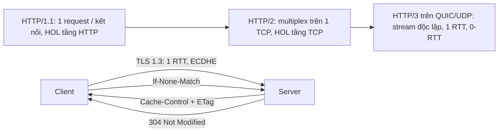

## 1. Core Concept

**HTTP** là giao thức yêu cầu–phản hồi của web; **HTTPS** là HTTP chạy trên **TLS** để **mã hoá, xác thực máy chủ và bảo vệ toàn vẹn**. Hiểu sự tiến hoá **HTTP/1.1 → HTTP/2 → HTTP/3**, quy trình **TLS handshake**, **caching** và **mã trạng thái** giúp bạn tối ưu hiệu năng, bảo mật và debug đúng chỗ — đặc biệt khi có proxy, CDN, load balancer ở giữa.

**Mental model:** HTTP là **bức thư viết trên bưu thiếp** (ai cũng đọc được); TLS là **phong bì có niêm phong và con dấu xác minh người gửi**. HTTP/1.1 là **một quầy phục vụ từng khách**, HTTP/2 là **một quầy có nhiều cửa sổ chia sẻ chung một hàng**, HTTP/3 là **các quầy tách riêng để quầy này kẹt không làm quầy khác kẹt**.

## 2. How It Works

**HTTP/1.1 vs HTTP/2 vs HTTP/3**
- **HTTP/1.1**: một request/response mỗi lượt trên một kết nối → **head-of-line blocking ở tầng HTTP**; trình duyệt mở khoảng **6 kết nối/host** để chạy song song. **HTTP/2**: **multiplexing** nhiều stream trên **một kết nối TCP**, **nén header (HPACK)**; nhưng một gói TCP mất vẫn **chặn cả kết nối (HOL ở tầng TCP)**. **HTTP/3**: chạy trên **QUIC (UDP)**, **mỗi stream phục hồi mất gói độc lập**, **handshake gộp TLS (1 RTT, có 0-RTT)**, **connection migration** (đổi mạng wifi ↔ 4G không đứt).

**TLS 1.3 handshake**
- **1 RTT** (TLS 1.2 cần 2 RTT): client gửi lời chào kèm **key share (ECDHE)**, server trả chứng chỉ + key share + `Finished`. **Forward secrecy** nhờ khoá phiên **tạm thời** (lộ khoá dài hạn sau này không giải mã được traffic cũ). **0-RTT resumption** giảm thêm 1 RTT nhưng **có thể bị replay** nên chỉ dùng cho request an toàn/idempotent. **Chứng chỉ** được xác minh qua **chuỗi CA**; **SNI** cho phép nhiều domain trên một IP; **ALPN** thương lượng h2/h3.

**mTLS (mutual TLS)**
- **Cả hai bên** trình chứng chỉ để xác thực lẫn nhau; dùng cho **service-to-service** (service mesh, zero trust), không phải cho người dùng cuối.

**HTTP caching → Giảm tải và độ trễ**
- **`Cache-Control: max-age=N`** (tươi trong N giây), **`no-cache`** (được lưu nhưng **phải xác thực lại** trước khi dùng), **`no-store`** (không lưu), `public/private`, **`immutable`**. **Validator**: **`ETag`**/`If-None-Match` hoặc `Last-Modified`/`If-Modified-Since` → server trả **304 Not Modified** (không gửi lại body). **`Vary`** chỉ định header ảnh hưởng đến cache key. Cách tốt cho tài nguyên tĩnh: **tên file có hash + `max-age` dài + `immutable`**.

**Mã trạng thái hay nhầm**
- **401** (chưa xác thực/thông tin sai) vs **403** (đã xác thực nhưng **không có quyền**). **502 Bad Gateway** (proxy nhận phản hồi **không hợp lệ** từ upstream) vs **503** (quá tải/bảo trì) vs **504 Gateway Timeout** (upstream **không trả lời kịp**). **301/308** (chuyển vĩnh viễn) vs **302/307** (tạm thời, 307/308 giữ nguyên method). **429** (vượt tốc độ), **409** (xung đột), **422** (dữ liệu không hợp lệ).

```bash
curl -I https://example.com/app.9f3c.js         # xem Cache-Control, ETag
curl -sI --http3 https://example.com | head -1   # thử HTTP/3 nếu curl hỗ trợ
openssl s_client -connect example.com:443 -servername example.com </dev/null | openssl x509 -noout -dates
```

## 3. Visual Diagram



## 4. Rules of Thumb & Trade-offs

| Tình huống / Nhu cầu | Chọn gì |
| --- | --- |
| Nhiều tài nguyên nhỏ trên một origin | HTTP/2 (multiplexing) |
| Mạng di động, mất gói, đổi mạng | HTTP/3 (QUIC) |
| Giảm tải và độ trễ cho file tĩnh | Cache-Control dài + file có hash |
| Dữ liệu nhạy cảm không được lưu cache | `no-store` |
| Xác thực lẫn nhau giữa service | mTLS |
| Upstream không trả lời kịp | 504 (và kiểm tra timeout) |

- **Được gì:** hiệu năng, bảo mật, cache. **Mất gì:** TLS tốn CPU/handshake (giảm bằng session resumption, TLS 1.3), HTTP/3 cần hỗ trợ UDP trên đường đi, cache sai gây dữ liệu cũ.

## 5. Must Remember / Production Pitfalls

- **Người dùng thấy file JS/CSS cũ sau deploy → cache dài không đổi tên file → tên file có hash, `Cache-Control` dài cho file hash, ngắn/`no-cache` cho HTML**.
- **Nhầm `no-cache` với `no-store` → dữ liệu nhạy cảm bị lưu → `no-store` cho dữ liệu nhạy cảm**.
- **Chứng chỉ hết hạn làm sập dịch vụ → không giám sát/gia hạn tự động → tự động hoá (ACME/Let's Encrypt, cert-manager), cảnh báo trước hạn**.
- **Debug sai tầng khi gặp 502/504 → nhầm lỗi proxy và upstream → 502 = upstream trả sai, 504 = upstream quá chậm; xem log upstream và timeout**.
- **Dùng 0-RTT cho thao tác ghi → bị replay → chỉ cho request idempotent**.
- Interview trap: "401 vs 403?" → **401 chưa xác thực, 403 đã xác thực nhưng không đủ quyền**; "502 vs 504?" → **upstream trả sai vs upstream không kịp trả lời**; "HTTP/2 còn vấn đề gì mà HTTP/3 giải?" → **HOL blocking tầng TCP**.

## 6. Search Hooks

- `HTTP/1.1 vs HTTP/2 vs HTTP/3` — tiến hoá và khác biệt.
- `TLS 1.3 handshake` — handshake 1 RTT và forward secrecy.
- `QUIC protocol` — giao thức nền của HTTP/3.
- `HTTP caching ETag Cache-Control` — validator và chỉ thị cache.
- `mTLS mutual TLS` — xác thực hai chiều.
- `HTTP status codes 401 403 502 504` — các mã dễ nhầm.
