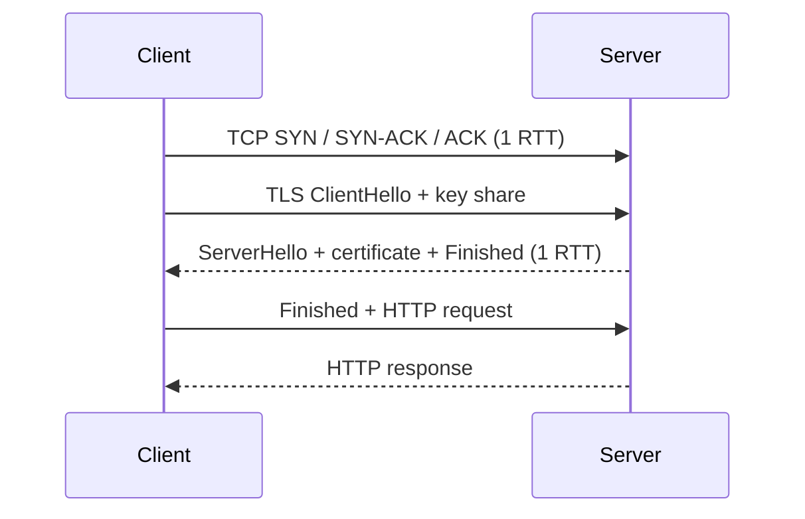

## 1. Core Concept

**HTTP** là giao thức request/response tầng ứng dụng chạy trên TCP (hoặc QUIC); **TLS** mã hoá và xác thực kết nối để tạo **HTTPS**. Chúng quyết định độ trễ (số RTT trước byte đầu tiên), khả năng tái dùng kết nối và độ an toàn của mọi API. Mental model: *HTTP là "ngữ pháp" của yêu cầu, TLS là "phong bì có khoá và con dấu" — mỗi phiên bản mới (HTTP/2, HTTP/3, TLS 1.3) chủ yếu để bớt RTT và bớt chặn nhau.*

## 2. How It Works

- **Request/response**: method (`GET`, `POST`, `PUT`, `DELETE`…), URL, header, body; trả về **status code** (2xx thành công, 3xx chuyển hướng, 4xx lỗi client, 5xx lỗi server).
- **HTTP/1.1**: **keep-alive** tái dùng kết nối nhưng mỗi kết nối xử lý tuần tự (**head-of-line blocking** ở tầng HTTP) → trình duyệt mở nhiều kết nối song song.
- **HTTP/2**: **multiplexing** nhiều stream trên một kết nối TCP, nén header (**HPACK**), vẫn bị HOL blocking ở **tầng TCP**.
- **HTTP/3**: chạy trên **QUIC (UDP)**, stream độc lập nên mất gói không chặn stream khác, tích hợp TLS 1.3, kết nối nhanh hơn (**0/1-RTT**).
- **TLS 1.3**: handshake **1 RTT** (1.2 cần 2 RTT) — thoả thuận cipher, trao đổi khoá, server gửi **certificate** ký bởi CA; client kiểm tra chuỗi chứng chỉ, hostname, hạn dùng. **SNI** cho phép nhiều domain trên một IP, **ALPN** chọn HTTP/2/3.
- **Caching**: `Cache-Control`, `ETag` + `If-None-Match` (trả `304 Not Modified`), `Vary`.
- **Chi phí trước byte đầu tiên** (kết nối mới): TCP 1 RTT + TLS 1.3 1 RTT = **2 RTT**.

## 3. Visual Diagram

## 4. Rules of Thumb & Trade-offs

- Luôn **tái dùng kết nối** (keep-alive, connection pool) — chi phí handshake lặp lại là lý do nhiều request "nhỏ mà chậm".
- **HTTP/2** cho nhiều request nhỏ cùng origin; **HTTP/3** lợi nhất trên mạng di động/mất gói.
- **TLS termination** tại load balancer đơn giản hoá chứng chỉ nhưng traffic nội bộ không mã hoá; cần zero-trust → **mTLS** giữa các service.
- Trade-off: bảo mật và độ trễ — TLS thêm CPU/RTT nhưng **không có lý do để bỏ HTTPS**; dùng session resumption để giảm chi phí.

## 5. Must Remember / Production Pitfalls

- **Chứng chỉ hết hạn** là sự cố production kinh điển: tự động gia hạn (ACM, Let's Encrypt) và cảnh báo trước hạn.
- Phân biệt mã lỗi: **401** (chưa xác thực) vs **403** (không đủ quyền), **502** (upstream trả lỗi) vs **504** (upstream timeout), **429** (bị giới hạn tốc độ).
- Trả **200 kèm lỗi trong body** làm hỏng retry, monitoring và cache.
- Header `X-Forwarded-For` có thể bị giả mạo; chỉ tin khi đi qua proxy bạn kiểm soát.
- Interview trap: "HTTP/2 giải quyết hết head-of-line blocking?" → chỉ ở tầng HTTP; **TCP vẫn chặn**, vì vậy có HTTP/3 (QUIC).

## 6. Search Hooks

- `HTTP/1.1 vs HTTP/2 vs HTTP/3` — khác biệt về multiplexing và head-of-line blocking.
- `TLS 1.3 handshake` — bắt tay 1-RTT và trao đổi khoá.
- `QUIC protocol` — giao thức trên UDP làm nền cho HTTP/3.
- `HTTP caching ETag Cache-Control` — cơ chế cache và xác thực lại ở tầng HTTP.
- `mTLS mutual TLS` — hai phía cùng xác thực bằng chứng chỉ.
- `HTTP status codes 401 vs 403 502 vs 504` — phân biệt các mã lỗi hay nhầm.
