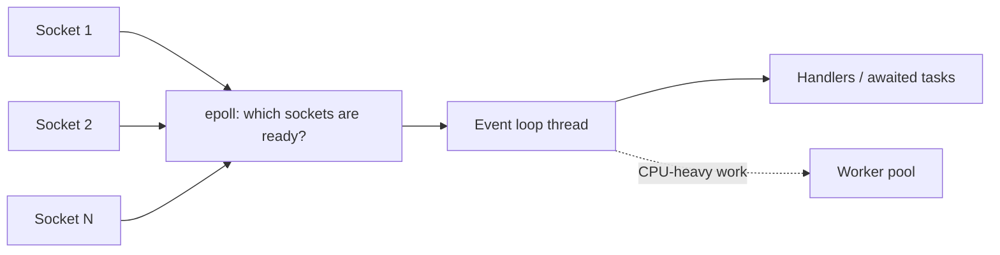

## 1. Core Concept

Server xử lý hàng chục nghìn kết nối không thể dùng một thread chặn cho mỗi kết nối. **Mô hình I/O** quyết định thread chờ I/O thế nào: **blocking** (đứng chờ), **non-blocking** (hỏi lại sau), và **multiplexing** (một thread theo dõi nhiều kết nối bằng `epoll/kqueue`). **Event loop** + **async/await** là cách lập trình trên nền multiplexing. Mental model: *thread rất đắt, còn "chờ" thì gần như miễn phí — hãy để một thread phục vụ nhiều kết nối đang chờ thay vì mỗi kết nối một thread.*

## 2. How It Works

- **Blocking I/O**: `read()` treo thread đến khi có dữ liệu; đơn giản nhưng cần **một thread mỗi kết nối** (tốn ~1 MB stack, context switch).
- **Non-blocking I/O**: `read()` trả về ngay "chưa có dữ liệu"; phải tự hỏi lại (busy-poll — lãng phí).
- **I/O multiplexing**: `select/poll` → **`epoll` (Linux), `kqueue` (BSD/macOS), IOCP (Windows)**: nhờ kernel báo **"những socket nào đã sẵn sàng"**; một thread xử lý hàng chục nghìn kết nối (**vấn đề C10K**).
- **Event loop (reactor)**: vòng lặp đơn: chờ sự kiện sẵn sàng → gọi **callback/handler** tương ứng → tiếp tục. Nền tảng của **Node.js, Nginx, Netty, asyncio, Tokio**.
- **async/await**: cú pháp biến callback thành code tuần tự; mỗi `await` **nhường** thread cho tác vụ khác khi chờ I/O. Chỉ có lợi cho **I/O-bound**.
- **Thread/virtual thread/coroutine**: **green threads** (goroutine của Go, virtual threads Java 21, coroutine Kotlin) cho phép viết code "blocking" đơn giản mà vẫn nhẹ nhờ runtime ánh xạ lên ít thread hệ điều hành.
- **Blocking trong event loop**: một thao tác **CPU nặng hoặc blocking call** trong loop **chặn mọi kết nối khác** — giải bằng **worker thread pool** riêng.
- **Backpressure**: khi producer nhanh hơn consumer, cần **giới hạn hàng đợi/dừng đọc** thay vì phình bộ nhớ.

## 3. Visual Diagram

## 4. Rules of Thumb & Trade-offs

| Tải | Chọn |
| --- | --- |
| Nhiều kết nối, chủ yếu chờ I/O (API gateway, chat) | **Event loop / async / virtual threads** |
| Tính toán nặng CPU | **Thread pool theo số core**, không đặt trong event loop |
| Ít kết nối, logic phức tạp | **Blocking + thread pool** đơn giản là đủ |

- Trade-off: async **tiết kiệm tài nguyên** nhưng làm code **khó gỡ lỗi, stack trace khó đọc, "màu hàm" lan toả**; virtual threads giữ code đơn giản với chi phí runtime.

## 5. Must Remember / Production Pitfalls

- **Một lời gọi blocking** (DB driver đồng bộ, `sleep`, DNS lookup chặn) trong event loop làm **toàn bộ server đứng hình**.
- **Async ≠ song song**: một event loop đơn luồng chỉ chạy một việc tại một thời điểm; CPU-bound không nhanh hơn.
- **Quên `await`** (hoặc không bắt lỗi trong promise) làm lỗi bị nuốt, tác vụ chạy "bỏ quên".
- **Thiếu backpressure**: đọc nhanh hơn ghi → hàng đợi trong bộ nhớ phình và OOM.
- **Giới hạn file descriptor** (`ulimit -n`) vẫn áp dụng khi giữ hàng chục nghìn kết nối.
- **Timeout** vẫn bắt buộc với mọi lời gọi async; không có timeout thì `await` có thể treo vô hạn.
- Interview trap: "Node.js đơn luồng sao xử lý nhiều request?" → **non-blocking I/O + event loop**, nhưng CPU nặng phải đẩy sang worker.

## 6. Search Hooks

- `blocking vs non-blocking I/O` — hai cách thread xử lý chờ I/O.
- `epoll kqueue IO multiplexing C10K` — kernel báo socket nào sẵn sàng.
- `event loop reactor pattern` — vòng lặp sự kiện làm nền cho Node.js và Nginx.
- `async await vs threads virtual threads` — đánh đổi giữa các mô hình đồng thời.
- `Java virtual threads Loom goroutines` — thread nhẹ do runtime quản lý.
- `backpressure reactive streams` — kiểm soát tốc độ giữa producer và consumer.
