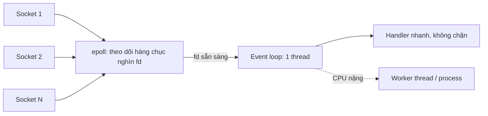

## 1. Core Concept

Server thường dành **phần lớn thời gian chờ I/O** (mạng, đĩa). Cách một chương trình **chờ** quyết định nó phục vụ được **bao nhiêu kết nối đồng thời với bao nhiêu tài nguyên**: mô hình **thread-per-connection** (mỗi kết nối một thread chặn) chịu được vài nghìn kết nối là đã nặng, còn **I/O multiplexing + event loop** (một thread theo dõi hàng chục nghìn kết nối qua `epoll`) giải quyết bài toán **C10K**. Hiểu mô hình này là chìa khoá để dùng đúng async/await, Node.js, Netty, goroutine, virtual thread.

**Mental model:** thread-per-connection như **mỗi khách có một nhân viên phục vụ riêng đứng chờ họ gọi món** (tốn nhân viên, phần lớn thời gian đứng không). Event loop như **một nhân viên duy nhất cầm chuông báo**: khi bàn nào bấm chuông (socket sẵn sàng) thì chạy tới phục vụ nhanh rồi quay lại — nhưng **nếu nhân viên đó mải làm một việc lâu, cả quán đứng chờ**.

## 2. How It Works

**Các mô hình I/O**
- **Blocking**: thread **chờ** tới khi có dữ liệu, không làm gì khác. **Non-blocking**: lời gọi **trả về ngay** (kể cả khi chưa có dữ liệu) → phải hỏi lại. **I/O multiplexing** (`select/poll/epoll/kqueue`): **một thread chờ nhiều socket**, kernel báo **socket nào đã sẵn sàng** → nền của event loop. **Asynchronous I/O thực sự** (`io_uring`, IOCP): gửi yêu cầu rồi kernel **báo khi hoàn tất**.

**epoll → Giải bài toán C10K**
- Thread-per-connection tốn **stack ~1 MB mỗi thread** (10.000 thread ≈ 10 GB bộ nhớ ảo) và context switch nặng. **`epoll`** cho một thread đăng ký hàng chục nghìn fd và chỉ nhận danh sách **fd đang sẵn sàng** (độ phức tạp theo số sự kiện, không theo tổng số kết nối) → phục vụ **hàng chục nghìn kết nối** bằng vài thread.

**Event loop (Reactor pattern)**
- Vòng lặp: **chờ sự kiện** (`epoll_wait`) → **gọi handler** tương ứng → quay lại chờ. Là nền của **Node.js (libuv)**, **Nginx**, Netty. **Quy tắc vàng: không bao giờ chặn event loop** — một thao tác **CPU nặng** hoặc **I/O đồng bộ** làm **mọi kết nối khác đứng hình**. CPU-bound phải đẩy sang **worker thread/process**.

**async/await**
- Cú pháp giúp viết code tuần tự nhưng thực chất **nhả luồng khi chờ** (promise/future). **Giúp cho tải I/O-bound**, không làm tác vụ CPU-bound nhanh hơn.

**Virtual threads và goroutine → Code blocking, chi phí thấp**
- **Goroutine** (Go: stack khởi đầu **~2 KB**, phình dần, scheduler **M:N**) và **virtual thread** (Java 21) cho phép viết code **blocking đơn giản** nhưng khi chờ I/O thì **đỗ cực rẻ** và nhường thread thật. **1 triệu goroutine ≈ 2 GB** so với 1 triệu thread OS là bất khả thi. Đổi lại cần chú ý **pinning/blocking native** làm mất lợi thế.

**Backpressure trong reactive streams**
- Khi producer nhanh hơn consumer, hàng đợi phình và bộ nhớ cạn. **Reactive Streams** có **`request(n)`**: consumer **báo số lượng muốn nhận**; kết hợp **bounded queue**, **drop/buffer/slow producer**, **giám sát độ trễ**.

```javascript
// Node.js: CPU nặng chặn event loop → tất cả request khác bị treo
app.get("/hash", (req, res) => {
  const h = crypto.pbkdf2Sync(pw, salt, 1e7, 64, "sha512"); // SAI: chặn loop
  res.send(h.toString("hex"));
});
// Đúng: pbkdf2 (bất đồng bộ, chạy trên thread pool) hoặc worker_threads
```

## 3. Visual Diagram



## 4. Rules of Thumb & Trade-offs

| Tình huống / Nhu cầu | Chọn gì |
| --- | --- |
| Hàng chục nghìn kết nối, chủ yếu I/O | Event loop / epoll (Node, Netty, Nginx) |
| Muốn code blocking đơn giản, quy mô lớn | Virtual thread / goroutine |
| Tác vụ CPU nặng | Worker thread/process, không chạy trên event loop |
| Số kết nối nhỏ, logic phức tạp | Thread-per-connection vẫn ổn |
| Producer nhanh hơn consumer | Backpressure, bounded queue |
| Tải I/O-bound | async/await |

- **Được gì:** nhiều kết nối đồng thời với ít tài nguyên. **Mất gì:** event loop đơn luồng dễ bị chặn; code callback/async khó debug (stack trace); CPU-bound không được lợi.

## 5. Must Remember / Production Pitfalls

- **Server Node/Netty đột nhiên đứng hình → thao tác blocking hoặc CPU nặng trên event loop → đẩy sang worker/thread pool, tránh API đồng bộ**.
- **Dùng JDBC/driver blocking trong event loop (reactive) → chặn loop → driver bất đồng bộ hoặc chạy trên pool riêng**.
- **Hết bộ nhớ khi tải tăng → hàng đợi không giới hạn, không có backpressure → bounded queue, `request(n)`, giám sát lag**.
- **Thread-per-connection sập ở vài nghìn kết nối → mỗi thread ~1 MB và context switch → event loop hoặc virtual thread**.
- **Async không làm nhanh hơn tác vụ CPU-bound → mô hình chỉ giúp khi phải chờ → dùng nhiều core/process cho CPU nặng**.
- Interview trap: "epoll giúp gì?" → **một thread theo dõi nhiều socket và chỉ nhận socket đã sẵn sàng**; "đừng chặn event loop vì sao?" → **một việc chặn làm mọi kết nối khác đứng**; "async/await tăng tốc loại tải nào?" → **I/O-bound**.

## 6. Search Hooks

- `blocking vs non-blocking I/O` — hai cách chờ I/O.
- `epoll kqueue I/O multiplexing` — một thread theo dõi nhiều socket.
- `event loop reactor pattern` — vòng lặp sự kiện của Node/Nginx.
- `C10K problem` — phục vụ hàng chục nghìn kết nối đồng thời.
- `virtual threads goroutines` — thread nhẹ cho code blocking quy mô lớn.
- `reactive streams backpressure` — kiểm soát tốc độ producer và consumer.
