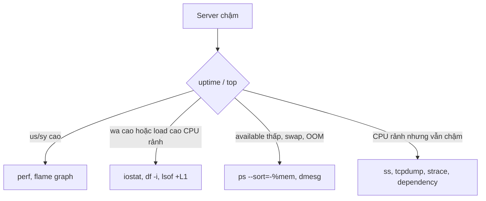

## 1. Core Concept

Khi production có sự cố, thường bạn chỉ có **một shell trên máy chủ** và vài phút để hiểu chuyện gì đang xảy ra. **Bộ công cụ debug Linux** giúp trả lời nhanh bốn câu: **tài nguyên nào cạn** (CPU, RAM, đĩa, mạng)? **tiến trình nào gây ra**? **nó đang làm gì** (syscall, kết nối, file)? và **dữ liệu có thực sự đi qua mạng**? Phương pháp xương sống là **USE** (Utilization, Saturation, Errors) áp cho từng tài nguyên, rồi đào sâu vào tiến trình đáng ngờ.

**Mental model:** như **bác sĩ khám bệnh**: đo sinh hiệu trước (nhiệt độ, huyết áp = uptime, top, free, iostat), khoanh vùng cơ quan nghi ngờ (CPU/RAM/đĩa/mạng), rồi mới **soi sâu** (strace, perf, tcpdump). Không "cho thuốc" (restart) trước khi thu thập **bằng chứng**.

## 2. How It Works

**Quy trình 60 giây → Bức tranh tổng quan**
- `uptime` (load average), `dmesg -T | tail` (OOM killer, lỗi phần cứng/driver), `vmstat 1` (CPU, bộ nhớ, swap, I/O), `mpstat -P ALL 1` (từng core), `pidstat 1` (theo tiến trình), `iostat -xz 1` (đĩa), `free -m`, `sar -n DEV 1` (mạng), `ss -s`, `top`.

**CPU và load average**
- **Load average** (1/5/15 phút) đếm tiến trình **runnable + đang chờ I/O không ngắt được (trạng thái D)**; so với **số core**. **Load cao nhưng CPU rảnh** = nhiều tiến trình **chờ I/O hoặc lock**, không phải thiếu CPU. Trong `top`: `us/sy` (user/kernel), **`wa`** (chờ I/O cao = nghẽn đĩa), **`st`** (steal: VM bị host lấy CPU), `id`. Tìm hàm nóng bằng **`perf top`/`perf record -g`** + **flame graph**.

**Bộ nhớ**
- Xem cột **`available`** (không phải `free`; page cache là bộ nhớ có thể thu hồi); **swap tăng** hoặc `dmesg | grep -i oom` = thiếu RAM/OOM killer. `ps aux --sort=-%mem`, `/proc/<pid>/status`.

**Đĩa**
- `df -h` (dung lượng) **và `df -i` (hết inode)** — hết inode khiến không tạo được file dù còn trống dung lượng; `iostat -x` xem **`await`** (độ trễ) và **`%util`** (với SSD/NVMe song song, `%util` kém ý nghĩa); `iotop`; **file đã xoá nhưng tiến trình còn giữ mở vẫn chiếm dung lượng** (`lsof +L1`).

**Mạng**
- `ss -tulpn` (cổng lắng nghe + tiến trình), `ss -s` (đếm ESTABLISHED/TIME_WAIT), `ip a`, `ping`, `mtr`, `dig`, `curl -v`, **`tcpdump -i any port 443 -w out.pcap`** để bắt gói tin.

**Soi một tiến trình**
- `lsof -p <pid>` / `lsof -i :8080` (file, socket đang mở), **`strace -p <pid> -f -tt -T`** (syscall + thời gian; `-c` để tổng hợp) cho thấy nó **đang chờ gì**, `/proc/<pid>/limits`, `jstack`/`py-spy dump` cho ngôn ngữ cụ thể, `journalctl -u <service> -f` cho log.

**eBPF → Quan sát ít xâm lấn**
- **bcc/bpftrace** chạy chương trình nhỏ trong kernel để theo dõi syscall, độ trễ đĩa (`biolatency`), vòng đời kết nối TCP (`tcplife`), `execsnoop`… **overhead thấp** hơn `strace`.

```bash
# "Server chậm": kiểm tra nhanh theo thứ tự
uptime; dmesg -T | tail -20; vmstat 1 5
free -m; df -h; df -i; iostat -xz 1 3
top -o %CPU -n 1 | head -15; ss -s
```

## 3. Visual Diagram



## 4. Rules of Thumb & Trade-offs

| Tình huống / Nhu cầu | Chọn gì |
| --- | --- |
| Tổng quan nhanh | Quy trình 60 giây (uptime, vmstat, iostat, free, ss) |
| Tìm hàm CPU nóng | perf + flame graph |
| Tiến trình đang chờ gì | strace -p (ngắn hạn) |
| File/socket tiến trình đang mở | lsof |
| Gói tin có đi qua mạng không | tcpdump |
| Theo dõi sâu, ít xâm lấn | eBPF (bcc/bpftrace) |
| Không tạo được file dù còn dung lượng | df -i |

- **Được gì:** tìm nút thắt trong vài phút bằng bằng chứng. **Mất gì:** công cụ sâu có **overhead** (strace làm chậm tiến trình tải cao); thu thập nhiều số liệu cần kinh nghiệm đọc.

## 5. Must Remember / Production Pitfalls

- **Load cao nhưng CPU rảnh → tiến trình kẹt chờ I/O (trạng thái D) hoặc lock → `iostat`, `vmstat` cột `b`, `strace`; không thêm CPU**.
- **Không tạo được file dù `df -h` còn trống → hết inode → `df -i`, dọn file nhỏ**.
- **Đĩa đầy dù đã xoá file lớn → tiến trình còn giữ file đã xoá → `lsof +L1`, restart tiến trình đó**.
- **Cạn ephemeral port / nhiều `TIME_WAIT` → mở-đóng kết nối quá nhiều → connection pool (`ss -s` để đếm)**.
- **Dịch vụ "tự chết" không thấy lỗi → OOM killer giết → `dmesg -T | grep -i oom`, xem giới hạn bộ nhớ**.
- **`strace -f` trên tiến trình tải cao làm sập dịch vụ → overhead lớn → dùng ngắn, `-c`, hoặc perf/eBPF**.
- Interview trap: "server chậm, bạn làm gì?" → **USE method: kiểm tra CPU/RAM/đĩa/mạng, rồi tiến trình đáng ngờ, rồi strace/perf — thu thập bằng chứng trước khi restart**; "load cao CPU rảnh nghĩa là gì?" → **đang chờ I/O hoặc lock**.

## 6. Search Hooks

- `Linux performance analysis in 60 seconds` — chuỗi lệnh kiểm tra nhanh của Netflix.
- `USE method utilization saturation errors` — khung kiểm tra theo từng tài nguyên.
- `strace lsof ss tcpdump` — theo dõi syscall, file, socket và gói tin.
- `iostat await util disk bottleneck` — chẩn đoán nghẽn I/O đĩa.
- `load average vs CPU usage` — vì sao load cao mà CPU rảnh.
- `eBPF bcc bpftrace observability` — quan sát nhân Linux ít xâm lấn.
