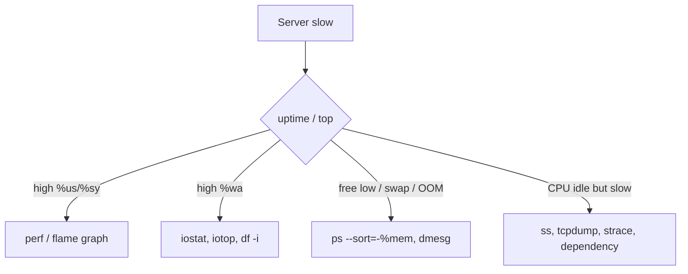

## 1. Core Concept

Khi production gặp sự cố, bạn thường chỉ có một shell trên máy chủ. **Bộ công cụ debug Linux** giúp trả lời nhanh bốn câu hỏi: tài nguyên nào đang cạn (CPU, RAM, đĩa, mạng)? tiến trình nào gây ra? nó đang làm gì (syscall, kết nối, file)? và dữ liệu có thực sự đi qua mạng? Mental model: *theo phương pháp **USE** (Utilization, Saturation, Errors) cho từng tài nguyên, rồi đào sâu vào tiến trình đáng ngờ.*

## 2. How It Works

- **Tổng quan tải**: `uptime` (load average), `top`/`htop` (CPU, RAM theo tiến trình), `vmstat 1`, `free -m`, `dstat`. **Load average** tính số tiến trình runnable + chờ I/O, so với số core.
- **CPU**: `top` cột `%us/%sy/%wa/%st` — **`wa` cao = chờ I/O**, **`st` cao = VM bị "ăn" CPU (steal)**; `pidstat -u 1`; `perf top`, **flame graph** để tìm hàm nóng.
- **Bộ nhớ**: `free`, `ps aux --sort=-%mem`, `/proc/<pid>/status`; **swap tăng** hay **OOM killer** (`dmesg | grep -i oom`) là dấu hiệu thiếu RAM.
- **Đĩa**: `df -h` (dung lượng), `df -i` (**hết inode**), `iostat -x 1` (`%util`, `await`), `iotop`, `du -sh * | sort -h`.
- **Mạng**: `ss -tulpn` (cổng đang lắng nghe, tiến trình), `ss -s`, `ip a`, `ping`, `traceroute/mtr`, `dig`, `curl -v`, **`tcpdump`** để bắt gói tin; `ss` đếm kết nối `TIME_WAIT`/`ESTABLISHED`.
- **Theo dõi một tiến trình**: `lsof -p <pid>` (file/socket đang mở), **`strace -p <pid> -f`** (system call, thấy nó chờ gì), `/proc/<pid>/fd`, `ltrace`; `jstack`/`py-spy` cho ngôn ngữ cụ thể.
- **Log**: `journalctl -u <service> -f`, `tail -f`, `grep/awk/sort | uniq -c`.

```bash
# "Server chậm" — kiểm tra nhanh theo thứ tự
uptime; free -m; df -h; df -i
top -o %CPU -n 1 | head -15
ss -s; dmesg -T | tail -20
```

## 3. Visual Diagram



## 4. Rules of Thumb & Trade-offs

- **Quan sát trước, hành động sau**: thu thập số liệu, đừng khởi động lại ngay (mất bằng chứng); nếu bắt buộc, chụp trước `top`, `ss`, thread/heap dump.
- Bắt đầu từ **tài nguyên → tiến trình → hành vi** theo USE, không đoán.
- Dùng **công cụ ít xâm lấn** trên production (`strace` làm chậm tiến trình nặng; `perf`/eBPF nhẹ hơn).
- Trade-off: **độ sâu thông tin** vs **overhead lên hệ thống đang gặp sự cố**.

## 5. Must Remember / Production Pitfalls

- **Load cao nhưng CPU rảnh** = nhiều tiến trình đang **chờ I/O** (D state), không phải thiếu CPU.
- **Hết inode** (`df -i`) khiến không tạo được file dù `df -h` còn trống.
- **File đã xoá nhưng còn tiến trình giữ mở** vẫn chiếm dung lượng (`lsof +L1`).
- **`TIME_WAIT` nhiều / cạn ephemeral port** xuất hiện khi mở-đóng kết nối quá nhiều; dùng connection pool.
- **`strace -f` trên tiến trình tải cao** có thể làm nó chậm đáng kể; dùng có chủ đích, thời gian ngắn.
- **OOM killer giết nhầm tiến trình** (thường là tiến trình lớn nhất); xem `dmesg` thay vì chỉ thấy "service tự chết".
- Interview trap: "Server chậm, bạn làm gì?" → **USE method**: kiểm tra CPU/RAM/đĩa/mạng, rồi tiến trình đáng ngờ, rồi `strace`/profile.

## 6. Search Hooks

- `Linux performance analysis in 60 seconds` — danh sách lệnh kiểm tra nhanh của Netflix.
- `USE method utilization saturation errors` — khung kiểm tra theo từng tài nguyên.
- `strace lsof ss tcpdump` — theo dõi syscall, file, socket và gói tin.
- `iostat await util disk bottleneck` — chẩn đoán nghẽn I/O đĩa.
- `load average vs CPU usage` — vì sao load cao mà CPU rảnh.
- `eBPF bcc bpftrace observability` — quan sát nhân Linux ít xâm lấn.
