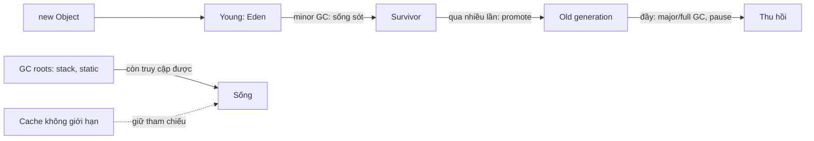

## 1. Core Concept

Mỗi chương trình cần **bộ nhớ** cho biến cục bộ và đối tượng sống lâu. **Stack** cấp phát/thu hồi tự động theo lời gọi hàm (nhanh, nhỏ, theo thread), còn **heap** chứa đối tượng có vòng đời tuỳ ý và cần ai đó **thu hồi**: lập trình viên thủ công (C/C++), **garbage collector** tự động (Java, Go, C#, Python…) hoặc **trình biên dịch qua ownership** (Rust). Hiểu cơ chế này giúp bạn chẩn đoán **rò rỉ bộ nhớ, độ trễ tăng đột biến do GC pause và OOM**.

**Mental model:** stack là **khay đồ đang cầm trên tay** (đặt xuống ngay khi xong việc), heap là **kho lưu trữ chung**; GC là **nhân viên dọn kho** tự động vứt món nào **không còn ai tham chiếu tới** — nhưng khi dọn kho lớn thì phải **tạm dừng công việc** (pause), và nếu bạn cứ giữ ghi chú trỏ tới món đồ cũ thì nhân viên dọn kho **không bao giờ vứt được**.

## 2. How It Works

**Stack vs heap**
- **Stack**: mỗi thread có một (thường cỡ **~1 MB**), chứa **khung hàm** (biến cục bộ, địa chỉ trả về); cấp phát chỉ là dịch con trỏ → **rất nhanh**; tràn ngăn xếp (**stack overflow**) khi đệ quy sâu. **Heap**: dùng chung giữa thread, cấp phát/thu hồi tốn kém hơn, có thể **phân mảnh**; đối tượng sống tới khi không còn tham chiếu (GC) hoặc bị giải phóng (thủ công).

**Garbage collection → Khả năng truy cập (reachability)**
- GC coi đối tượng **còn sống nếu truy cập được từ GC roots** (biến trên stack, biến static, thread đang chạy…). Thuật toán: **mark-sweep(-compact)** (đánh dấu rồi quét, có thể nén chống phân mảnh), **copying** (sao chép đối tượng sống sang vùng mới).

**Generational hypothesis → Hầu hết đối tượng chết trẻ**
- Heap chia **young generation** (Eden + survivor) và **old generation**. **Minor GC** thu young **thường xuyên và rẻ** (ít đối tượng sống sót); đối tượng sống qua nhiều lần được **thăng cấp (promote)** sang old; **major/full GC** thu old **hiếm nhưng đắt**. Lý do tổng công việc GC giảm.

**Stop-the-world và các GC hiện đại**
- Nhiều giai đoạn GC phải **tạm dừng mọi thread ứng dụng (STW)** → **độ trễ đột biến**. **G1** (chia vùng, mục tiêu pause như `-XX:MaxGCPauseMillis=200`), **ZGC/Shenandoah** (hầu hết công việc **đồng thời**, pause **dưới vài mili-giây** bất kể kích thước heap), **Parallel** (tối đa throughput), Go dùng GC **đồng thời tri-color**. Đánh đổi: **throughput vs độ trễ vs bộ nhớ**.

**Rò rỉ trong ngôn ngữ có GC → Giữ tham chiếu không cần thiết**
- GC không phát hiện "đối tượng vô dụng", chỉ "đối tượng không truy cập được". Nguyên nhân rò rỉ: **cache/map không giới hạn**, **collection static** chỉ thêm không xoá, **listener/callback không huỷ đăng ký**, **ThreadLocal trong thread pool**, tài nguyên không đóng. Dấu hiệu: **heap sau full GC vẫn tăng dần**; xử lý bằng **heap dump** (jmap, Eclipse MAT) để tìm đường tham chiếu giữ đối tượng, và **GC log**.

**GC thrashing và bộ nhớ ngoài heap**
- Heap gần đầy → GC chạy liên tục, **CPU tập trung cho GC** (có thể báo `GC overhead limit exceeded`). **Container bị OOMKilled** dù `-Xmx` nhỏ hơn limit vì tiến trình còn dùng **metaspace, stack thread, direct buffer, native** ngoài heap — đặt `-Xmx` ≈ **50–75%** limit.

**Quản lý không dùng GC**
- **C/C++**: thủ công (**use-after-free, double free, leak**). **Rust**: **ownership** — mỗi giá trị **một chủ sở hữu**, chuyển quyền (move), **borrow checker** (hoặc nhiều tham chiếu đọc **hoặc** một tham chiếu ghi) kiểm tra lúc biên dịch → an toàn bộ nhớ **không cần GC**, giải phóng xác định khi hết scope. **Reference counting** (Python/Swift) có vấn đề **vòng tham chiếu**.

```bash
java -Xmx2g -XX:+UseZGC -Xlog:gc*:file=gc.log MyApp      # GC log, ZGC
jmap -dump:live,format=b,file=heap.hprof <pid>            # heap dump để phân tích rò rỉ
jcmd <pid> GC.heap_info
```

## 3. Visual Diagram



## 4. Rules of Thumb & Trade-offs

| Tình huống / Nhu cầu | Chọn gì |
| --- | --- |
| Throughput tối đa, chịu pause | Parallel GC |
| Pause thấp, heap lớn | ZGC / Shenandoah |
| Cân bằng, mặc định hiện đại | G1 |
| Chạy trong container | `-Xmx` ≈ 50–75% limit |
| Nghi ngờ rò rỉ | Heap dump + MAT, GC log |
| An toàn bộ nhớ không GC | Rust (ownership) |
| Giảm áp lực GC | Giảm cấp phát đối tượng ngắn hạn trên đường nóng |

- **Được gì:** GC loại bỏ cả lớp lỗi bộ nhớ thủ công. **Mất gì:** pause và overhead CPU/bộ nhớ, ít kiểm soát; GC low-pause đổi throughput lấy độ trễ.

## 5. Must Remember / Production Pitfalls

- **Heap tăng mãi dù có GC → rò rỉ logic (cache/map không giới hạn, listener) → giới hạn kích thước/TTL, huỷ đăng ký, heap dump tìm đường giữ**.
- **Độ trễ p99 tăng đột biến định kỳ → GC pause (old gen đầy/phân mảnh) → chọn GC low-pause, tăng heap hợp lý, giảm tốc độ cấp phát**.
- **Pod bị OOMKilled dù `-Xmx` nhỏ hơn limit → bộ nhớ ngoài heap (metaspace, thread stack, direct buffer) → đặt `-Xmx` thấp hơn limit, theo dõi bộ nhớ native**.
- **CPU cao, ứng dụng gần như đứng → GC thrashing do heap gần đầy → tăng heap/sửa rò rỉ, không chỉ tăng `-Xmx`**.
- **Nạp cả file/bảng lớn vào RAM một lần → OOM → xử lý theo luồng/lô (streaming)**.
- Interview trap: "có GC thì hết rò rỉ bộ nhớ?" → **không, GC chỉ thu hồi đối tượng không truy cập được; giữ tham chiếu thừa vẫn rò rỉ**; "vì sao generational GC hiệu quả?" → **hầu hết đối tượng chết trẻ nên minor GC rẻ và thường xuyên**; "container OOM dù Xmx nhỏ?" → **bộ nhớ ngoài heap**.

## 6. Search Hooks

- `stack vs heap memory` — hai vùng bộ nhớ và vòng đời của chúng.
- `garbage collection generational mark-sweep` — nguyên lý thu hồi tự động.
- `stop-the-world pauses ZGC G1` — tạm dừng của GC và các GC hiện đại.
- `memory leak in garbage collected languages` — rò rỉ do giữ tham chiếu thừa.
- `Rust ownership borrow checker` — an toàn bộ nhớ không cần GC.
- `heap dump analysis` — phân tích ảnh chụp heap để tìm rò rỉ.
