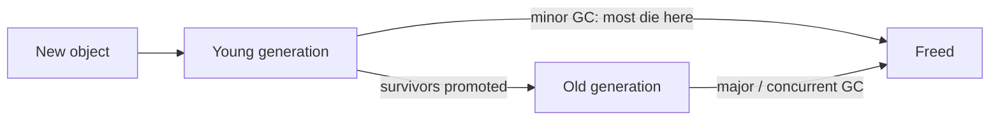

## 1. Core Concept

Mọi chương trình dùng bộ nhớ qua **stack** (nhanh, tự động theo lời gọi hàm) và **heap** (linh hoạt, cần được cấp phát và thu hồi). **Garbage Collector (GC)** tự thu hồi vùng nhớ không còn tham chiếu (Java, Go, C#, JS, Python), đổi lấy **chi phí CPU và các lần tạm dừng**. Hiểu mô hình này giải thích vì sao ứng dụng **chậm theo đợt (latency spike)**, **rò rỉ bộ nhớ** và **bị OOM** dù code "trông đúng". Mental model: *bộ nhớ không miễn phí — mỗi object bạn tạo là việc cho GC làm sau này.*

## 2. How It Works

- **Stack**: biến cục bộ và khung gọi hàm, cấp/thu hồi tự động, kích thước giới hạn (**stack overflow** khi đệ quy quá sâu). **Heap**: object sống lâu hơn một lần gọi hàm.
- **Reachability**: GC coi object **còn sống nếu truy cập được từ "GC roots"** (biến stack, static, thread); không truy cập được thì thu hồi. **Rò rỉ** trong ngôn ngữ có GC = object vẫn bị **tham chiếu không cần thiết** (cache không giới hạn, listener không gỡ, `static` map).
- **Generational hypothesis**: **hầu hết object chết trẻ** → chia heap thành **young** (thu gom thường xuyên, rẻ) và **old** (hiếm, đắt); object sống sót được **promote**.
- **Thuật toán**: **mark-sweep(-compact)**, **copying** (young), **concurrent/low-pause GC** (G1, ZGC, Shenandoah ở JVM; GC đồng thời của Go chỉ tạm dừng cực ngắn). **Stop-the-world (STW)** là lúc mọi luồng ứng dụng bị dừng để GC làm việc.
- **Quản lý thủ công/ownership**: C/C++ (`malloc/free`), **Rust** (ownership & borrow checker — an toàn bộ nhớ lúc biên dịch, không GC); **reference counting** (Python, Swift) không xử lý được **vòng tham chiếu** nếu thiếu cycle collector.

## 3. Visual Diagram

## 4. Rules of Thumb & Trade-offs

- **Giảm tạo object ngắn hạn trên đường nóng** (tái dùng buffer, tránh boxing/nối chuỗi trong vòng lặp) hơn là chỉnh tham số GC.
- Đặt **heap** vừa đủ: quá nhỏ → GC liên tục; quá lớn → pause dài và tốn RAM; luôn chừa chỗ cho **non-heap** (metaspace, thread stack, native).
- Cần **độ trễ thấp** → GC low-pause (ZGC/G1 tuned); cần **throughput tối đa** → Parallel GC.
- Trade-off: **throughput** vs **độ trễ (pause)** vs **bộ nhớ** — không có GC tốt nhất cho mọi tải.

## 5. Must Remember / Production Pitfalls

- **Rò rỉ logic**: cache/map không giới hạn, `ThreadLocal` không dọn, listener quên gỡ làm heap tăng dần rồi **OutOfMemoryError**.
- **GC thrashing**: heap gần đầy làm GC chạy liên tục, CPU 100% mà thông lượng thấp.
- **Container bị OOMKilled** vì tổng bộ nhớ (heap + non-heap + native) vượt limit, dù `-Xmx` nhỏ hơn limit.
- **Pause dài** thường là dấu hiệu **old gen đầy hoặc fragmentation** — xem GC log, không đoán.
- Interview trap: "Có GC thì hết rò rỉ bộ nhớ?" → **không**: rò rỉ = giữ tham chiếu không cần.

## 6. Search Hooks

- `stack vs heap memory` — hai vùng bộ nhớ và vòng đời của chúng.
- `garbage collection generational mark-sweep` — nguyên lý thu hồi dựa trên khả năng truy cập.
- `stop-the-world pauses ZGC G1` — tạm dừng của GC và các GC độ trễ thấp.
- `memory leak in garbage collected languages` — rò rỉ do giữ tham chiếu.
- `Rust ownership borrow checker` — an toàn bộ nhớ không cần GC.
- `heap dump analysis` — phân tích ảnh chụp heap để tìm rò rỉ.
