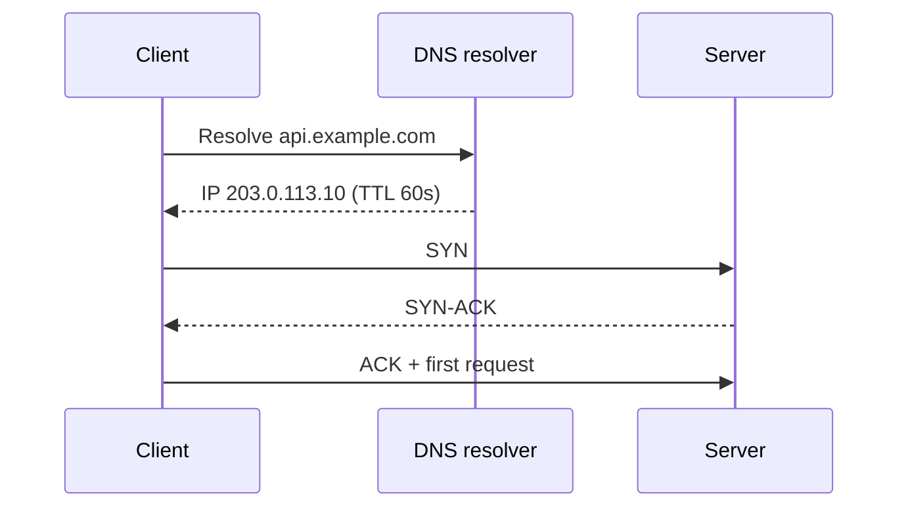

## 1. Core Concept

Mọi request giữa các service đều đi qua mạng, và mạng là thứ **chậm, không đáng tin và có độ trễ không thể nén dưới tốc độ ánh sáng**. **IP** định tuyến gói tin tới máy đích, **TCP** biến mạng không tin cậy thành luồng byte tin cậy có thứ tự, **DNS** đổi tên miền thành địa chỉ IP. Mental model: *mỗi lần "gọi API" là một chuỗi chi phí — DNS lookup, TCP handshake, rồi mới tới dữ liệu — và bạn trả bằng **round-trip time (RTT)**.*

## 2. How It Works

- **Mô hình phân lớp (TCP/IP)**: Link → **IP** (địa chỉ, định tuyến) → **TCP/UDP** (cổng, độ tin cậy) → Application (HTTP, DNS, gRPC).
- **TCP** (hướng kết nối): **3-way handshake** `SYN → SYN-ACK → ACK` tốn **1 RTT** trước khi gửi dữ liệu; đảm bảo thứ tự bằng **sequence number**, báo nhận bằng **ACK**, gửi lại gói mất (**retransmission**).
- **Flow control** (cửa sổ nhận, tránh làm tràn người nhận) khác **congestion control** (tránh làm nghẽn mạng): bắt đầu bằng **slow start**, tăng dần, giảm mạnh khi mất gói (**AIMD**; CUBIC/BBR).
- **UDP**: không kết nối, không đảm bảo thứ tự/đến nơi; nhanh, dùng cho DNS, video, QUIC (HTTP/3).
- **DNS**: client hỏi **recursive resolver** → resolver hỏi **root → TLD → authoritative server**, rồi **cache theo TTL**. Bản ghi thường gặp: `A/AAAA`, `CNAME`, `MX`, `TXT`.
- **Độ trễ tham khảo**: cùng data center ≈ 0.5 ms; cùng Region khác AZ ≈ 1–2 ms; liên lục địa ≈ 100–200 ms.

## 3. Visual Diagram

## 4. Rules of Thumb & Trade-offs

- Giảm RTT hiệu quả hơn tối ưu code: **connection pooling/keep-alive**, đặt dịch vụ gần nhau, **CDN**, gộp request (batching).
- **TCP** cho nhu cầu tin cậy (API, DB); **UDP/QUIC** khi độ trễ quan trọng hơn độ tin cậy từng gói.
- **TTL DNS thấp** → failover/đổi IP nhanh nhưng tăng tải DNS và độ trễ; **TTL cao** ngược lại.
- Trade-off cốt lõi: *Reliability vs. Latency* — TCP trả giá bằng handshake và head-of-line blocking.

## 5. Must Remember / Production Pitfalls

- **Không có "mạng tin cậy"**: gói có thể mất, trễ, trùng → mọi lời gọi từ xa cần **timeout** và chiến lược retry.
- **Ephemeral port exhaustion / `TIME_WAIT`**: mở/đóng quá nhiều kết nối ngắn làm cạn port, bị `cannot assign requested address`.
- **DNS cache** ở nhiều tầng (OS, JVM, resolver): đổi IP mà client vẫn dùng IP cũ lâu hơn TTL (JVM từng cache vô hạn).
- **Head-of-line blocking** của TCP: một gói mất làm chậm cả luồng phía sau.
- Interview trap: "Tại sao request đầu tiên chậm hơn?" → DNS + TCP (+ TLS) handshake; những lần sau tái dùng kết nối.

## 6. Search Hooks

- `TCP three-way handshake` — bắt tay ba bước tạo kết nối và tốn 1 RTT.
- `TCP congestion control slow start AIMD` — cách TCP tránh làm nghẽn mạng.
- `TCP vs UDP` — đánh đổi giữa độ tin cậy và độ trễ.
- `DNS resolution recursive authoritative TTL` — quá trình phân giải tên miền và cache.
- `TIME_WAIT ephemeral port exhaustion` — cạn port khi mở/đóng kết nối liên tục.
- `Latency numbers every programmer should know` — bảng độ trễ tham chiếu của phần cứng và mạng.
