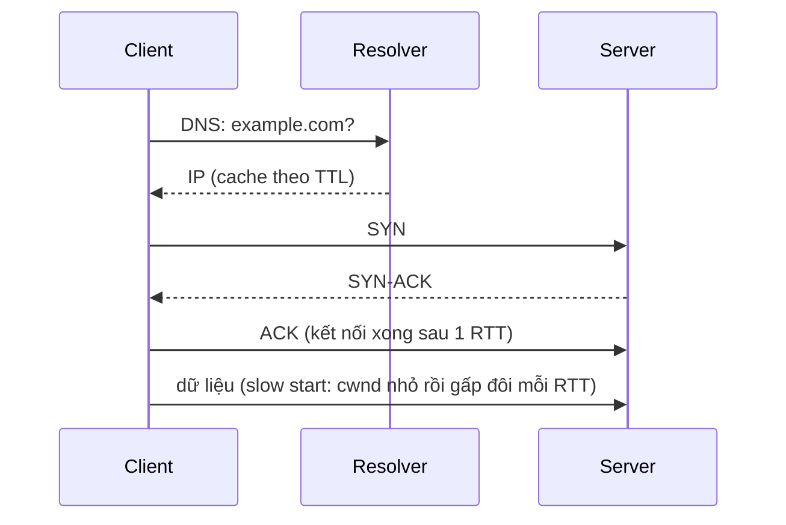

## 1. Core Concept

Mọi hệ thống phân tán đều chạy trên **mạng**, và mạng có những giới hạn vật lý không thể tối ưu bằng code: **độ trễ (latency)**, **băng thông**, **mất gói**. Hiểu **TCP** (đảm bảo giao hàng, có handshake và kiểm soát tắc nghẽn), **UDP** (nhẹ, không đảm bảo) và **DNS** (dịch tên sang IP, có cache theo TTL) giúp bạn **chẩn đoán độ trễ, lỗi kết nối và thiết kế giao thức đúng**.

**Mental model:** TCP như **gọi điện có xác nhận từng câu** (mở đầu bằng "alô, nghe rõ không?", mất câu nào thì nói lại), UDP như **gửi bưu thiếp** (nhanh, không đảm bảo tới nơi). DNS là **danh bạ điện thoại có ghi chú "số này dùng được trong N phút"** (TTL).

## 2. How It Works

**TCP three-way handshake → Chi phí 1 RTT trước khi gửi dữ liệu**
- **SYN → SYN-ACK → ACK**, mất **1 RTT**. Ví dụ client ở Việt Nam gọi server Mỹ (RTT ~200 ms): chỉ để mở kết nối đã tốn ~200 ms; thêm TLS 1.3 là +1 RTT nữa (HTTP/1.1 qua TLS có thể ~3 RTT trước byte dữ liệu đầu). Vì thế **tái sử dụng kết nối (keep-alive, connection pool)** quan trọng.

**TCP congestion control → Slow start và AIMD**
- **Slow start**: `cwnd` (cửa sổ tắc nghẽn) bắt đầu nhỏ (thường 10 MSS) và **gấp đôi mỗi RTT** cho tới ngưỡng. **Congestion avoidance (AIMD)**: **tăng cộng (additive increase)** mỗi RTT, **giảm nhân (multiplicative decrease)** — giảm một nửa khi mất gói. Hệ quả: kết nối **mới** bắt đầu chậm; truyền file nhỏ trên kết nối mới **không bao giờ đạt hết băng thông**. **Flow control** (cửa sổ nhận `rwnd`) là cơ chế riêng để không làm tràn bên nhận.

**TCP vs UDP → Chọn theo yêu cầu**
- **TCP**: tin cậy, đúng thứ tự, kiểm soát tắc nghẽn; đổi lại **head-of-line blocking** (một gói mất làm nghẽn cả luồng) và handshake. **UDP**: không kết nối, không đảm bảo, độ trễ thấp — dùng cho **DNS, VoIP, game, streaming, QUIC/HTTP3** (ứng dụng tự lo độ tin cậy nếu cần).

**DNS resolution → Chuỗi tra cứu và cache**
- Client hỏi **recursive resolver**; nếu chưa có cache thì hỏi **root → TLD (.com) → authoritative server** rồi trả kết quả, **cache theo TTL**. Bản ghi: **A/AAAA** (IPv4/IPv6), **CNAME** (bí danh, **không đặt ở domain gốc**), **MX**, **TXT**, **NS**. **TTL** đánh đổi: **TTL thấp** → đổi IP/failover nhanh nhưng tải DNS cao và thêm độ trễ; **TTL cao** ngược lại. Có cả **negative caching** (cache cả kết quả "không tồn tại").

**TIME_WAIT và cạn ephemeral port**
- Bên **đóng kết nối trước** vào **TIME_WAIT** khoảng **60 giây** (Linux). Mỗi kết nối ra dùng một **ephemeral port** (mặc định khoảng **28.000** cổng: 32768–60999). Ví dụ: **1.000 kết nối mới/giây** tới cùng một đích → cạn cổng trong ~**28–60 giây** → lỗi `Cannot assign requested address`. Cách xử lý: **connection pool/keep-alive**, mở rộng dải cổng, `tcp_tw_reuse` (cho kết nối ra), tránh tạo kết nối mới cho mỗi request.

**Latency numbers → Thang đo trực giác**
- Truy cập bộ nhớ chính ~**100 ns**; đọc ngẫu nhiên SSD ~**100 µs**; **RTT trong cùng datacenter ~0,5 ms**; seek đĩa quay ~**10 ms**; **RTT liên lục địa ~150 ms**. Một lời gọi mạng chậm hơn bộ nhớ **hàng nghìn đến hàng triệu lần**.

```bash
dig +trace example.com            # xem chuỗi root → TLD → authoritative
curl -w "dns:%{time_namelookup} tcp:%{time_connect} tls:%{time_appconnect} ttfb:%{time_starttransfer}\n" -so /dev/null https://example.com
ss -s                              # đếm kết nối, TIME_WAIT
```

## 3. Visual Diagram



## 4. Rules of Thumb & Trade-offs

| Tình huống / Nhu cầu | Chọn gì |
| --- | --- |
| Cần tin cậy và đúng thứ tự | TCP |
| Độ trễ thấp, chịu mất gói (game, VoIP, DNS) | UDP |
| Nhiều request tới cùng đích | Keep-alive, connection pool |
| Failover nhanh bằng DNS | TTL thấp (đổi lấy tải và trễ) |
| Cạn ephemeral port | Pool kết nối, mở rộng dải cổng |
| Giảm RTT cho người dùng xa | CDN, edge, đặt server gần người dùng |

- **Được gì:** đúng giao thức cho đúng bài toán. **Mất gì:** TCP tốn handshake và có HOL blocking; TTL thấp tăng tải/độ trễ DNS; UDP buộc ứng dụng tự lo độ tin cậy.

## 5. Must Remember / Production Pitfalls

- **Lỗi "Cannot assign requested address" khi tải cao → mở kết nối mới cho mỗi request, TIME_WAIT chiếm hết cổng → connection pooling/keep-alive, mở rộng dải cổng**.
- **Request đầu tiên rất chậm với người dùng xa → handshake TCP + TLS tốn nhiều RTT → keep-alive, TLS 1.3/0-RTT, CDN gần người dùng**.
- **Đổi IP/failover nhưng người dùng vẫn vào IP cũ → cache DNS theo TTL → hạ TTL trước khi chuyển, chấp nhận độ trễ lan truyền**.
- **Truyền file nhỏ chậm dù băng thông lớn → slow start trên kết nối mới → tái dùng kết nối**.
- **Không đặt CNAME ở domain gốc → ràng buộc DNS → dùng ALIAS/ANAME của nhà cung cấp**.
- Interview trap: "chi phí mở một kết nối TCP?" → **1 RTT handshake (cộng TLS)**; "TCP vs UDP?" → **tin cậy + đúng thứ tự vs nhanh + không đảm bảo**; "vì sao cạn cổng?" → **TIME_WAIT 60 giây × tốc độ tạo kết nối mới**.

## 6. Search Hooks

- `TCP three-way handshake` — chi phí 1 RTT để mở kết nối.
- `TCP congestion control slow start AIMD` — vì sao kết nối mới chậm.
- `TCP vs UDP` — đánh đổi tin cậy và độ trễ.
- `DNS resolution TTL` — chuỗi tra cứu và cache.
- `TIME_WAIT ephemeral port exhaustion` — cạn cổng khi tạo quá nhiều kết nối.
- `latency numbers every programmer should know` — thang đo độ trễ.
