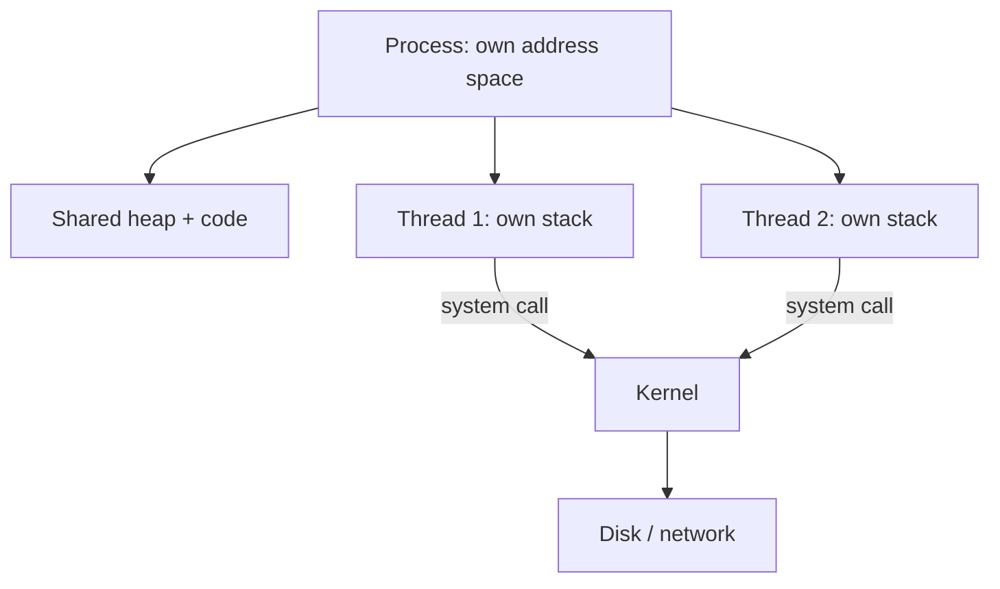

## 1. Core Concept

Hệ điều hành chia tài nguyên máy (CPU, RAM, I/O) cho chương trình qua **process** và **thread**, trừu tượng hoá bằng **virtual memory** và **system call**. Hiểu chúng giúp bạn biết vì sao server "hết thread", vì sao container bị OOM kill, và vì sao thêm thread không làm nhanh hơn. Mental model: *process là một "ngôi nhà" có không gian địa chỉ riêng; thread là những "người" trong nhà dùng chung đồ đạc (heap) nhưng mỗi người có ngăn kéo riêng (stack).*

## 2. How It Works

- **Process**: có **không gian địa chỉ ảo riêng**, file descriptor, quyền riêng; cô lập nên một process lỗi không phá process khác. **Thread**: chạy trong process, **dùng chung heap** và tài nguyên, mỗi thread có **stack** và thanh ghi riêng.
- **Scheduler** (preemptive) cắt thời gian CPU cho các thread runnable; **context switch** lưu/khôi phục trạng thái, tốn vài micro-giây và làm lạnh cache CPU.
- **Virtual memory**: mỗi process thấy bộ nhớ liên tục, OS ánh xạ qua **page table**; thiếu RAM → **swap/paging** (rất chậm); hết hẳn → **OOM killer**.
- **User mode vs kernel mode**: đọc file, gửi mạng… là **system call** (chuyển chế độ, tốn chi phí).
- **I/O**: thread gọi I/O **blocking** sẽ ngủ chờ; **file descriptor** đại diện file/socket, bị giới hạn bởi `ulimit -n`.
- **Container** không phải VM: dùng **namespaces** (cô lập view) + **cgroups** (giới hạn CPU/RAM) trên cùng kernel.
- **CPU-bound** (tính toán) vs **I/O-bound** (chờ mạng/đĩa): thread pool cho CPU-bound ≈ số core; cho I/O-bound có thể lớn hơn nhiều.

## 3. Visual Diagram

## 4. Rules of Thumb & Trade-offs

- Cần **cô lập/an toàn** → nhiều process; cần **chia sẻ dữ liệu nhanh** → nhiều thread (đổi lại phải xử lý đồng bộ).
- **Thread-per-request** đơn giản nhưng mỗi thread tốn stack (~1 MB mặc định trên JVM/Linux) và context switch → không scale tới hàng chục nghìn kết nối (cần mô hình I/O không chặn, event loop).
- Đặt **memory limit** khớp heap + overhead; đặt **CPU limit** có hiểu biết vì cgroups có thể **throttle**.
- Trade-off: nhiều thread tăng song song hoá nhưng tăng **tranh chấp lock và context switch**.

## 5. Must Remember / Production Pitfalls

- Thêm thread vượt số core cho tác vụ **CPU-bound** chỉ làm chậm hơn (context switch).
- **Hết file descriptor** (`Too many open files`) thường do rò rỉ kết nối/file — kiểm tra `ulimit -n` và đóng tài nguyên.
- Container bị **OOMKilled** khi vượt memory limit dù app "không rò rỉ": heap + metaspace + thread stack + native > limit.
- **CPU throttling** trong cgroups làm latency tăng đột biến dù CPU trung bình thấp.
- **Noisy neighbor**: tài nguyên dùng chung trên một host ảnh hưởng nhau.
- Interview trap: "Process khác thread thế nào?" → trả lời bằng **không gian địa chỉ, chi phí tạo/switch, cô lập lỗi**, không chỉ "thread nhẹ hơn".

## 6. Search Hooks

- `process vs thread` — khác biệt về không gian địa chỉ, chi phí và cô lập.
- `context switch cost` — chi phí chuyển ngữ cảnh giữa các thread.
- `virtual memory paging swap OOM killer` — quản lý bộ nhớ và hậu quả khi thiếu RAM.
- `Linux namespaces cgroups containers` — nền tảng cô lập và giới hạn tài nguyên của container.
- `CPU-bound vs I/O-bound thread pool sizing` — chọn kích thước thread pool theo loại tải.
- `ulimit file descriptors too many open files` — giới hạn file descriptor của tiến trình.
