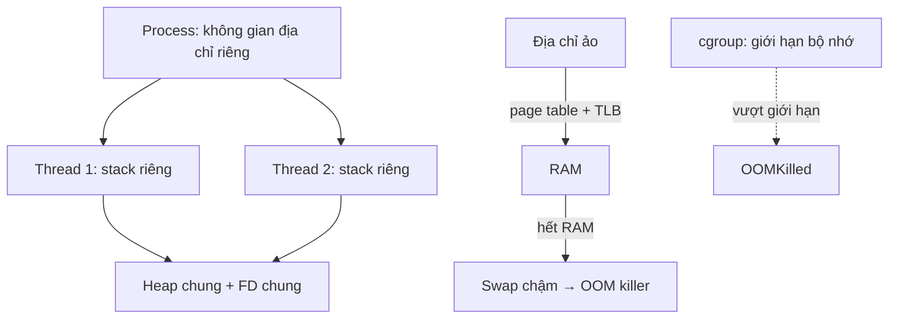

## 1. Core Concept

Hệ điều hành cho mỗi chương trình ảo giác **có CPU và bộ nhớ riêng**, thông qua **process** (không gian địa chỉ riêng), **thread** (luồng thực thi chia sẻ bộ nhớ), **virtual memory** (địa chỉ ảo ánh xạ sang RAM/đĩa) và các cơ chế cô lập (**namespaces, cgroups**) nền tảng của container. Hiểu chúng giúp bạn **chẩn đoán OOM, độ trễ do context switch, cạn file descriptor** và **cỡ thread pool** hợp lý.

**Mental model:** process là **một căn hộ riêng** (tường, bếp, kho riêng; muốn nói chuyện phải qua điện thoại/IPC); thread là **những người cùng sống trong một căn hộ** (dùng chung kho, nhanh nhưng dễ giẫm chân). Virtual memory là **sơ đồ đánh số kho ảo**; hệ điều hành bí mật hoán đổi hàng thật giữa kho nhanh (RAM) và kho chậm (đĩa).

## 2. How It Works

**Process vs thread**
- **Process**: không gian địa chỉ **riêng**, có PID, tài nguyên (file descriptor) riêng; tạo tốn kém (`fork`/`exec`, copy-on-write), cô lập tốt (một process crash không kéo process khác). **Thread**: chia sẻ **heap và tài nguyên** của process, có **stack và thanh ghi riêng**; tạo rẻ hơn, giao tiếp nhanh qua bộ nhớ chung nhưng **cần đồng bộ** và một thread lỗi có thể làm sập cả process.

**Context switch → Chi phí ẩn**
- Khi scheduler chuyển CPU giữa các thread/process, phải **lưu/khôi phục trạng thái**: chi phí trực tiếp cỡ **vài micro-giây**, và chi phí **gián tiếp** lớn hơn (mất cache CPU, TLB). Quá nhiều thread chạy đồng thời → **context switch nhiều, thông lượng giảm**.

**Virtual memory, paging và OOM killer**
- Mỗi process thấy không gian địa chỉ ảo riêng, chia **trang (page) 4 KB** ánh xạ qua **page table** (cache bằng **TLB**). **Page fault** khi trang chưa có trong RAM (nạp từ đĩa/swap), **mmap** ánh xạ file vào bộ nhớ. **Hết RAM**: hệ thống swap (rất chậm), rồi **OOM killer** chọn process để **kill** (theo `oom_score`). Trong **container**, giới hạn bộ nhớ bằng **cgroup**: vượt là bị **OOMKilled** dù máy còn RAM.

**Namespaces và cgroups → Nền tảng container**
- **Namespaces** cô lập **cái process nhìn thấy** (PID, mạng, mount, hostname, user…). **cgroups** giới hạn **tài nguyên process dùng** (CPU, bộ nhớ, I/O). Container = process Linux thường + namespace + cgroup (không phải máy ảo).

**Cỡ thread pool → CPU-bound vs I/O-bound**
- **CPU-bound**: số thread ≈ **số core** (+1). **I/O-bound**: thread phần lớn **chờ**, nên cần nhiều hơn: `cores × (1 + thời gian chờ / thời gian tính)`. Ví dụ **8 core**, mỗi request chờ I/O 90 ms và tính 10 ms → `8 × (1 + 9) = 80` thread. Với mô hình **async/event loop** hay **virtual thread** có thể phục vụ nhiều hơn mà không cần ngần ấy thread hệ điều hành.

**File descriptor và `ulimit`**
- Mọi file, **socket**, pipe đều là **file descriptor (FD)**; mỗi process có giới hạn (`ulimit -n`, mặc định thường **1024** mềm). Server nhiều kết nối gặp lỗi **"Too many open files"** nếu không nâng giới hạn hoặc **rò rỉ FD** (quên đóng).

```bash
ulimit -n                                # giới hạn FD mềm
ls /proc/$(pgrep -n myapp)/fd | wc -l    # số FD đang mở
cat /sys/fs/cgroup/memory.max            # giới hạn bộ nhớ của cgroup
dmesg -T | grep -i "killed process"      # dấu vết OOM killer
```

## 3. Visual Diagram



## 4. Rules of Thumb & Trade-offs

| Tình huống / Nhu cầu | Chọn gì |
| --- | --- |
| Cô lập lỗi mạnh | Nhiều process |
| Chia sẻ dữ liệu nhanh trong một tiến trình | Thread (có đồng bộ) |
| Tải CPU-bound | Pool ≈ số core |
| Tải I/O-bound | Pool lớn hơn, hoặc async/virtual thread |
| Nhiều kết nối đồng thời | Nâng `ulimit -n`, đóng FD đúng cách |
| Chạy cô lập, nhẹ | Container (namespace + cgroup) |

- **Được gì:** đúng mô hình cho đúng workload. **Mất gì:** nhiều thread → context switch và tranh chấp; nhiều process → tốn bộ nhớ và IPC; container chia sẻ kernel nên cô lập kém máy ảo.

## 5. Must Remember / Production Pitfalls

- **Pod bị OOMKilled dù node còn RAM → vượt giới hạn cgroup (gồm heap + non-heap + page cache) → đặt limit hợp lý, tính cả bộ nhớ ngoài heap**.
- **Thông lượng giảm khi thêm thread → context switch và tranh chấp lock → giảm cỡ pool, đo CPU run-queue**.
- **"Too many open files" khi tải cao → `ulimit -n` thấp hoặc rò rỉ FD → nâng giới hạn, đóng kết nối, theo dõi số FD**.
- **Server chậm bất thường khi bộ nhớ gần đầy → swap thrashing → giảm bộ nhớ dùng, thêm RAM, tắt/giảm swap với dịch vụ nhạy độ trễ**.
- **Cho rằng container là VM → kỳ vọng cô lập tuyệt đối → nhớ container chia sẻ kernel, thêm seccomp/user namespace khi cần**.
- Interview trap: "process và thread khác gì?" → **process không gian địa chỉ riêng, thread chia sẻ heap**; "container là gì?" → **process Linux + namespace + cgroup**; "cỡ thread pool?" → **CPU-bound ≈ core, I/O-bound ≈ core × (1 + wait/compute)**.

## 6. Search Hooks

- `process vs thread` — hai đơn vị thực thi và đánh đổi.
- `context switch cost` — chi phí chuyển ngữ cảnh.
- `virtual memory paging OOM killer` — bộ nhớ ảo và khi hết RAM.
- `Linux namespaces cgroups containers` — nền tảng của container.
- `thread pool sizing CPU-bound I/O-bound` — công thức cỡ pool.
- `ulimit file descriptors` — giới hạn file descriptor.
