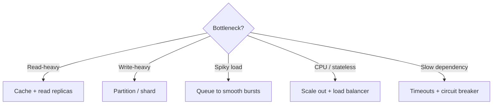

## 1. Core Concept

**Scalability** là khả năng hệ thống xử lý tải tăng bằng cách thêm tài nguyên mà hiệu năng và chi phí vẫn chấp nhận được. Nó đo bằng **throughput** (request/giây), **latency** (đặc biệt **percentile p95/p99**) và **availability**. Mental model: *hệ thống nhanh bằng điểm yếu nhất của nó — scale là tìm **bottleneck** rồi gỡ nó, lặp lại.*

## 2. How It Works

- **Vertical scaling** (scale up): máy mạnh hơn — đơn giản, có trần và là single point of failure. **Horizontal scaling** (scale out): thêm nhiều máy — gần như vô hạn nhưng đòi hỏi **stateless** và phân phối tải.
- **Bốn đòn bẩy**: **replication** (nhân bản để đọc/chịu lỗi), **partitioning/sharding** (chia dữ liệu để ghi), **caching** (tránh tính lại), **asynchronous processing** (queue để làm dịu đỉnh tải).
- **Stateless service**: không giữ state trong process → request nào đến instance nào cũng được; state đẩy ra DB/cache.
- **Ước lượng nhanh (back-of-envelope)**: `1 triệu request/ngày ≈ 12 QPS` trung bình; lấy **peak ≈ 2–5× trung bình**. Dung lượng = số bản ghi × kích thước × replication.
- **Little's Law**: `L = λ × W` — số request đang xử lý = tốc độ đến × thời gian xử lý trung bình; dùng để tính số thread/connection cần.
- **Availability**: 99.9% ≈ 8.76 giờ downtime/năm; 99.99% ≈ 52.6 phút/năm. Hệ thống nối tiếp nhân xác suất: `0.999^5 ≈ 0.995`.
- **Amdahl's Law**: phần tuần tự giới hạn mức tăng tốc tối đa dù thêm bao nhiêu máy.

## 3. Visual Diagram

## 4. Rules of Thumb & Trade-offs

- **Đo trước, scale sau**: tìm bottleneck bằng profiling/metrics; đừng thêm máy vào chỗ không phải điểm nghẽn.
- Bắt đầu đơn giản (một DB + cache + vài instance stateless); chỉ **shard khi thật sự cần** vì chi phí vận hành lớn.
- Thiết kế theo **p99**, không theo trung bình: người dùng cảm nhận độ trễ đuôi.
- Trade-off: scale ngang đổi **đơn giản và nhất quán mạnh** lấy **khả năng mở rộng và chịu lỗi**.

## 5. Must Remember / Production Pitfalls

- **Tail latency amplification**: một request gọi 100 service song song thì p99 của từng service trở thành p50 của tổng.
- **Retry không kiểm soát** biến sự cố nhỏ thành quá tải (retry storm) — cần backoff và giới hạn.
- Trạng thái trong memory (session, cache cục bộ) **cản trở scale ngang**.
- **Single point of failure** ẩn: một DB, một load balancer, một cron, một DNS.
- **Premature scaling** tốn kém: kiến trúc phức tạp cho tải chưa tồn tại.
- Interview trap: luôn hỏi **số liệu** trước (QPS, dữ liệu, read/write ratio, yêu cầu latency) rồi mới vẽ kiến trúc.

## 6. Search Hooks

- `vertical vs horizontal scaling` — scale up và scale out, ưu nhược điểm.
- `stateless service design` — đẩy state ra ngoài để scale ngang.
- `back-of-the-envelope estimation system design` — ước lượng QPS, dung lượng, băng thông.
- `Little's Law` — liên hệ giữa lượng đồng thời, tốc độ đến và thời gian xử lý.
- `tail latency p99 percentiles` — vì sao độ trễ đuôi quan trọng hơn trung bình.
- `availability nines SLA SLO` — cách đọc và tính độ sẵn sàng.
