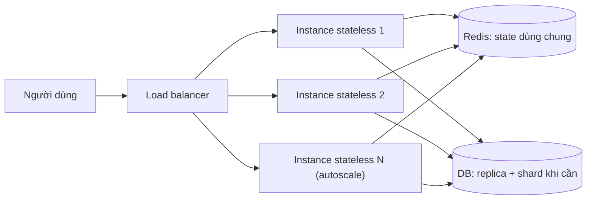

## 1. Core Concept

**Scalability** là khả năng hệ thống **xử lý tải tăng lên** (nhiều người dùng, nhiều dữ liệu, nhiều request) bằng cách **thêm tài nguyên** mà vẫn giữ hiệu năng chấp nhận được. Nó không phải "thêm máy": phải biết **nút thắt nằm ở đâu**, **ước lượng được quy mô**, thiết kế **stateless** để nhân bản, và hiểu **độ trễ đuôi (tail latency)** cùng **mức sẵn sàng** thể hiện bằng SLO.

**Mental model:** hệ thống như **một nhà hàng**: thêm bếp trưởng giỏi hơn (vertical) có giới hạn; thêm nhiều bếp song song (horizontal) cần **công thức không phụ thuộc người nấu (stateless)** và **quầy phát món không nghẽn**. Khách quan tâm **món chậm nhất trong bàn** (tail latency), không phải thời gian trung bình.

## 2. How It Works

**Vertical vs horizontal**
- **Vertical (scale up)**: máy mạnh hơn — đơn giản, không đổi kiến trúc, nhưng **có trần**, đắt và vẫn là điểm lỗi đơn. **Horizontal (scale out)**: thêm nhiều máy — gần như không có trần, chịu lỗi tốt, nhưng cần **load balancer, dữ liệu phân tán, xử lý nhất quán**.

**Stateless service → Điều kiện để scale ngang**
- Không giữ **state phiên trong bộ nhớ** của instance; state ra **DB/cache dùng chung** (Redis), request nào cũng có thể rơi vào instance nào. Khi đó thêm/bớt/thay instance an toàn (autoscaling).

**Back-of-the-envelope → Ước lượng nhanh**
- Mốc thường dùng: **1 ngày = 86.400 giây (~10⁵)**. Ví dụ **1 triệu người dùng hoạt động/ngày × 10 request = 10⁷ request/ngày ≈ 115 request/giây trung bình**; **peak thường gấp 3–5 lần** → ~350–600 rps. Lưu trữ: 1 triệu bản ghi × 1 KB ≈ **1 GB**; 100 byte × 10⁹ = **100 GB**. Dùng để chọn kiến trúc đúng cỡ (một máy hay nhiều shard?).

**Little's Law → Quan hệ tải, độ trễ và đồng thời**
- **`L = λ × W`**: số request **đang xử lý đồng thời** `L` = **tốc độ đến** `λ` × **thời gian xử lý trung bình** `W`. Ví dụ **100 rps × 0,2 s = 20 request đồng thời** → cần ít nhất ~20 worker/kết nối; nếu `W` tăng lên 2 s thì cần ~200 → hết thread pool.

**Tail latency (p99) → Quan trọng hơn trung bình**
- **p99 = 1% request chậm nhất**. Với **fan-out**: nếu một request gọi **100** dịch vụ và mỗi dịch vụ có **1%** khả năng chậm, xác suất cả 100 đều nhanh là `0,99¹⁰⁰ ≈ 37%` ⇒ **~63%** request gặp ít nhất một lời gọi chậm. Cách giảm: **timeout**, **hedged request**, cache, giảm fan-out.

**Availability nines → SLA, SLO, SLI**
- **99,9%** ≈ **8,76 giờ ngừng/năm** (≈ 43,8 phút/tháng); **99,99%** ≈ **52,6 phút/năm**; **99,999%** ≈ **5,26 phút/năm**. **SLI** (chỉ số đo), **SLO** (mục tiêu nội bộ), **SLA** (cam kết với khách, có phạt); **error budget** = 1 − SLO. Dịch vụ **nối tiếp** nhân SLA: `99,9% × 99,9% ≈ 99,8%`.

**Nút thắt và các đòn bẩy**
- Tìm **bottleneck** (CPU, I/O, DB, mạng) bằng đo lường; đòn bẩy: **cache, CDN, bất đồng bộ/hàng đợi, read replica, sharding, tối ưu truy vấn/index**. **Amdahl's law**: phần tuần tự giới hạn mức tăng tốc dù thêm bao nhiêu máy.

```python
dau, req_per_user = 1_000_000, 10
avg_rps = dau * req_per_user / 86_400          # ≈ 115 rps
peak_rps = avg_rps * 4                         # ≈ 460 rps
concurrent = peak_rps * 0.2                    # Little: 0.2 s mỗi request ≈ 92 đồng thời
```

## 3. Visual Diagram



## 4. Rules of Thumb & Trade-offs

| Tình huống / Nhu cầu | Chọn gì |
| --- | --- |
| Cần tăng nhanh, đơn giản, tải còn vừa | Scale up (vertical) |
| Cần chịu lỗi và tăng gần như vô hạn | Scale out (horizontal) + stateless |
| Chọn cỡ kiến trúc | Ước lượng back-of-the-envelope |
| Tính cỡ pool/đồng thời | Little's Law |
| Fan-out nhiều dịch vụ | Chú ý p99, timeout, hedging |
| Cam kết độ sẵn sàng | SLO + error budget |

- **Được gì:** chịu tải lớn, chịu lỗi. **Mất gì:** độ phức tạp phân tán (nhất quán, vận hành), chi phí hạ tầng; **tối ưu sớm khi chưa đo** là sai lầm phổ biến.

## 5. Must Remember / Production Pitfalls

- **Thêm instance nhưng mất đăng nhập/giỏ hàng → state lưu trong bộ nhớ instance → đưa state ra Redis/DB, thiết kế stateless**.
- **Trung bình ổn nhưng người dùng phàn nàn chậm → p99 cao do fan-out/GC/tranh chấp → theo dõi p95/p99, timeout, hedged request**.
- **Hết thread/kết nối khi độ trễ backend tăng → Little's Law (L = λW) → timeout, giới hạn đồng thời, backpressure**.
- **Thêm máy mà không nhanh hơn → nút thắt ở DB hoặc phần tuần tự (Amdahl) → đo bottleneck, cache, tách đọc/ghi**.
- **Cam kết 99,99% nhưng chuỗi phụ thuộc nối tiếp nhiều dịch vụ → SLA tổng thấp hơn từng thành phần → tính SLA nối tiếp, thêm dự phòng**.
- Interview trap: "scale up vs scale out?" → **scale up có trần và là điểm lỗi đơn, scale out cần stateless**; "99,9% là bao lâu ngừng?" → **~8,76 giờ/năm (43,8 phút/tháng)**; "Little's Law?" → **L = λ × W**.

## 6. Search Hooks

- `vertical vs horizontal scaling` — hai hướng mở rộng.
- `stateless service design` — thiết kế để nhân bản dễ.
- `back-of-the-envelope estimation` — ước lượng nhanh quy mô.
- `Little's Law` — quan hệ tải, độ trễ và đồng thời.
- `tail latency p99` — độ trễ đuôi và fan-out.
- `availability nines SLA SLO` — mức sẵn sàng và error budget.
