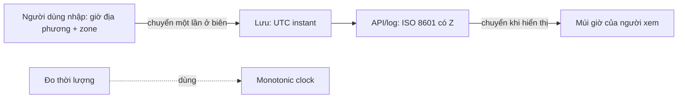

## 1. Core Concept

**Thời gian** là nguồn bug âm thầm lớn: múi giờ, giờ mùa hè (DST), giây nhuận, đồng hồ máy lệch, và đặc biệt là **nhầm một "thời điểm" (instant) với một "giờ trên đồng hồ treo tường" (wall time)**. Quy tắc nền: **lưu và truyền thời điểm bằng UTC**, **chỉ chuyển sang múi giờ người dùng khi hiển thị**, đo khoảng thời gian bằng **đồng hồ monotonic** và **không tin đồng hồ của máy khác**.

**Mental model:** có **hai khái niệm** khác nhau: **instant** (một điểm duy nhất trên trục thời gian toàn cầu, như "khoảnh khắc đội tuyển ghi bàn") và **wall time** (con số trên đồng hồ treo tường ở một nơi, như "9 giờ sáng" — mơ hồ nếu không biết nơi nào). Mọi bug thời gian đều là **trộn lẫn hai thứ**.

## 2. How It Works

**Instant, local time và zoned time**
- **Instant**: điểm trên trục thời gian (UTC/epoch). **Local date-time** (`2026-03-08 02:30`) **chưa xác định** cho tới khi biết **múi giờ**. **Zoned date-time** = local + zone (`Asia/Ho_Chi_Minh`). Lưu trong DB dạng `timestamptz` (PostgreSQL chuẩn hoá về UTC) hoặc **epoch**, không lưu local time không kèm zone.

**UTC + IANA time zone**
- Dùng **tên múi giờ IANA** (`America/New_York`, `Asia/Ho_Chi_Minh`) chứ **không dùng offset cố định** (`-05:00`): offset **đổi theo DST và theo luật từng nước** (ví dụ Việt Nam không có DST, UTC+7 quanh năm; New York đổi UTC−5 ↔ UTC−4). Cơ sở dữ liệu tz được cập nhật khi luật đổi.

**DST → Giờ không tồn tại và giờ lặp**
- Giờ chuyển **"nhảy tới"** (02:00 → 03:00) làm **02:30 không tồn tại**; giờ chuyển **"lùi"** (02:00 → 01:00) làm **01:30 xuất hiện hai lần**. Ngày DST dài **23 hoặc 25 giờ**, nên "cộng 86.400 giây" **khác** "cộng 1 ngày lịch".

**Đồng hồ vật lý → Wall clock và monotonic**
- **Wall clock** có thể **nhảy** (NTP chỉnh, người quản trị đổi giờ, giây nhuận) — `System.currentTimeMillis`, `time.time()`. **Monotonic clock** **chỉ tiến**, dùng **đo khoảng thời gian/timeout** — `System.nanoTime`, `time.monotonic()`, `performance.now()`. Dùng wall clock để đo thời lượng có thể cho **kết quả âm**.

**Đồng hồ phân tán → Không tin timestamp chéo máy**
- Đồng hồ các máy **lệch nhau** (mili-giây đến giây dù có NTP). Dùng timestamp từ hai máy để quyết định "ai ghi sau" (**last-write-wins**) có thể **mất dữ liệu**. Dùng **đồng hồ logic** (**Lamport**, **vector clock**), **hybrid logical clock**, hoặc cơ chế thứ tự do hệ thống quyết định (Spanner dùng **TrueTime** với khoảng bất định).

**Định dạng và biểu diễn**
- **ISO 8601 / RFC 3339** cho API và log: `2026-11-21T09:30:00Z` hoặc `2026-11-21T16:30:00+07:00`; tránh `03/04/2026` (3 tháng 4 hay 4 tháng 3?). **Epoch**: cẩn thận **giây vs mili-giây**, và **Year 2038** với số 32-bit.

**Sự kiện tương lai theo giờ địa phương**
- "Họp 9:00 sáng hằng ngày ở Berlin" nên lưu **local time + zone** (luật DST có thể đổi), không phải một UTC cố định; ngược lại **sự kiện đã xảy ra** thì lưu UTC.

```python
from datetime import datetime, timezone
from zoneinfo import ZoneInfo
now = datetime.now(timezone.utc)                       # instant, lưu cái này
vn = now.astimezone(ZoneInfo("Asia/Ho_Chi_Minh"))      # chỉ để hiển thị
import time; t0 = time.monotonic(); work(); elapsed = time.monotonic() - t0  # đo thời lượng
```

## 3. Visual Diagram



## 4. Rules of Thumb & Trade-offs

| Tình huống / Nhu cầu | Chọn gì |
| --- | --- |
| Lưu thời điểm sự kiện | UTC (`timestamptz`/epoch) |
| Hiển thị cho người dùng | Chuyển sang IANA zone của họ |
| Đo thời lượng/timeout | Monotonic clock |
| Lịch hẹn lặp lại theo giờ địa phương | Local time + IANA zone |
| Truyền qua API/log | ISO 8601 / RFC 3339 |
| Cron | Chạy theo UTC |
| Xác định thứ tự giữa các máy | Đồng hồ logic, không so timestamp vật lý |

- **Được gì:** UTC đơn giản và so sánh được. **Mất gì:** mất ngữ nghĩa giờ địa phương cần cho lịch/nhắc hẹn (khi đó phải lưu thêm zone); đồng hồ logic phức tạp hơn timestamp.

## 5. Must Remember / Production Pitfalls

- **Giờ sai một tiếng sau ngày DST → cộng 86.400 giây thay vì 1 ngày lịch → dùng phép cộng theo lịch của thư viện chuẩn**.
- **Không khôi phục được thời điểm thật → lưu local time không kèm zone → lưu UTC hoặc kèm IANA zone**.
- **Độ trễ âm/timeout sai khi NTP chỉnh đồng hồ → đo bằng wall clock → monotonic clock**.
- **Cron chạy 0 hoặc 2 lần vào ngày DST → cron theo giờ địa phương → chạy theo UTC**.
- **Mất dữ liệu khi last-write-wins giữa các node → so timestamp lệch đồng hồ → đồng hồ logic/version, thứ tự do hệ thống quyết định**.
- **Parse ngày mơ hồ (`03/04/2026`) hoặc nhầm giây/mili-giây → luôn dùng ISO 8601 và đơn vị rõ ràng**.
- Interview trap: "vì sao không lưu offset +07:00 thay cho tên múi giờ?" → **offset không mã hoá luật DST hay thay đổi tương lai của vùng**; "đo thời lượng dùng đồng hồ nào?" → **monotonic**; "so timestamp hai máy để biết ai trước?" → **không tin được, dùng đồng hồ logic**.

## 6. Search Hooks

- `UTC vs local time storing timestamps` — lưu thời điểm tuyệt đối và hiển thị theo múi giờ.
- `IANA time zone database DST pitfalls` — vì sao dùng tên múi giờ và bẫy giờ mùa hè.
- `monotonic clock vs wall clock` — đồng hồ đo khoảng thời gian và đồng hồ treo tường.
- `ISO 8601 RFC 3339 timestamps` — định dạng thời gian chuẩn cho API.
- `Falsehoods programmers believe about time` — danh sách các giả định sai về thời gian.
- `Lamport clocks vector clocks` — đồng hồ logic thay cho đồng hồ vật lý.
