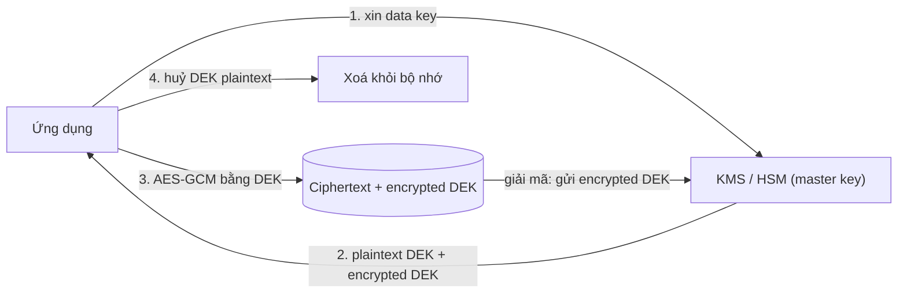

## 1. Core Concept

Mật mã học thực dụng cho kỹ sư xoay quanh bốn mục tiêu: **confidentiality** (bí mật), **integrity** (toàn vẹn), **authenticity** (xác thực nguồn gốc) và **non-repudiation** (chống chối bỏ). Quy tắc số một: **không tự chế thuật toán, dùng thư viện chuẩn** và chọn **primitive đúng mục đích** — sai primitive (hash để mã hoá, MD5 để băm mật khẩu) là lỗi phổ biến nhất.

**Mental model:** mỗi primitive là một **công cụ khác nhau**: **hash** như dấu vân tay một chiều; **mã hoá đối xứng** như khoá chung cho khoá và mở; **bất đối xứng** như hộp thư (ai cũng bỏ thư vào được bằng public key, chỉ chủ mở bằng private key); **chữ ký** như con dấu chứng thực.

## 2. How It Works

**Hash và băm mật khẩu**
- **Hash** (SHA-256) một chiều, nhanh — **không dùng trực tiếp cho mật khẩu**: GPU thử hàng tỷ hash/giây. Mật khẩu cần **hàm chậm, có salt, tốn bộ nhớ**: **argon2id** (khuyên dùng), **bcrypt**, **scrypt/PBKDF2**. **Salt** ngẫu nhiên riêng từng người chống rainbow table; **pepper** là bí mật bổ sung lưu ngoài DB.

**Mã hoá đối xứng: AES-GCM**
- **AES-GCM** là **authenticated encryption (AEAD)**: vừa **bí mật** vừa **phát hiện sửa đổi** (auth tag). **Nonce/IV không được lặp lại với cùng key** (lặp nonce trong GCM làm lộ key/plaintext thảm hoạ). Tránh **ECB** (lộ mẫu) và **CBC không xác thực** (padding oracle). Key 128/256 bit.

**Đối xứng vs bất đối xứng**
- **Đối xứng**: nhanh, mã hoá dữ liệu lớn, nhưng phải **chia sẻ khoá**. **Bất đối xứng** (RSA ≥ 2048, ECDSA/Ed25519): chậm, dùng cho **trao đổi khoá, chữ ký, TLS handshake**; thực tế **kết hợp**: bất đối xứng thoả thuận khoá, đối xứng mã hoá dữ liệu.

**HMAC vs chữ ký số**
- **HMAC**: xác thực bằng **khoá bí mật chung**; ai có khoá đều tạo được → **không chống chối bỏ**; dùng giữa hai hệ thống tin nhau (webhook signature). **Digital signature**: ký bằng **private key**, xác minh bằng **public key** → xác thực nguồn gốc và **non-repudiation**.

**Envelope encryption (KMS data key)**
- Mã hoá dữ liệu lớn bằng **data key (DEK)** cục bộ, rồi **mã hoá DEK bằng master key (KEK)** trong **KMS/HSM**. Lưu `{ciphertext, encrypted DEK}`. Lợi: master key **không rời KMS**, mã hoá nhanh cục bộ, **xoay khoá** chỉ cần re-wrap DEK, kiểm soát bằng IAM và audit.

**So sánh nhanh theo mục đích**
- Băm mật khẩu → **argon2id**; mã hoá dữ liệu → **AES-GCM/ChaCha20-Poly1305**; ký/xác minh → **Ed25519/ECDSA**; xác thực webhook → **HMAC-SHA256**; số ngẫu nhiên bảo mật → **CSPRNG** (không `Math.random`).

```python
import os
from cryptography.hazmat.primitives.ciphers.aead import AESGCM
key = AESGCM.generate_key(bit_length=256)
nonce = os.urandom(12)                       # nonce DUY NHẤT cho mỗi lần mã hoá với cùng key
ct = AESGCM(key).encrypt(nonce, b"secret", b"aad")   # ct gồm cả auth tag
pt = AESGCM(key).decrypt(nonce, ct, b"aad")          # sai/sửa -> raise InvalidTag
```

## 3. Visual Diagram



## 4. Rules of Thumb & Trade-offs

| Nhu cầu | Dùng |
| --- | --- |
| Lưu mật khẩu | argon2id (hoặc bcrypt) + salt |
| Mã hoá dữ liệu | AES-256-GCM / ChaCha20-Poly1305 |
| Mã hoá dữ liệu lớn trên cloud | Envelope encryption với KMS |
| Xác thực webhook giữa hai bên tin nhau | HMAC-SHA256 |
| Chống chối bỏ, xác minh công khai | Chữ ký số (Ed25519/ECDSA) |
| Sinh token/key | CSPRNG |

- **Được gì:** bảo vệ dữ liệu có cơ sở toán học. **Mất gì:** hàm băm mật khẩu chậm tốn CPU/RAM (có chủ đích), quản lý khoá và xoay khoá phức tạp, sai cấu hình mất toàn bộ bảo đảm.

## 5. Must Remember / Production Pitfalls

- **Mật khẩu bị bẻ nhanh sau khi lộ DB → SHA-256/MD5 không salt → argon2id/bcrypt**.
- **Lộ plaintext khi lặp nonce → GCM dùng lại nonce với cùng key → nonce ngẫu nhiên/đếm duy nhất, xoay key**.
- **Dữ liệu bị sửa không phát hiện → dùng CBC/ECB không xác thực → AEAD (AES-GCM)**.
- **Mất kiểm soát khoá → để master key trong code/biến môi trường → KMS/HSM, envelope encryption, IAM**.
- **Token đoán được → dùng `Math.random`/time → CSPRNG**.
- **So sánh HMAC/token bằng `==` → timing attack → so sánh hằng thời gian**.
- Interview trap: "hash vs mã hoá?" → **hash một chiều, mã hoá hai chiều có khoá**; "HMAC vs chữ ký số?" → **HMAC khoá chung không chống chối bỏ, chữ ký dùng khoá bất đối xứng**; "vì sao envelope encryption?" → **master key không rời KMS, xoay khoá rẻ**.

## 6. Search Hooks

- `password hashing argon2id bcrypt` — băm mật khẩu đúng cách.
- `AES-GCM authenticated encryption` — mã hoá kèm xác thực.
- `symmetric vs asymmetric encryption` — khác biệt và cách kết hợp.
- `envelope encryption KMS data key` — mã hoá phong bì với KMS.
- `HMAC vs digital signature` — xác thực bằng khoá chung và khoá bất đối xứng.
- `CSPRNG secure random` — sinh ngẫu nhiên an toàn.
