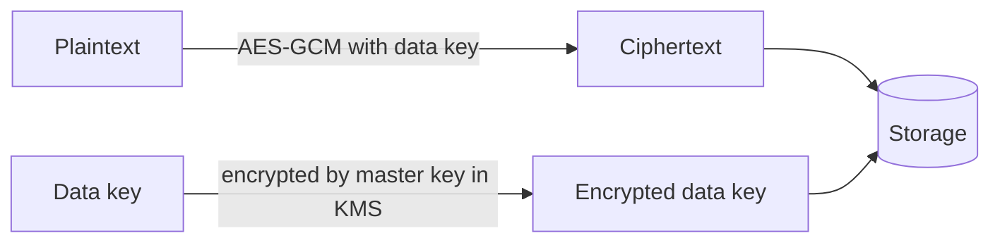

## 1. Core Concept

Mật mã học cho kỹ sư không phải là tự phát minh thuật toán mà là **chọn đúng công cụ cho đúng mục đích**: **bảo mật** (confidentiality — mã hoá), **toàn vẹn** (integrity — hash/MAC), **xác thực** (authenticity — chữ ký số/MAC), và **quản lý khoá**. Mental model: *thuật toán thì công khai và đã được kiểm chứng; **chỉ khoá là bí mật** — nên phần khó nhất của mật mã trong thực tế là **quản lý khoá**, không phải toán học.*

## 2. How It Works

- **Hash** (SHA-256, SHA-3): hàm một chiều, kết quả cố định; **không phải mã hoá**. Dùng cho toàn vẹn, định danh nội dung. **MD5/SHA-1 đã hỏng** về va chạm.
- **Password hashing**: dùng hàm **chậm có chủ đích và có salt** — **argon2id**, **bcrypt**, **scrypt** — không dùng SHA-256 thuần. **Salt** duy nhất mỗi mật khẩu chống rainbow table; **pepper** là bí mật chung lưu ngoài DB.
- **Mã hoá đối xứng** (AES): một khoá cho cả mã hoá và giải mã, nhanh. Dùng chế độ **authenticated encryption (AES-GCM, ChaCha20-Poly1305)** vừa mã hoá vừa chống sửa đổi; **nonce/IV không bao giờ được lặp** với cùng khoá.
- **Mã hoá bất đối xứng** (RSA, ECC): cặp khoá công khai/riêng; chậm hơn, dùng để **trao đổi khoá** (ECDH) và **chữ ký số**. Thực tế dùng **hybrid**: bất đối xứng để thoả thuận khoá, đối xứng để mã hoá dữ liệu (đúng cách TLS làm).
- **MAC/HMAC**: xác thực và toàn vẹn bằng khoá chung; **chữ ký số** làm điều đó với khoá riêng/công khai (bất kỳ ai cũng kiểm chứng được).
- **Envelope encryption**: mã hoá dữ liệu bằng **data key**, rồi mã hoá data key bằng **master key** trong **KMS/HSM** — xoay master key không cần mã hoá lại toàn bộ dữ liệu.
- **Ngẫu nhiên**: chỉ dùng **CSPRNG** (`/dev/urandom`, `crypto.randomBytes`), không dùng `Math.random()` cho token/khoá.

## 3. Visual Diagram

## 4. Rules of Thumb & Trade-offs

| Cần | Dùng |
| --- | --- |
| Lưu mật khẩu | **argon2id / bcrypt** + salt |
| Mã hoá dữ liệu | **AES-256-GCM** (hoặc ChaCha20-Poly1305) |
| Kiểm tra dữ liệu không bị sửa (cùng bí mật) | **HMAC-SHA256** |
| Chứng minh nguồn gốc, nhiều bên kiểm | **Chữ ký số (Ed25519/ECDSA/RSA-PSS)** |
| Trao đổi khoá | **ECDH** (qua TLS 1.3) |

- **Đừng tự viết crypto**; dùng thư viện chuẩn (libsodium, thư viện của nền tảng) với cấu hình mặc định an toàn.
- Trade-off: **an toàn vs hiệu năng** (argon2 tốn CPU/RAM có chủ đích; tăng cost theo năm).

## 5. Must Remember / Production Pitfalls

- **Base64/hex không phải mã hoá**; nó chỉ là **mã hoá dạng biểu diễn** — ai cũng giải được.
- **Tái dùng nonce** với AES-GCM làm lộ khoá/plaintext — thảm hoạ.
- **ECB mode** làm lộ mẫu dữ liệu; **mã hoá không xác thực (CBC không MAC)** dễ bị tấn công padding oracle.
- **Khoá cứng trong code/repo** và không có kế hoạch **xoay khoá** là lỗi phổ biến nhất.
- **So sánh MAC/hash bằng `==`** rò rỉ qua timing; dùng so sánh **constant-time**.
- **JWT `alg: none`**, nhầm HS256/RS256 là lỗi triển khai mật mã kinh điển.
- Interview trap: "Hash khác mã hoá thế nào?" → hash **một chiều**, không có khoá giải; mã hoá **hai chiều** với khoá.

## 6. Search Hooks

- `password hashing argon2 bcrypt salt` — lưu mật khẩu an toàn.
- `AES-GCM authenticated encryption nonce` — mã hoá đối xứng kèm toàn vẹn.
- `symmetric vs asymmetric encryption hybrid` — khi nào dùng loại nào và cách kết hợp.
- `envelope encryption KMS data key` — mã hoá dữ liệu bằng data key bảo vệ bởi master key.
- `HMAC vs digital signature` — xác thực bằng khoá chung và khoá công khai.
- `constant-time comparison timing attack` — so sánh không rò rỉ qua thời gian.
