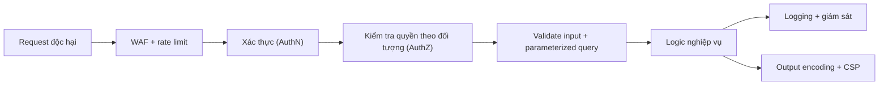

## 1. Core Concept

**OWASP Top 10** là danh sách các **rủi ro bảo mật web phổ biến và nghiêm trọng nhất** (Broken Access Control, Injection, Cryptographic Failures, SSRF…). Hầu hết sự cố đều bắt nguồn từ vài nguyên nhân gốc: **tin input người dùng**, **kiểm tra quyền thiếu**, **cấu hình mặc định** và **thiếu phòng thủ nhiều lớp**. Mục tiêu: nắm **cơ chế tấn công và cách chặn gốc**, không học thuộc tên.

**Mental model:** ứng dụng như **toà nhà nhiều lớp cửa**: kẻ tấn công thử từng ổ khoá. **Defense in depth** nghĩa là mất một lớp vẫn còn lớp khác; **least privilege** nghĩa là ai/cái gì cũng chỉ có chìa cho đúng phòng cần vào.

## 2. How It Works

**Broken Access Control và IDOR (#1)**
- **IDOR**: `GET /orders/1234` trả đơn của người khác vì server **chỉ kiểm tra đã đăng nhập, không kiểm tra sở hữu**. Phòng: **luôn kiểm tra quyền ở server cho từng đối tượng** (`order.userId == currentUser`), deny by default; ID khó đoán **không** thay thế kiểm tra quyền.

**SQL Injection**
- Input được **nối chuỗi** vào truy vấn: `' OR '1'='1`. Phòng: **parameterized queries/prepared statements** (dữ liệu và lệnh tách riêng), ORM dùng đúng cách, **không** nối chuỗi; ép **least privilege** cho tài khoản DB. Escape thủ công và blacklist là **không đủ**.

**XSS, Output Encoding và CSP**
- Kẻ tấn công chèn script chạy trong trình duyệt nạn nhân (đánh cắp session, thao tác thay user). Phòng: **output encoding theo ngữ cảnh** (HTML/attribute/JS/URL), framework auto-escape (không dùng `innerHTML`/`dangerouslySetInnerHTML` với dữ liệu thô), **CSP** hạn chế nguồn script, cookie **HttpOnly + Secure + SameSite**.

**CSRF**
- Trang độc hại khiến trình duyệt gửi request kèm cookie của bạn. Phòng: **SameSite cookie**, **CSRF token**, kiểm tra `Origin`.

**SSRF và cloud metadata**
- Server bị lừa **gọi URL do kẻ tấn công chọn**, truy cập mạng nội bộ hoặc **metadata service** `169.254.169.254` để lấy **credential IAM**. Phòng: **allowlist** host/URL đích, chặn dải IP nội bộ/link-local, giải DNS rồi kiểm tra IP (chống rebinding), dùng **IMDSv2** (bắt buộc token, chặn SSRF đơn giản), không cho đi theo redirect.

**Defense in Depth và Least Privilege**
- Nhiều lớp kiểm soát độc lập: validate input, WAF, kiểm tra quyền, mã hoá, giám sát. Mỗi dịch vụ/tài khoản chỉ có **quyền tối thiểu**; hạn chế **blast radius** khi một lớp thủng.

**Các điểm cốt lõi khác**
- **Cryptographic failures** (mã hoá yếu, lộ dữ liệu), **security misconfiguration** (mặc định, debug bật), **vulnerable components** (thư viện lỗi thời), **authentication failures** (brute force, không MFA), **logging & monitoring** thiếu.

```python
# KHÔNG: nối chuỗi -> SQL injection
cur.execute(f"SELECT * FROM users WHERE email = '{email}'")
# ĐÚNG: parameterized query
cur.execute("SELECT * FROM users WHERE email = %s", (email,))
# IDOR: kiểm tra sở hữu ở server
order = repo.get(order_id)
if order.user_id != current_user.id:
    raise Forbidden()
```

## 3. Visual Diagram



## 4. Rules of Thumb & Trade-offs

| Rủi ro | Phòng chống chính |
| --- | --- |
| Injection (SQL, command) | Parameterized queries, tránh nối chuỗi |
| XSS | Output encoding theo ngữ cảnh, CSP, cookie HttpOnly |
| IDOR / Broken Access Control | Kiểm tra quyền server-side theo đối tượng, deny by default |
| CSRF | SameSite cookie, CSRF token |
| SSRF | Allowlist đích, chặn IP nội bộ, IMDSv2 |
| Thư viện lỗi thời | Dependency scanning, cập nhật |

- **Được gì:** giảm bề mặt tấn công, hạn chế thiệt hại. **Mất gì:** thêm công sức phát triển/kiểm thử, kiểm tra quá chặt có thể gây false positive và giảm trải nghiệm.

## 5. Must Remember / Production Pitfalls

- **Người dùng xem được dữ liệu người khác → chỉ kiểm tra đăng nhập → kiểm tra sở hữu theo từng đối tượng (IDOR)**.
- **Dữ liệu bị đánh cắp qua truy vấn → nối chuỗi SQL → parameterized queries**.
- **Credential IAM bị lấy từ server → SSRF tới metadata → IMDSv2, allowlist, chặn IP nội bộ**.
- **Script lạ chạy trên trang → render input thô → output encoding, CSP**.
- **Chỉ validate ở client → dễ bị bypass → luôn validate/authorize ở server**.
- **Một lớp phòng thủ duy nhất → thủng là mất hết → defense in depth, least privilege**.
- Interview trap: "chống SQL injection?" → **parameterized queries, không escape thủ công**; "UUID có chống IDOR?" → **không, phải kiểm tra quyền**; "SSRF nguy hiểm thế nào trên cloud?" → **lấy credential từ metadata service**.

## 6. Search Hooks

- `OWASP Top 10` — danh sách rủi ro web hàng đầu.
- `SQL injection parameterized queries` — chặn injection bằng truy vấn tham số hoá.
- `XSS output encoding CSP` — chống chèn script.
- `SSRF IMDSv2 cloud metadata` — chặn truy cập metadata qua SSRF.
- `IDOR broken access control` — thiếu kiểm tra quyền theo đối tượng.
- `defense in depth least privilege` — nhiều lớp phòng thủ, quyền tối thiểu.
