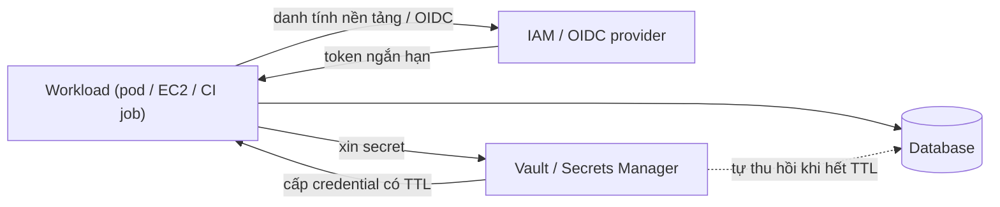

## 1. Core Concept

**Secrets management** là cách **lưu, cấp phát, xoay vòng và thu hồi** thông tin nhạy cảm (mật khẩu DB, API key, token, chứng chỉ) mà **không để lộ trong code, Git, log hay image**. Hướng tốt nhất hiện nay: **ít secret dài hạn nhất có thể** — dùng **danh tính workload và credential ngắn hạn** thay vì khoá tĩnh.

**Mental model:** secret như **chìa khoá phòng server**. Cách tệ nhất là **dán chìa lên cửa (commit vào Git)**. Cách tốt là **không phát chìa cố định**: mỗi lần cần, **người gác cổng (Vault/IAM) cấp thẻ tạm** chỉ mở đúng phòng trong vài phút rồi **tự hết hạn**.

## 2. How It Works

**Nguyên tắc chung**
- **Không hard-code**, không đưa vào image/env file commit. Lưu trong **secrets manager** (AWS Secrets Manager, Azure Key Vault, HashiCorp Vault). Áp dụng **least privilege**, **mã hoá at-rest**, **audit log** mỗi lần truy cập, **rotation** định kỳ và khi nghi ngờ lộ. Tách secret theo môi trường.

**Dynamic secrets (Vault)**
- Thay vì một mật khẩu DB dùng chung mãi, Vault **tạo user DB tạm thời theo yêu cầu** (TTL vài phút–giờ, quyền tối thiểu) và **tự thu hồi khi hết hạn**. Lợi: **không có secret dài hạn để lộ**, mỗi workload có credential riêng → truy vết và thu hồi từng cái.

**Secret zero và Workload Identity**
- **Secret zero** là bài toán gà–trứng: để lấy secret cần có credential ban đầu — vậy lưu credential đó ở đâu? Lời giải: **workload identity** nền tảng cấp danh tính cho workload (IAM role gắn EC2/ECS/EKS, **IRSA**, Azure **Managed Identity**, GCP Workload Identity); workload **chứng minh danh tính bằng nền tảng**, không cần mang secret nào.

**OIDC federation cho CI/CD**
- Pipeline (GitHub Actions) lấy **token OIDC ngắn hạn** do GitHub phát, **đổi lấy role cloud tạm thời** (`AssumeRoleWithWebIdentity`) qua **trust policy** giới hạn repo/branch → **không lưu AWS key dài hạn** trong CI secrets.

**Secret scanning và pre-commit**
- **Pre-commit hooks** (gitleaks, detect-secrets) chặn commit chứa secret; **secret scanning** trên repo/CI (và GitHub push protection) bắt lọt. **Khi lộ: coi như đã bị lộ vĩnh viễn → thu hồi/xoay ngay**, xoá khỏi history chỉ là bước phụ (đã bị crawler thu).

```yaml
# GitHub Actions: không lưu AWS key, dùng OIDC -> role tạm thời
permissions: { id-token: write, contents: read }
steps:
  - uses: aws-actions/configure-aws-credentials@v4
    with:
      role-to-assume: arn:aws:iam::123456789012:role/gha-deploy
      aws-region: ap-southeast-1
```

## 3. Visual Diagram



## 4. Rules of Thumb & Trade-offs

| Tình huống / Nhu cầu | Chọn gì |
| --- | --- |
| Truy cập AWS/Azure từ workload | Workload identity (IAM role/Managed Identity), không dùng key |
| CI/CD deploy lên cloud | OIDC federation |
| Mật khẩu DB cho nhiều service | Dynamic secrets (Vault) hoặc rotation tự động |
| Ngăn secret vào Git | Pre-commit + secret scanning + push protection |
| Secret đã lộ | Thu hồi/xoay ngay |

- **Được gì:** ít secret dài hạn, thu hồi nhanh, audit rõ. **Mất gì:** thêm hạ tầng (Vault) và độ phức tạp, phụ thuộc availability của secrets manager, cần thiết kế cache/fallback.

## 5. Must Remember / Production Pitfalls

- **Key AWS bị đào bới trên GitHub → commit secret → thu hồi ngay, xoay, bật push protection**.
- **Lộ secret qua log/biến môi trường dump → in ra khi lỗi → che secret trong log, không in env**.
- **Một mật khẩu DB dùng chung mọi nơi → blast radius lớn, khó xoay → dynamic secrets/credential riêng từng service**.
- **Ứng dụng sập vì secret hết hạn → rotation không phối hợp → rotation hai pha, ứng dụng tải lại secret**.
- **Secrets manager chết làm cả hệ thống chết → phụ thuộc cứng → cache có TTL, retry, thiết kế HA**.
- **Lưu AWS key trong CI secrets → khoá dài hạn → OIDC federation, trust policy theo repo/branch**.
- Interview trap: "secret zero là gì?" → **credential ban đầu để lấy secret; giải bằng workload identity**; "bị commit secret thì làm gì trước?" → **thu hồi/xoay, rồi mới dọn history**; "dynamic secrets lợi gì?" → **credential tạm, riêng từng workload, tự hết hạn**.

## 6. Search Hooks

- `secrets management best practices` — thực hành quản lý secret.
- `HashiCorp Vault dynamic secrets` — credential tạm theo yêu cầu.
- `OIDC federation GitHub Actions AWS` — CI không cần khoá dài hạn.
- `secret scanning pre-commit gitleaks` — chặn secret vào Git.
- `workload identity IRSA Managed Identity` — danh tính workload thay secret tĩnh.
- `secret zero problem` — bài toán credential khởi đầu.
