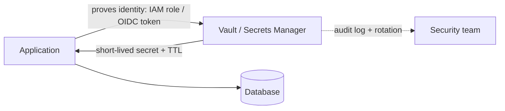

## 1. Core Concept

**Secret** (mật khẩu DB, API key, private key, token) là thứ cho phép hành động nhân danh hệ thống; lộ một secret thường đồng nghĩa mất quyền kiểm soát. **Secrets management** là việc **lưu, cấp phát, xoay vòng và kiểm toán** secret để chúng **không nằm trong code, ngắn hạn và chỉ đúng chủ thể mới lấy được**. Mental model: *đừng "giấu" secret — hãy **loại bỏ chúng** bằng danh tính (identity) và credentials ngắn hạn bất cứ khi nào có thể.*

## 2. How It Works

- **Không bao giờ commit secret**: lịch sử Git giữ mãi; bot quét GitHub tìm key lộ trong **vài phút**. Dùng **pre-commit hook + secret scanning** (gitleaks, GitHub push protection).
- **Nơi lưu**: **Secrets Manager / Vault / Key Vault / Parameter Store (SecureString)**, mã hoá bằng KMS, có **IAM, audit log, versioning**. Không dùng file `.env` commit lên repo hay biến môi trường làm nơi lưu chính.
- **Cấp phát cho ứng dụng bằng danh tính**: **IAM role / managed identity / workload identity** để ứng dụng **tự lấy** secret lúc chạy; không phải nhúng credential để lấy secret (bài toán "secret zero").
- **Credentials ngắn hạn**: **STS** token tạm thời, **dynamic secrets** (Vault tạo user DB riêng có TTL cho mỗi lần dùng), **OIDC federation** cho CI/CD (GitHub Actions nhận role AWS không cần lưu access key).
- **Xoay vòng (rotation)**: tự động theo lịch và khi nghi ngờ lộ; thiết kế ứng dụng hỗ trợ **hai secret hợp lệ cùng lúc** để xoay không downtime.
- **Phân quyền tối thiểu**: mỗi service chỉ đọc secret của mình; tách secret theo môi trường (dev/staging/prod).
- **Kubernetes Secret** mặc định chỉ **base64**, không mã hoá: bật **encryption at rest** hoặc dùng **External Secrets/CSI driver** lấy từ vault.

## 3. Visual Diagram

## 4. Rules of Thumb & Trade-offs

- Thứ tự ưu tiên: **không cần secret (identity)** > **credentials ngắn hạn tự động** > **secret lưu trong vault, xoay vòng** > (tránh) secret tĩnh dài hạn.
- **Tách cấu hình khỏi secret**: cấu hình không nhạy cảm để trong config; secret ở kho riêng.
- Phát hiện lộ → **thu hồi và xoay vòng ngay**, rồi mới điều tra; xoá khỏi Git không làm secret an toàn trở lại.
- Trade-off: **vault tập trung** tăng an toàn và audit nhưng thêm **điểm phụ thuộc/độ trễ** — cache có TTL và thiết kế khi vault không sẵn sàng.

## 5. Must Remember / Production Pitfalls

- **Xoá secret khỏi commit mới nhất không đủ**: nó vẫn nằm trong lịch sử và các bản clone/fork; phải **thu hồi**.
- **Secret trong log, error message, URL, biến CI in ra** — che (mask) và không log header Authorization.
- **Một secret dùng chung cho mọi môi trường/service** làm bán kính ảnh hưởng khi lộ cực lớn.
- **Quên xoay vòng** và secret của nhân viên đã nghỉ vẫn hoạt động.
- Interview trap: "Lưu secret ở đâu?" → trả lời bằng **identity + vault + credentials ngắn hạn**, không phải "trong `.env`".

## 6. Search Hooks

- `secrets management best practices` — lưu, cấp phát, xoay vòng và audit secret.
- `HashiCorp Vault dynamic secrets` — credentials sinh theo yêu cầu, có TTL.
- `AWS Secrets Manager rotation` — xoay secret tự động trên AWS.
- `OIDC federation CI/CD GitHub Actions AWS` — CI nhận quyền tạm thời không lưu key.
- `gitleaks secret scanning pre-commit` — phát hiện secret trước khi commit.
- `secret zero problem workload identity` — dùng danh tính thay cho credential khởi tạo.
