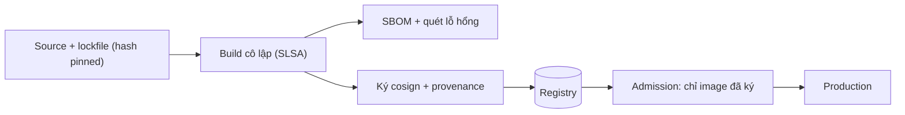

## 1. Core Concept

**Software supply chain security** bảo vệ **toàn bộ đường từ mã nguồn, dependency, build đến artifact chạy production** khỏi bị can thiệp. Phần lớn code bạn chạy là **của người khác** (thư viện, base image, build tool), nên kẻ tấn công nhắm vào **mắt xích yếu nhất**: package độc hại, build server bị chiếm, artifact bị thay. Mục tiêu: **biết bạn chạy cái gì, nó đến từ đâu, và chứng minh nó không bị sửa**.

**Mental model:** như **chuỗi cung ứng thực phẩm**: bạn cần **nhãn thành phần (SBOM)**, **niêm phong chống tháo (chữ ký)**, **hồ sơ nhà máy (provenance)** và **chỉ nhập từ nhà cung cấp đã kiểm duyệt**. Một lô nguyên liệu bẩn đầu chuỗi làm hỏng mọi thứ cuối chuỗi.

## 2. How It Works

**Các hình thức tấn công**
- **Dependency confusion**: kẻ tấn công đăng package công khai **trùng tên package nội bộ** với version cao hơn → build kéo nhầm gói độc. **Typosquatting**: tên gần giống (`reqeusts`). **Compromised maintainer/package** (event-stream), **malicious install script**, **build system compromise** (SolarWinds).

**Lockfile và reproducible build**
- **Lockfile** (`package-lock.json`, `poetry.lock`, `go.sum`) **ghim version + hash** → cùng input cho cùng dependency; dùng lệnh cài **nghiêm ngặt** (`npm ci`, `pip install --require-hashes`). **Reproducible build**: cùng source cho **artifact giống hệt từng bit** → bên thứ ba **xác minh** binary khớp source. Ghim base image theo **digest** (`@sha256:…`), không chỉ tag `latest`.

**SBOM**
- **Software Bill of Materials** liệt kê thành phần và phiên bản (định dạng **SPDX**, **CycloneDX**), sinh bằng **Syft**. Giá trị: khi có CVE mới (Log4Shell) biết **ngay hệ thống nào bị ảnh hưởng**; kết hợp quét lỗ hổng (Grype, Trivy, Dependabot).

**Ký artifact và provenance**
- **Sigstore/cosign**: ký image/artifact bằng **danh tính ngắn hạn (keyless, OIDC)** và ghi vào **transparency log (Rekor)**; admission controller trên Kubernetes **chỉ cho chạy image đã ký đúng**. **Provenance** (attestation) ghi **ai build, từ commit nào, ở đâu**.

**SLSA**
- Khung **mức độ trưởng thành** của build: L1 (có provenance) → L2 (build hosted, provenance ký) → L3 (**build cô lập, chống giả mạo**). Bảo vệ **build pipeline** như production: quyền tối thiểu, runner ephemeral, bảo vệ nhánh, review bắt buộc.

**Phòng thủ dependency confusion**
- **Scoped/namespaced package** (`@company/x`), cấu hình registry **ưu tiên nguồn nội bộ**, **đặt trước tên** nội bộ trên registry công khai, chặn tên nội bộ từ nguồn ngoài, **allowlist registry**.

```bash
# Build chặt: cài đúng lockfile, sinh SBOM, quét lỗ hổng, ký image theo digest
npm ci --ignore-scripts
syft packages dir:. -o cyclonedx-json > sbom.json
grype sbom:sbom.json --fail-on high
cosign sign --yes registry.example.com/app@sha256:abc123...
```

## 3. Visual Diagram



## 4. Rules of Thumb & Trade-offs

| Rủi ro | Biện pháp |
| --- | --- |
| Dependency confusion | Scoped package, ưu tiên registry nội bộ, giữ chỗ tên |
| Thư viện có CVE | SBOM + quét liên tục + tự động cập nhật |
| Artifact bị thay | Ký cosign + xác minh khi admission |
| Build khác nhau mỗi lần | Lockfile + base image theo digest + reproducible build |
| Pipeline bị chiếm | Runner ephemeral, quyền tối thiểu, SLSA L3 |
| Script cài đặt độc hại | `--ignore-scripts`, review dependency mới |

- **Được gì:** truy vết được, phát hiện/chặn thay đổi trái phép. **Mất gì:** thêm bước CI/công cụ, ma sát cập nhật dependency, cần quản lý khoá/danh tính ký.

## 5. Must Remember / Production Pitfalls

- **Build kéo nhầm package công khai trùng tên nội bộ → dependency confusion → scoped package, registry nội bộ ưu tiên**.
- **Không biết bị ảnh hưởng bởi CVE nào → thiếu SBOM → sinh và lưu SBOM mỗi build, quét liên tục**.
- **Cùng tag nhưng nội dung đổi → tag `latest` có thể bị ghi đè → ghim theo digest**.
- **Image lạ chạy được trong cluster → không kiểm chữ ký → admission controller yêu cầu cosign**.
- **Pipeline CI bị chiếm → quyền quá rộng, token dài hạn → OIDC, runner ephemeral, bảo vệ nhánh**.
- **Cập nhật tự động kéo bản độc hại → tin mù → review, cooldown, quét trước khi merge**.
- Interview trap: "dependency confusion là gì?" → **package công khai trùng tên nội bộ, version cao hơn**; "SBOM dùng làm gì?" → **biết thành phần để phản ứng nhanh khi có CVE**; "lockfile có đủ không?" → **không, cần ghim hash/digest và bảo vệ build**.

## 6. Search Hooks

- `software supply chain security SLSA` — khung bảo vệ chuỗi cung ứng phần mềm.
- `SBOM SPDX CycloneDX` — danh sách thành phần phần mềm.
- `dependency confusion typosquatting` — tấn công qua tên package.
- `Sigstore cosign artifact signing` — ký và xác minh artifact.
- `lockfiles reproducible builds` — ghim phụ thuộc và build tái lập.
- `in-toto provenance attestation` — bằng chứng nguồn gốc build.
