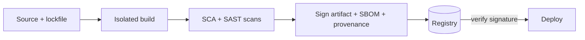

## 1. Core Concept

Ứng dụng hiện đại có **70–90% code là thư viện bên thứ ba**, cộng với công cụ build, image nền và pipeline CI. **Software supply chain security** bảo vệ **toàn bộ chuỗi** từ mã nguồn → dependency → build → artifact → triển khai, vì kẻ tấn công nhắm vào mắt xích yếu nhất. Mental model: *bạn chạy code của hàng nghìn người lạ — hãy biết mình đang dùng gì, kiểm chứng nó từ đâu tới, và đảm bảo build là lặp lại được.*

## 2. How It Works

- **Dependency scanning (SCA)**: so khớp phiên bản dependency với cơ sở dữ liệu **CVE** (Dependabot, Renovate, Snyk, `npm audit`, `osv-scanner`); xử lý cả **dependency gián tiếp (transitive)**.
- **Lockfile + ghim phiên bản/hash**: `package-lock.json`, `poetry.lock`, `go.sum` để cài **đúng bản đã kiểm duyệt**; CI dùng `npm ci`, không `npm install`.
- **Các kiểu tấn công**: **typosquatting** (gói tên gần giống), **dependency confusion** (gói nội bộ bị gói công khai trùng tên đè lên), **tài khoản maintainer bị chiếm**, **mã độc trong postinstall script**, **image nền độc hại**.
- **SBOM (Software Bill of Materials)**: danh sách thành phần của artifact (SPDX, CycloneDX) để biết ngay mình bị ảnh hưởng khi có lỗ hổng mới (như Log4Shell).
- **Build đáng tin cậy**: build trong môi trường **cô lập, tái lập được (reproducible)**; **ký artifact/image** (Sigstore/cosign) và **kiểm chứng chữ ký + provenance (SLSA)** trước khi triển khai.
- **Bảo vệ pipeline**: quyền tối thiểu cho CI, secret ngắn hạn qua OIDC, **bảo vệ nhánh chính** (review bắt buộc), pin version của **GitHub Actions** theo commit SHA.
- **Image container**: dùng image nền nhỏ/đã xác minh (distroless), quét lỗ hổng, cập nhật định kỳ.

## 3. Visual Diagram

## 4. Rules of Thumb & Trade-offs

- **Ít dependency hơn = ít bề mặt tấn công**: cân nhắc trước khi thêm thư viện cho vài dòng code.
- **Cập nhật thường xuyên theo lô nhỏ** (Renovate) rẻ hơn dồn một cú "nâng cấp lớn" khi có CVE khẩn.
- Ưu tiên theo **khả năng khai thác thực tế** (reachability, EPSS) thay vì chạy theo mọi CVE.
- Trade-off: **an toàn (ghim, kiểm chứng)** vs **tốc độ nhận bản vá**; tự động hoá cập nhật có test để cân bằng.

## 5. Must Remember / Production Pitfalls

- **`npm install` trong CI** có thể kéo bản mới khác bản đã test; dùng lockfile (`npm ci`).
- **Dependency confusion**: cấu hình registry nội bộ ưu tiên và dùng scope/namespace cho package riêng.
- **Quét một lần khi release** là không đủ: lỗ hổng mới xuất hiện **sau** khi bạn đã phát hành → quét liên tục artifact đang chạy.
- **Action/plugin CI ghim theo tag** (`@v3`) có thể bị chiếm và đổi nội dung; ghim theo SHA.
- **AI gợi ý tên package không tồn tại** ("package hallucination") — kẻ tấn công đăng ký đúng tên đó; luôn kiểm tra package có thật, có uy tín.
- Interview trap: "SBOM để làm gì?" → biết nhanh **mình có dùng thành phần bị lỗ hổng không** và ở đâu.

## 6. Search Hooks

- `software supply chain security SLSA` — khung bảo vệ chuỗi cung ứng phần mềm.
- `SBOM SPDX CycloneDX` — danh sách thành phần của phần mềm.
- `dependency confusion typosquatting` — hai kiểu tấn công qua tên package.
- `Sigstore cosign image signing` — ký và kiểm chứng artifact.
- `lockfile npm ci reproducible builds` — cài đúng bản đã kiểm duyệt.
- `Dependabot Renovate vulnerability scanning` — tự động hoá cập nhật dependency.
