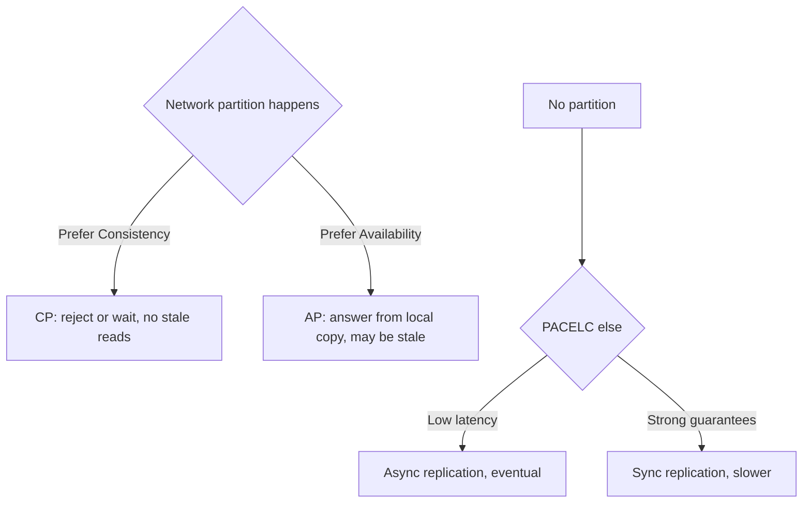

## 1. Core Concept

Khi dữ liệu được nhân bản qua nhiều node, hai bản sao có thể **bất đồng** trong lúc mạng trục trặc. **CAP theorem** nói: khi xảy ra **network partition (P)**, hệ thống phải chọn **Consistency (C)** hoặc **Availability (A)**. **Consistency model** mô tả chính xác "đọc thấy gì sau khi ghi". Mental model: *phân tán nghĩa là phải trả giá — hoặc đồng bộ để nhất quán (chậm/có thể từ chối), hoặc cho phép lệch để luôn trả lời (nhanh/có thể cũ).*

## 2. How It Works

- **CAP**: **Consistency** (mọi đọc thấy ghi mới nhất — nghĩa **linearizability**, khác chữ C trong ACID), **Availability** (mọi request tới node sống đều nhận phản hồi), **Partition tolerance** (chịu được mất liên lạc giữa node). Mạng thực tế **luôn có thể partition** nên lựa chọn thật sự là **CP hay AP khi có partition**.
- **PACELC**: *nếu có Partition thì chọn A hay C; **Else** (bình thường) thì chọn **Latency** hay **Consistency**.* Nhấn mạnh rằng ngay cả khi không lỗi, đồng bộ nhiều bản sao vẫn tốn độ trễ.
- **Mô hình nhất quán** (mạnh → yếu): **Linearizable** (như một bản sao duy nhất) → **Sequential** → **Causal** (giữ quan hệ nhân quả) → **Read-your-writes / Monotonic reads** (đảm bảo theo phiên) → **Eventual** (cuối cùng hội tụ).
- **Quorum**: với `N` bản sao, ghi chờ `W` ack, đọc hỏi `R` bản; nếu **`R + W > N`** thì đọc luôn chạm ít nhất một bản mới nhất. Ví dụ `N=3, W=2, R=2`.
- **Leader-based** (một leader nhận ghi, follower sao chép) vs **leaderless** (Dynamo-style, quorum, read repair, hinted handoff).
- **Ví dụ**: **CP** — etcd, ZooKeeper, Spanner (nhất quán mạnh, có thể từ chối khi mất quorum); **AP/tunable** — Cassandra, DynamoDB (mặc định eventually consistent, có tuỳ chọn đọc mạnh).

## 3. Visual Diagram

## 4. Rules of Thumb & Trade-offs

| Cần | Chọn |
| --- | --- |
| Số dư tài khoản, tồn kho, lock/leader election | **Nhất quán mạnh** (CP, chấp nhận chậm/từ chối) |
| Feed, đếm lượt xem, giỏ hàng, danh mục | **Eventual** (AP, ưu tiên sẵn sàng + nhanh) |
| UX cần "thấy cái mình vừa ghi" | **Read-your-writes** theo phiên |

- Chọn nhất quán **theo từng use case**, không theo cả hệ thống.
- Trade-off: **Consistency vs Availability vs Latency**.

## 5. Must Remember / Production Pitfalls

- **"Chọn 2 trong 3" là cách hiểu sai**: P không phải tuỳ chọn; CAP chỉ nói về hành vi **khi có partition**.
- **C của CAP ≠ C của ACID**: CAP-C là linearizability; ACID-C là ràng buộc toàn vẹn.
- **Đọc từ replica** (read replica, cache) có thể **cũ**: người dùng vừa lưu xong lại thấy dữ liệu cũ — dùng đọc từ leader sau khi ghi hoặc sticky session.
- **Clock skew** làm "last write wins" mất dữ liệu; cần version/vector clock hoặc đồng hồ logic.
- **Quorum không tự đảm bảo linearizability** nếu có sloppy quorum/hinted handoff.
- Interview trap: "Hệ thống X là CP hay AP?" → trả lời kèm **điều kiện và cấu hình** (nhiều hệ thống tuỳ chỉnh được).

## 6. Search Hooks

- `CAP theorem` — chọn nhất quán hay sẵn sàng khi có network partition.
- `PACELC theorem` — mở rộng CAP với đánh đổi độ trễ khi bình thường.
- `linearizability vs eventual consistency` — hai đầu phổ mô hình nhất quán.
- `quorum reads and writes R+W>N` — điều kiện đảm bảo đọc thấy ghi mới nhất.
- `read-your-writes consistency` — đảm bảo người dùng thấy chính dữ liệu họ vừa ghi.
- `Jepsen consistency analysis` — kiểm chứng thực nghiệm tính nhất quán của DB phân tán.
