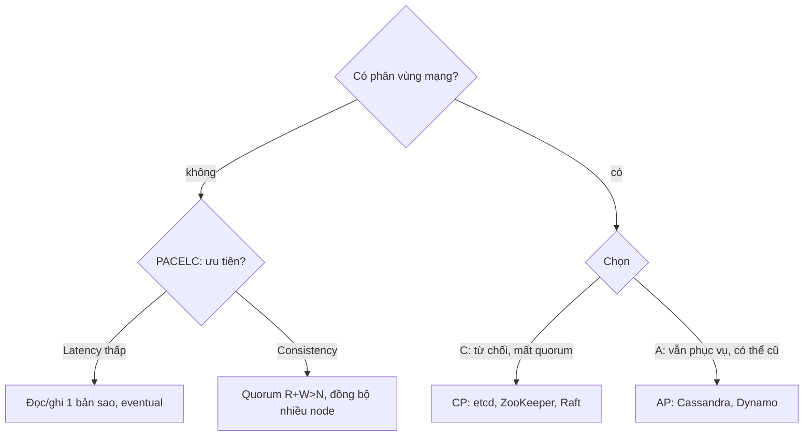

## 1. Core Concept

**CAP** nói rằng khi một hệ thống phân tán gặp **phân vùng mạng (partition)**, nó **không thể đồng thời** đảm bảo cả **Consistency** (mọi đọc thấy ghi mới nhất, hiểu theo nghĩa **linearizability**) và **Availability** (mọi request tới node còn sống đều nhận được phản hồi): phải **chọn một**. Vì phân vùng mạng là thứ **không thể loại bỏ**, lựa chọn thực tế là **CP** (từ chối/chặn khi phân vùng để giữ nhất quán) hay **AP** (vẫn phục vụ nhưng có thể trả dữ liệu cũ). Các **mô hình nhất quán** mô tả "mức đúng" ở khoảng giữa hai cực.

**Mental model:** hai chi nhánh ngân hàng mất liên lạc. **CP**: cả hai ngừng rút tiền cho tới khi nối lại (an toàn, nhưng khách bực). **AP**: cả hai vẫn cho rút, sau này đối chiếu và sửa (tiện, nhưng có thể rút vượt số dư). Không có lựa chọn "vừa an toàn tuyệt đối vừa luôn phục vụ" khi đường dây bị đứt.

## 2. How It Works

**Hiểu đúng CAP**
- Không phải "chọn 2 trong 3 mọi lúc": **khi không có phân vùng**, hệ thống có thể vừa C vừa A; CAP chỉ ràng buộc **trong lúc phân vùng**. "C" của CAP (linearizability) **khác "C" của ACID** (ràng buộc toàn vẹn).
- **CP**: ZooKeeper, etcd, các DB dùng consensus (Raft/Paxos); khi mất quorum thì từ chối ghi/đọc. **AP**: Cassandra, DynamoDB (chế độ mặc định) — vẫn phục vụ và **hội tụ sau**.

**PACELC → Cả khi không có phân vùng**
- **Nếu Partition thì chọn A hay C; Else (bình thường) chọn Latency hay Consistency.** Ngay cả khi mạng ổn, nhất quán mạnh **tốn độ trễ** (phải chờ đồng bộ nhiều node/Region). Đây là lý do DynamoDB/Cassandra có chế độ đọc/ghi **tunable**.

**Phổ mô hình nhất quán (từ mạnh đến yếu)**
- **Linearizability**: hoạt động như một bản sao duy nhất, theo thứ tự thời gian thực. **Sequential/causal**: giữ thứ tự nhân quả. **Read-your-writes**: bạn luôn thấy ghi của chính mình. **Monotonic reads**: không "quay ngược thời gian". **Eventual consistency**: nếu ngừng ghi, mọi bản sao **cuối cùng** hội tụ, nhưng trong lúc đó có thể đọc dữ liệu cũ.

**Quorum → Tinh chỉnh bằng R và W**
- Với **N** bản sao, ghi chờ **W** xác nhận, đọc hỏi **R** node: nếu **R + W > N** thì tập đọc và tập ghi **giao nhau**, đọc thấy ghi mới nhất. **Ví dụ N = 3, W = 2, R = 2**: chịu được mất 1 node; **W = 1, R = 1** nhanh nhưng có thể đọc cũ. **Sloppy quorum + hinted handoff** giữ khả dụng khi node lỗi.

**Xử lý xung đột (AP)**
- **Last-write-wins** (đơn giản, có thể mất cập nhật), **vector clock** (phát hiện xung đột để ứng dụng hoà giải), **CRDT** (cấu trúc tự hợp nhất như bộ đếm, tập hợp).

**Kiểm chứng**
- **Jepsen** kiểm thử thực tế các DB xem chúng có giữ đúng cam kết nhất quán khi lỗi mạng/crash không; đừng tin quảng cáo.

## 3. Visual Diagram

## 4. Rules of Thumb & Trade-offs

| Tình huống / Nhu cầu | Chọn gì |
| --- | --- |
| Số dư tài khoản, khoá phân tán, điều phối | CP / linearizability |
| Giỏ hàng, feed, bộ đếm lượt xem, chấp nhận trễ | AP / eventual consistency |
| Người dùng phải thấy bài vừa đăng của mình | Read-your-writes |
| Đọc thấy ghi mới nhất với N=3 | R + W > N (ví dụ W=2, R=2) |
| Hai bản ghi xung đột ở AP | LWW, vector clock hoặc CRDT |
| Độ trễ đa Region thấp | Nới lỏng nhất quán (eventual) |

- **Được gì:** hiểu để chọn đúng cho từng dữ liệu. **Mất gì:** nhất quán mạnh đổi lấy độ trễ và khả dụng; nhất quán yếu đổi lấy phức tạp ở tầng ứng dụng (xử lý dữ liệu cũ, xung đột).

## 5. Must Remember / Production Pitfalls

- **Hiểu CAP là "chọn 2 trong 3 luôn luôn" → thiết kế sai → CAP chỉ ràng buộc khi có phân vùng; ngoài đó là PACELC**.
- **Người dùng đăng bài rồi không thấy bài của mình → đọc từ replica trễ → read-your-writes (đọc leader/sticky replica sau khi ghi)**.
- **Mất cập nhật khi hai bên ghi đồng thời ở AP với LWW → đồng hồ lệch và ghi đè → CRDT hoặc hoà giải ở ứng dụng**.
- **Nhầm "C" của CAP với "C" của ACID → giải thích sai → CAP-C là linearizability, ACID-C là ràng buộc toàn vẹn**.
- **Tin cam kết "strong consistency" của DB mà chưa kiểm chứng → bất ngờ khi lỗi mạng → đọc phân tích Jepsen, test lỗi mạng**.
- Interview trap: "chọn 2 trong 3 của CAP?" → **luôn có P; câu hỏi là C hay A khi phân vùng**; "R + W > N để làm gì?" → **tập đọc giao tập ghi nên thấy ghi mới nhất**; "PACELC thêm gì?" → **đánh đổi latency vs consistency cả khi không phân vùng**.

## 6. Search Hooks

- `CAP theorem` — đánh đổi nhất quán và khả dụng khi phân vùng.
- `PACELC theorem` — mở rộng CAP cho cả lúc bình thường.
- `linearizability vs eventual consistency` — hai đầu của phổ nhất quán.
- `quorum reads writes R+W>N` — đảm bảo đọc thấy ghi mới nhất.
- `read-your-writes consistency` — người dùng luôn thấy ghi của mình.
- `Jepsen consistency analysis` — kiểm chứng cam kết nhất quán của DB.
