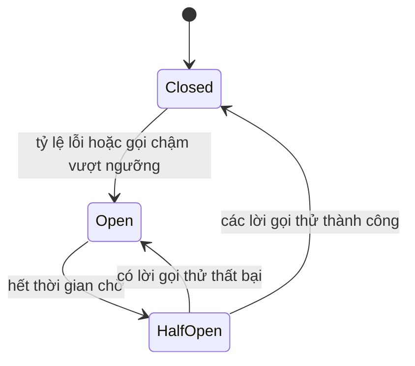

## 1. Core Concept

**Circuit Breaker** là cơ chế bảo vệ ứng dụng khi một dependency (service khác, DB, API ngoài) bắt đầu lỗi hoặc chậm: thay vì tiếp tục gọi và **dồn thread vào chờ**, nó **ngắt mạch** và **fail fast** trong một khoảng thời gian, cho dependency có thời gian hồi phục. Nó giải quyết **cascading failure** — một service chậm kéo sập cả chuỗi service phụ thuộc vào nó.

**Mental model:** như **cầu dao điện trong nhà**: khi quá tải, cầu dao **tự ngắt** để bảo vệ cả hệ thống dây; sau một lúc bạn **thử đóng lại** (half-open) và nếu ổn thì dòng điện chảy tiếp, nếu vẫn chập thì ngắt lại. Không có cầu dao, một thiết bị chập có thể cháy cả nhà.

## 2. How It Works

**Ba trạng thái → Closed, Open, Half-Open**
- **Closed**: gọi bình thường và **đếm lỗi** trong cửa sổ trượt (ví dụ 20 lời gọi gần nhất hoặc 60 giây).
- **Open**: khi vượt ngưỡng (ví dụ **tỷ lệ lỗi ≥ 50%** hoặc **tỷ lệ gọi chậm cao**), mạch **mở**: mọi lời gọi **thất bại ngay lập tức** (hoặc trả **fallback**) mà không chạm dependency, trong **thời gian chờ** (ví dụ 30 giây).
- **Half-Open**: sau thời gian chờ cho phép **một vài lời gọi thử** (ví dụ 3); nếu **thành công** thì về **Closed**, nếu **thất bại** thì về **Open** lại.

**Vì sao cần → Cạn thread**
- Ví dụ: service A có 200 thread, dependency B bắt đầu trả lời sau **30 giây**; chỉ cần **7 request mỗi giây** là 200 thread bị treo hết trong vài chục giây, A không phục vụ được cả những request không liên quan đến B. Timeout ngắn + circuit breaker + bulkhead ngăn việc này.

**Các cơ chế đi kèm → Khả năng chịu lỗi theo lớp**
- **Timeout**: bắt buộc, vì breaker chỉ biết lỗi khi lời gọi **kết thúc** (kể cả bị timeout).
- **Bulkhead**: **cô lập tài nguyên** (pool thread/semaphore riêng cho từng dependency) để một dependency lỗi không ăn hết tài nguyên chung.
- **Retry với backoff + jitter**: chỉ retry lỗi **tạm thời và idempotent**; retry không kiểm soát **khuếch đại tải** khi dependency đang yếu (**retry storm**).
- **Fallback**: trả dữ liệu cache, giá trị mặc định hoặc chức năng suy giảm (**graceful degradation**).

**Cấu hình thực tế → Mỗi dependency một breaker**
- Breaker **theo từng dependency** (không dùng một breaker toàn cục), ngưỡng dựa trên **tỷ lệ lỗi và gọi chậm** thay vì số lỗi tuyệt đối, **số lời gọi tối thiểu** trước khi đánh giá (tránh mở mạch vì 1/2 lời gọi lỗi). Thư viện: **Resilience4j**, **Polly**, hoặc **service mesh** (outlier detection ở Istio/Envoy).

```java
CircuitBreakerConfig cfg = CircuitBreakerConfig.custom()
    .failureRateThreshold(50)                  // % lỗi để mở mạch
    .slowCallDurationThreshold(Duration.ofSeconds(2))
    .slidingWindowSize(20).minimumNumberOfCalls(10)
    .waitDurationInOpenState(Duration.ofSeconds(30))
    .permittedNumberOfCallsInHalfOpenState(3).build();
```

## 3. Visual Diagram



## 4. Rules of Thumb & Trade-offs

| Tình huống / Nhu cầu | Chọn gì |
| --- | --- |
| Dependency chậm/lỗi làm cạn thread | Timeout + Circuit Breaker |
| Một dependency lỗi không được ảnh hưởng dependency khác | Bulkhead (pool riêng) |
| Lỗi tạm thời, thao tác idempotent | Retry backoff + jitter |
| Cần trả lời dù dependency lỗi | Fallback (cache/mặc định) |
| Cần fail fast ở tầng mạng | Outlier detection của mesh |

- **Được gì:** ngăn lan truyền lỗi, giữ hệ thống phản hồi, cho dependency thời gian hồi phục. **Mất gì:** có thể **từ chối nhầm** khi dependency đã khoẻ trở lại, thêm tham số cần tinh chỉnh và phải thiết kế fallback.

## 5. Must Remember / Production Pitfalls

- **Service A treo theo B chậm → timeout dài hoặc không có timeout → đặt timeout ngắn cho mọi lời gọi ra ngoài**.
- **Mạch mở rồi đóng liên tục (flapping) → ngưỡng quá nhạy hoặc thiếu số lời gọi tối thiểu → tăng cửa sổ, `minimumNumberOfCalls`, thời gian chờ**.
- **Dependency hồi phục chậm dù đã khoẻ → retry storm từ nhiều client → backoff có jitter, retry budget, breaker ở mọi client**.
- **Một breaker dùng chung cho nhiều dependency → một nơi lỗi chặn cả nơi khác → breaker theo từng dependency**.
- **Fallback gây hiệu ứng phụ sai (trả dữ liệu cũ cho thanh toán) → không phân biệt thao tác → chỉ fallback an toàn, thao tác quan trọng thì fail rõ ràng**.
- Interview trap: "Half-Open dùng để làm gì?" → **thử vài lời gọi để kiểm tra dịch vụ đã hồi phục chưa**; "circuit breaker khác retry thế nào?" → **retry thử lại, breaker ngừng gọi khi dependency lỗi**; "vì sao cần bulkhead?" → **cô lập tài nguyên, một dependency lỗi không ăn hết pool chung**.

## 6. Search Hooks

- `circuit breaker pattern Resilience4j` — ngắt mạch khi dependency lỗi.
- `half-open state circuit breaker` — trạng thái thử hồi phục.
- `bulkhead pattern` — cô lập tài nguyên theo dependency.
- `cascading failure` — lỗi lan truyền dọc chuỗi service.
- `retry storm backoff jitter` — retry khuếch đại tải khi hệ thống yếu.
