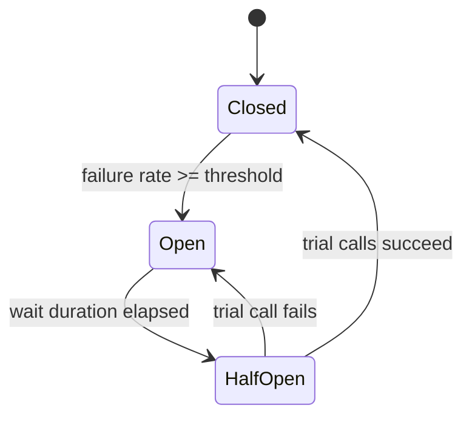

## 1. Core Concept

**Circuit Breaker** bọc lời gọi tới một remote dependency và **fail-fast** khi dependency đó đang lỗi, thay vì để từng request chờ timeout. Nó chặn **Cascading Failure**: một service chậm làm caller cạn thread/connection rồi kéo sập cả chuỗi upstream. Mental model: *cầu dao điện — ngắt mạch để bảo vệ hệ thống, rồi thử đóng lại khi an toàn.*

## 2. How It Works

- **CLOSED**: request đi qua bình thường; breaker ghi nhận kết quả vào **sliding window** (count-based hoặc time-based).
- Khi **failure rate** hoặc **slow call rate** vượt ngưỡng (ví dụ ≥ 50% trên tối thiểu 20 calls) → chuyển **OPEN**.
- **OPEN**: mọi request bị từ chối ngay (`CallNotPermittedException`) và đi vào **fallback**; không có traffic nào chạm dependency trong `waitDurationInOpenState`.
- Hết thời gian chờ → **HALF-OPEN**: cho phép N **trial request**. Đạt ngưỡng thành công → CLOSED; lỗi → quay lại OPEN.
- Breaker nên được tách **theo từng dependency/endpoint**, không dùng chung một breaker cho cả service.

```java
CircuitBreakerConfig config = CircuitBreakerConfig.custom()
    .slidingWindowType(SlidingWindowType.COUNT_BASED)
    .slidingWindowSize(50)
    .minimumNumberOfCalls(20)
    .failureRateThreshold(50)
    .slowCallDurationThreshold(Duration.ofMillis(800))
    .waitDurationInOpenState(Duration.ofSeconds(10))
    .permittedNumberOfCallsInHalfOpenState(5)
    .build();
```

## 3. Visual Diagram



## 4. Rules of Thumb & Trade-offs

- **Dùng khi**: gọi synchronous qua network tới dependency có thể chậm/chết (HTTP, gRPC, DB của service khác, 3rd-party API).
- **Không dùng khi**: lỗi là lỗi nghiệp vụ (4xx, validation) — không được tính vào failure rate; hoặc gọi in-process.
- **Kết hợp đúng thứ tự**: `Bulkhead → TimeLimiter → CircuitBreaker → Retry` (tuỳ thư viện); Retry không có breaker sẽ khuếch đại tải lên dependency đang chết (**retry storm**).
- **Trade-off**: đổi *availability của tính năng* (trả fallback/degraded response) lấy *stability của toàn hệ thống*. Ngưỡng quá nhạy → flapping; quá lỏng → breaker mở muộn.

## 5. Must Remember / Production Pitfalls

- **Timeout là bắt buộc**: không có timeout, breaker không bao giờ thấy lỗi — request chỉ treo.
- **Fallback phải rẻ và an toàn**: cache cũ, default value, hoặc lỗi rõ ràng; fallback gọi một remote service khác có thể tạo thêm một điểm lỗi.
- **minimumNumberOfCalls** quá thấp → breaker mở chỉ vì 2/3 request lỗi lúc traffic thấp.
- **Breaker per instance**: mỗi pod có state riêng; 50 pod nghĩa là 50 breaker mở/đóng không đồng thời — chấp nhận được, đừng cố đồng bộ state qua Redis.
- **Observability**: export metrics state transition, alert khi breaker OPEN kéo dài.
- **Interview trap**: Circuit Breaker không thay thế Retry hay Rate Limiter — nó bảo vệ *caller*, còn Rate Limiter bảo vệ *callee*.

## 6. Search Hooks

- `Circuit Breaker Pattern` — fail-fast khi dependency lỗi để chặn lỗi dây chuyền.
- `Resilience4j CircuitBreaker sliding window` — cấu hình ngưỡng theo count/time window.
- `Half-Open State` — trạng thái thử nghiệm trước khi đóng lại breaker.
- `Bulkhead Pattern` — cô lập thread pool/connection theo dependency.
- `Retry Storm exponential backoff jitter` — tránh retry đồng loạt làm sập dependency.
- `Cascading Failure` — lỗi lan truyền do cạn tài nguyên ở caller.
