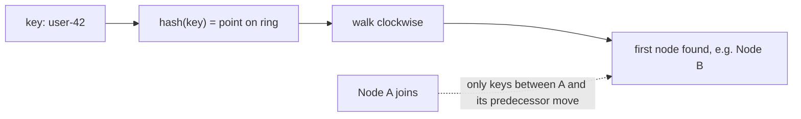

## 1. Core Concept

Khi phân phối key lên `N` node bằng `hash(key) % N`, **đổi `N` làm gần như mọi key đổi node** (≈ `(N−1)/N` key bị chuyển) — cache nguội hàng loạt hoặc phải di chuyển lượng dữ liệu khổng lồ. **Consistent hashing** đặt cả node và key lên cùng một **vòng băm**, nhờ đó thêm/bớt một node chỉ làm di chuyển khoảng **`1/N` số key**. Mental model: *mỗi key đi theo chiều kim đồng hồ đến node đầu tiên gặp — nhổ một node thì chỉ các key của nó chuyển sang hàng xóm.*

## 2. How It Works

- **Vòng băm**: không gian hash (ví dụ `0 … 2^32−1`) nối đầu-đuôi thành vòng.
- **Gán node**: hash định danh node (IP/tên) → một điểm trên vòng. **Gán key**: hash key → điểm trên vòng → **node đầu tiên theo chiều kim đồng hồ**.
- **Thêm node**: node mới chỉ nhận một phần key từ node kế tiếp. **Xoá node**: key của nó chuyển cho node kế tiếp.
- **Virtual nodes (vnodes)**: mỗi node vật lý chiếm **nhiều điểm** (thường 100–256) trên vòng để phân bố đều, và node mạnh hơn có thể có nhiều vnode hơn.
- **Nhân bản**: lưu key trên `R` node liên tiếp theo chiều kim đồng hồ (Cassandra, DynamoDB).
- **Biến thể**: **rendezvous (HRW) hashing** (chọn node có `hash(key, node)` lớn nhất, đơn giản và đều), **jump consistent hash** (không cần lưu vòng, chỉ đánh số node tuần tự), **hash slots** (Redis Cluster chia 16,384 slot rồi gán slot cho node).
- **Ứng dụng**: sharding DB (Cassandra, DynamoDB), cache phân tán (memcached client), load balancer giữ affinity, CDN.

```python
import bisect, hashlib

def h(s: str) -> int:
    return int(hashlib.md5(s.encode()).hexdigest(), 16)

class Ring:
    def __init__(self, nodes, vnodes=100):
        self.ring = sorted((h(f"{n}#{i}"), n) for n in nodes for i in range(vnodes))
        self.keys = [k for k, _ in self.ring]

    def node_for(self, key: str) -> str:
        i = bisect.bisect(self.keys, h(key)) % len(self.ring)
        return self.ring[i][1]
```

## 3. Visual Diagram



## 4. Rules of Thumb & Trade-offs

- Dùng khi **số node thay đổi thường xuyên** (autoscale, node hỏng) và việc di chuyển key tốn kém (cache, shard dữ liệu).
- Số node cố định và ít đổi → `hash % N` hoặc slot cố định đủ đơn giản.
- Luôn dùng **vnodes**; một điểm mỗi node cho phân bố rất lệch.
- Trade-off: **ít di chuyển dữ liệu và chịu thay đổi membership** đổi lấy **độ phức tạp cài đặt và cần đồng bộ thông tin vòng** giữa các node (gossip).

## 5. Must Remember / Production Pitfalls

- **Thiếu vnodes** → node nhận lượng key chênh lệch lớn; một node chết dồn toàn bộ tải sang đúng một hàng xóm.
- Consistent hashing **không giải quyết hot key**: một key quá nóng vẫn dồn vào một node → cần cache cục bộ hoặc nhân bản key.
- Mọi client/node phải **thấy cùng một cấu hình vòng**; cấu hình lệch làm cùng key đến nhiều node khác nhau.
- Khi thêm node, dữ liệu cần được **sao chép sang node mới** trước khi chuyển lưu lượng, nếu không cache miss tăng vọt.
- Interview trap: "Consistent hashing có cân bằng tải hoàn hảo không?" → không; cần vnodes và vẫn có thể lệch theo phân bố key.

## 6. Search Hooks

- `consistent hashing ring virtual nodes` — vòng băm và vnodes.
- `rendezvous hashing HRW` — lựa chọn node thay thế đơn giản, phân bố đều.
- `jump consistent hash` — thuật toán không cần lưu vòng.
- `Redis Cluster hash slots` — chia 16,384 slot cho các node.
- `Dynamo paper consistent hashing replication` — ứng dụng trong hệ lưu trữ phân tán.
- `hash mod N rehashing problem` — vì sao modulo đơn giản gây di chuyển hàng loạt.
