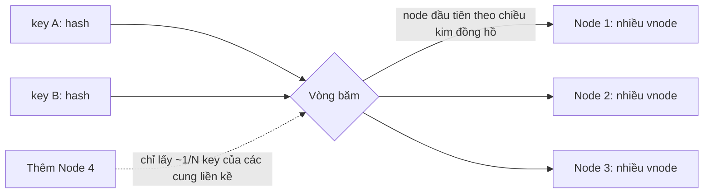

## 1. Core Concept

Khi phân phối dữ liệu/request qua **N node** (cache, shard, LB), cách đơn giản `node = hash(key) mod N` có một nhược điểm chí mạng: **khi N thay đổi (thêm/bớt node), gần như mọi key đổi node** — làm cache mất sạch, dữ liệu phải di chuyển ồ ạt. **Consistent hashing** thiết kế lại để **chỉ khoảng 1/N số key phải di chuyển** khi thêm hoặc bớt một node.

**Mental model:** hãy tưởng tượng **một vòng tròn đồng hồ** có các node đặt ở vài vị trí; mỗi key rơi vào một điểm trên vòng và **thuộc về node đầu tiên gặp khi đi theo chiều kim đồng hồ**. Thêm một node mới chỉ **"cướp" một đoạn cung** từ node kế tiếp, các cung còn lại giữ nguyên.

## 2. How It Works

**Vấn đề của `hash mod N`**
- Ví dụ: 4 node → thêm node thứ 5: key có `h mod 4` đổi sang `h mod 5` — khoảng **80%** key đổi node. Với cache, đó là **cache miss hàng loạt** và quá tải DB; với shard, là di chuyển gần cả dữ liệu.

**Vòng băm (hash ring)**
- Băm cả **node** và **key** vào cùng không gian (ví dụ 0 … 2³²−1) xếp thành vòng. Key thuộc **node gặp đầu tiên theo chiều kim đồng hồ**. **Thêm/bớt một node chỉ ảnh hưởng key trong cung liền kề** (≈ 1/N tổng số key). Để lưu **R bản sao**, chọn **R node khác nhau kế tiếp** trên vòng.

**Virtual nodes (vnode) → Cân bằng tải**
- Mỗi node vật lý được đặt **nhiều điểm (khoảng 100–200 vnode)** trên vòng thay vì một. Lợi ích: **phân phối đều hơn** (một node vật lý không bị một cung lớn bất thường), node **mạnh hơn nhận nhiều vnode hơn**, và khi một node chết tải của nó **rải đều** cho nhiều node thay vì dồn vào một node kế tiếp.

**Các biến thể**
- **Rendezvous (HRW) hashing**: với mỗi key, tính `hash(key, node)` cho mọi node và chọn node **điểm cao nhất**; đơn giản, không cần vòng, độ phức tạp O(N), cũng chỉ di chuyển ≈ 1/N key. **Jump consistent hash**: không tốn bộ nhớ, rất nhanh và đều, nhưng đánh số node **liên tục từ 0** và không xoá được node tuỳ ý (hợp shard tăng dần).
- **Redis Cluster** không dùng vòng mà dùng **16.384 hash slot**: `slot = CRC16(key) mod 16384`; slot được gán cho node và **di chuyển theo slot** khi resharding.

**Ứng dụng**
- Phân phối cache (Memcached client), **Dynamo/Cassandra** (phân vùng và bản sao), **CDN và LB** (Maglev), sharding. Lưu ý: consistent hashing **không giải quyết hot key** — một key quá nóng vẫn dồn vào một node.

```python
import bisect, hashlib
def h(x): return int(hashlib.md5(x.encode()).hexdigest(), 16)
ring = sorted((h(f"{n}#{v}"), n) for n in nodes for v in range(150))   # 150 vnode mỗi node
def owner(key):
    i = bisect.bisect(ring, (h(key), ""))        # node đầu tiên theo chiều kim đồng hồ
    return ring[i % len(ring)][1]
```

## 3. Visual Diagram



## 4. Rules of Thumb & Trade-offs

| Tình huống / Nhu cầu | Chọn gì |
| --- | --- |
| Số node cố định, không đổi | `hash mod N` đủ dùng |
| Số node thay đổi (cache, shard) | Consistent hashing + vnode |
| Muốn đơn giản, N nhỏ | Rendezvous hashing |
| Shard đánh số tăng dần, ít bộ nhớ | Jump consistent hash |
| Redis cluster | Hash slots (16.384) |
| Cần node mạnh nhận nhiều tải hơn | Tăng số vnode theo trọng số |

- **Được gì:** thêm/bớt node chỉ di chuyển ≈ 1/N dữ liệu, mở rộng ít gián đoạn. **Mất gì:** phức tạp hơn hash đơn giản, cần vnode để cân bằng, không giải quyết hot key và cần quản lý metadata vòng.

## 5. Must Remember / Production Pitfalls

- **Thêm một cache node làm DB quá tải vì miss hàng loạt → dùng `hash mod N` → consistent hashing để chỉ ~1/N key bị ảnh hưởng**.
- **Một node nhận tải lớn hơn hẳn → ít vnode nên phân phối lệch → tăng vnode (100–200) hoặc trọng số theo năng lực**.
- **Node chết làm node kế bên sập theo → tải dồn vào một hàng xóm → vnode rải tải, thêm replica**.
- **Một key cực nóng vẫn quá tải một node → hash không giải quyết skew key → cache cục bộ, nhân bản key nóng, tách key**.
- **Cụm Redis resharding chậm → di chuyển theo slot → lên kế hoạch di chuyển slot dần và giám sát**.
- Interview trap: "tại sao không dùng `hash mod N`?" → **đổi N làm gần như mọi key đổi node (khoảng (N−1)/N)**; "vnode để làm gì?" → **cân bằng tải và rải đều khi node lỗi**; "Redis Cluster dùng vòng băm không?" → **không, dùng 16.384 hash slot**.

## 6. Search Hooks

- `consistent hashing ring virtual nodes` — vòng băm và vnode.
- `rendezvous hashing HRW` — chọn node có điểm cao nhất.
- `jump consistent hash` — băm nhất quán không tốn bộ nhớ.
- `Redis Cluster hash slots` — 16.384 slot thay cho vòng băm.
- `hash mod N rehashing problem` — vì sao đổi N làm di chuyển gần hết key.
