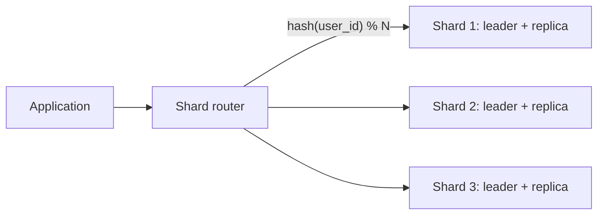

## 1. Core Concept

Một database đơn lẻ có trần về **đọc, ghi và dung lượng**. **Replication** nhân bản dữ liệu qua nhiều node để **chịu lỗi và scale đọc**; **sharding (partitioning)** chia dữ liệu thành các mảnh nằm trên các node khác nhau để **scale ghi và dung lượng**. Mental model: *replication = nhiều bản sao của cùng dữ liệu (nhất quán là vấn đề); sharding = mỗi node giữ một phần khác nhau (truy vấn xuyên mảnh là vấn đề).*

## 2. How It Works

- **Single-leader replication**: ghi vào **leader**, follower sao chép qua log. **Synchronous** (chờ follower, an toàn nhưng chậm), **asynchronous** (nhanh nhưng mất dữ liệu nếu leader chết), **semi-sync** (chờ một follower). Phổ biến nhất (PostgreSQL, MySQL).
- **Multi-leader** (nhiều Region cùng ghi) và **leaderless** (Dynamo-style, quorum) cần **giải quyết xung đột ghi** (last-write-wins, CRDT, hợp nhất ở ứng dụng).
- **Replication lag** gây các dị thường khi đọc từ follower: **không thấy chính dữ liệu vừa ghi**, **đọc lùi thời gian** (monotonic reads bị phá), thấy kết quả không theo thứ tự nhân quả. Cách giảm: đọc từ **leader** sau khi ghi, **sticky replica** theo phiên, hoặc đọc kèm **LSN/token** tối thiểu.
- **Failover**: phát hiện leader chết → bầu follower mới. Rủi ro **split brain** (hai leader) và **mất ghi chưa kịp sao chép**.
- **Sharding strategies**: **range** (dải khoá — range scan tốt nhưng dễ hot shard), **hash** (phân bố đều, mất range scan), **directory/lookup** (bảng ánh xạ linh hoạt nhưng thêm điểm phụ thuộc); thường kết hợp **consistent hashing** để giảm di chuyển dữ liệu khi thêm node.
- **Shard key** quyết định tất cả: cardinality cao, phân bố đều, khớp access pattern chính.
- **Secondary index**: **local** (mỗi shard tự index, truy vấn phải hỏi mọi shard) hoặc **global** (index riêng cũng được phân mảnh).

## 3. Visual Diagram

## 4. Rules of Thumb & Trade-offs

- Thứ tự cân nhắc: **index/cache/query tốt hơn → read replica → scale dọc → partitioning/sharding**; shard là bước cuối vì rất đắt vận hành.
- Đọc nhiều → thêm replica; ghi/dung lượng vượt một node → shard.
- Chọn shard key theo truy vấn phổ biến để **một request chỉ chạm một shard**.
- Trade-off: **Scalability vs. Query flexibility/Consistency/Operational complexity**.

## 5. Must Remember / Production Pitfalls

- **Hot shard**: key đơn điệu tăng (timestamp, auto-increment) dồn mọi ghi vào shard cuối; "celebrity key" làm một shard quá tải.
- **Cross-shard JOIN/transaction** rất đắt hoặc không có → thiết kế để tránh, hoặc dùng Saga.
- **Resharding** (đổi số shard) di chuyển lượng lớn dữ liệu và rất khó; chọn số shard ảo dư từ đầu.
- **ID duy nhất** toàn cục không thể dùng auto-increment từng shard → snowflake/ULID.
- Failover tự động không có **fencing** dễ gây split brain.
- Đọc từ replica rồi **ghi dựa trên giá trị cũ** làm dữ liệu sai.
- Interview trap: "Thêm replica có tăng được throughput ghi không?" → **không**; mọi ghi vẫn đi qua leader.

## 6. Search Hooks

- `database replication leader follower` — mô hình sao chép phổ biến.
- `replication lag read-your-writes` — dị thường khi đọc từ replica trễ.
- `database sharding strategies` — range, hash, directory và cách chọn shard key.
- `hot shard hot partition` — một shard quá tải do phân bố lệch.
- `split brain failover fencing` — hai leader cùng tồn tại và cách ngăn.
- `Vitess Citus sharding` — công cụ sharding cho MySQL và PostgreSQL.
