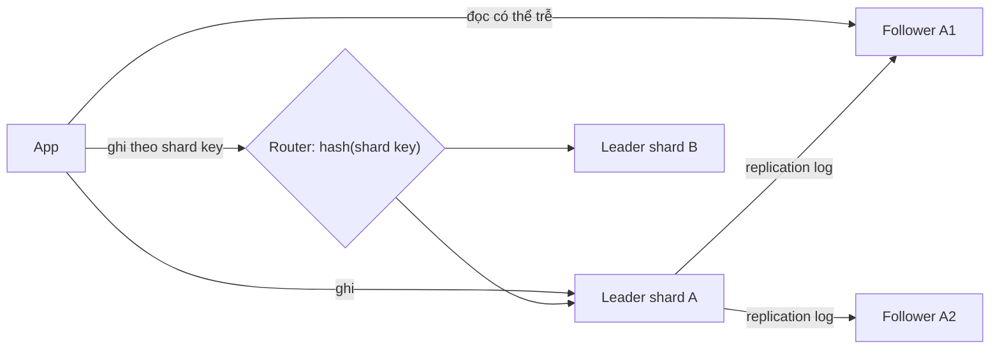

## 1. Core Concept

Một database đơn lẻ có hai giới hạn: **không chịu lỗi** (chết là mất dịch vụ) và **không scale vô hạn** (đọc, ghi, dung lượng). **Replication** (nhân bản dữ liệu qua nhiều node) giải quyết **độ sẵn sàng và scale đọc**; **Sharding** (chia dữ liệu theo chiều ngang qua nhiều node) giải quyết **scale ghi và dung lượng**. Hai kỹ thuật này **trực giao** và thường dùng cùng nhau: mỗi shard có leader và follower riêng.

**Mental model:** replication là **photocopy cuốn sổ cái cho nhiều chi nhánh** (nhiều người đọc cùng một nội dung, một sổ gốc để ghi); sharding là **chia cuốn sổ thành nhiều quyển theo họ tên khách hàng** (mỗi quyển nhỏ hơn, mỗi nhân viên ghi vào quyển của mình).

## 2. How It Works

**Replication → Mô hình leader–follower**
- **Leader** nhận ghi, ghi vào log (WAL/binlog); **follower** áp dụng log. **Đồng bộ** (chờ follower xác nhận: an toàn, chậm, một follower chết có thể chặn ghi), **bất đồng bộ** (leader không chờ: nhanh, nhưng **mất dữ liệu gần nhất nếu leader chết trước khi follower nhận**), **bán đồng bộ** (chờ ít nhất một follower). Ngoài ra còn **multi-leader** và **leaderless** (Dynamo/Cassandra, dùng quorum).

**Replication lag → Các bất thường**
- Follower bất đồng bộ **trễ vài ms đến vài giây**. Hệ quả: **vi phạm read-your-writes** (ghi xong đọc replica không thấy), **monotonic reads** (đọc lần sau thấy dữ liệu cũ hơn lần trước vì chuyển replica), **consistent prefix** (thấy kết quả trước nguyên nhân). Cách giảm: đọc **leader** cho dữ liệu vừa ghi, **gắn người dùng với một replica**, theo dõi vị trí log (LSN/GTID) đã ghi.

**Failover → Split brain và fencing**
- Khi leader chết, **bầu hoặc promote** một follower. Rủi ro **split brain**: hai node cùng tin mình là leader và cùng nhận ghi → dữ liệu phân kỳ. Phòng bằng **quorum/consensus (Raft)**, **fencing token/epoch** (node cũ bị từ chối ghi), và **STONITH** (tắt hẳn node nghi ngờ).

**Sharding → Cách chia**
- **Range** (theo khoảng khoá: truy vấn khoảng hiệu quả, dễ **hot spot** nếu khoá tăng dần), **hash** (phân phối đều, mất tính liên tục), **directory/lookup** (bảng ánh xạ linh hoạt), **địa lý**. **Shard key** là quyết định quan trọng nhất: cardinality cao, phân phối đều, **có mặt trong hầu hết truy vấn**.
- **Hot shard/hot partition**: tải dồn vào một shard dù tổng còn dư (khoá lệch, người dùng đặc biệt đông). **Resharding** (đổi số shard) tốn kém: dùng **consistent hashing hoặc nhiều shard ảo** để di chuyển ít dữ liệu.

**Cái giá của sharding**
- **Truy vấn/join/giao dịch chéo shard** phức tạp (cần scatter–gather, **2PC hoặc saga**), **secondary index** phân tán, sinh ID toàn cục, vận hành khó hơn.

```sql
-- Đọc sau ghi an toàn: sau khi ghi, đọc trên leader (hoặc replica đã đạt LSN đã ghi)
SELECT pg_current_wal_lsn();                      -- trên leader sau khi ghi
-- replica: chỉ phục vụ khi pg_last_wal_replay_lsn() >= LSN đó
```

## 3. Visual Diagram



## 4. Rules of Thumb & Trade-offs

| Tình huống / Nhu cầu | Chọn gì |
| --- | --- |
| Chịu lỗi, scale đọc | Replication (leader–follower) |
| Không được mất dữ liệu đã commit | Đồng bộ/bán đồng bộ (đổi latency) |
| Scale ghi và dung lượng | Sharding |
| Truy vấn theo khoảng | Range sharding |
| Phân phối đều, truy vấn theo khoá | Hash sharding |
| Đọc ngay sau khi ghi | Đọc leader/sticky replica |
| Tránh split brain | Consensus + fencing token |

- **Được gì:** HA, scale đọc, scale ghi. **Mất gì:** replication lag (eventual), mất dữ liệu gần nhất khi failover bất đồng bộ, độ phức tạp truy vấn chéo shard và vận hành; **chỉ shard khi một node (kể cả replica đọc, cache, tối ưu index) không còn đủ**.

## 5. Must Remember / Production Pitfalls

- **Người dùng ghi xong không thấy dữ liệu của mình → đọc replica trễ → đọc leader sau ghi, sticky replica, kiểm tra LSN**.
- **Mất giao dịch gần nhất sau failover → replication bất đồng bộ → bán đồng bộ cho dữ liệu quan trọng và chấp nhận latency**.
- **Hai leader cùng nhận ghi (split brain) → failover không có fencing → quorum, epoch/fencing token, STONITH**.
- **Một shard quá tải dù cụm còn dư → hot shard do shard key lệch → chọn khoá phân phối đều, thêm hậu tố/tách key nóng**.
- **Join giữa shard chậm/không khả thi → dữ liệu không đồng vị trí → thiết kế shard key theo truy vấn, denormalize hoặc co-locate**.
- Interview trap: "replication và sharding khác gì?" → **replication nhân bản cho HA và scale đọc, sharding chia dữ liệu để scale ghi và dung lượng**; "replication lag gây gì?" → **vi phạm read-your-writes/monotonic reads**; "split brain phòng sao?" → **quorum và fencing token**.

## 6. Search Hooks

- `database replication leader follower` — nhân bản leader–follower.
- `replication lag read your writes monotonic reads` — các bất thường do trễ.
- `database sharding strategies range hash` — các cách chia shard.
- `hot shard hot partition` — một shard quá tải.
- `split brain fencing token` — tránh hai leader cùng ghi.
