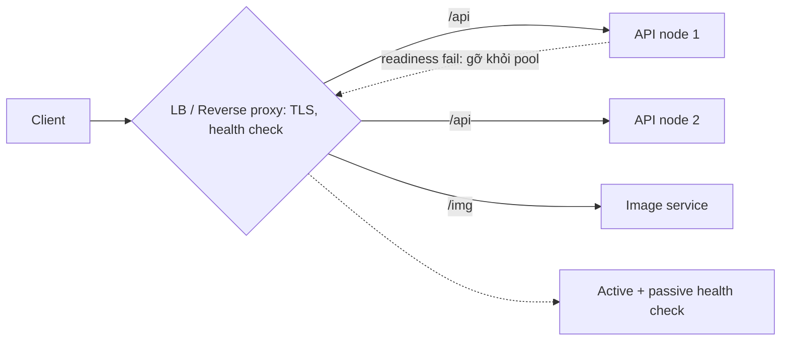

## 1. Core Concept

**Load balancer** phân phối request tới nhiều server backend để **tăng thông lượng, loại bỏ điểm lỗi đơn và cho phép scale ngang**; **reverse proxy** đứng trước backend để làm thêm các việc như **kết thúc TLS, cache, nén, giới hạn tốc độ và định tuyến theo nội dung**. Nhiều sản phẩm (Nginx, HAProxy, Envoy, ALB) làm cả hai vai trò.

**Mental model:** load balancer là **người điều phối cổng sân bay**: nhìn hàng đợi từng quầy (health + tải) rồi chỉ hành khách tới quầy phù hợp; **L4** chỉ nhìn "chuyến bay số mấy" (địa chỉ/cổng), **L7** đọc cả "vé" (URL, header, cookie) để dẫn tới quầy chuyên biệt.

## 2. How It Works

**L4 vs L7 → Quyết định theo tầng nào**
- **L4 (TCP/UDP)**: quyết định theo IP/port, **rất nhanh, ít tốn tài nguyên**, không hiểu HTTP, hợp mọi giao thức. **L7 (HTTP)**: đọc **path, host, header, cookie**, hỗ trợ **định tuyến nội dung** (`/api` → service A, `/img` → service B), **kết thúc TLS**, WAF, retry, rewrite; đổi lại tốn CPU hơn.

**Thuật toán phân phối**
- **Round robin** (lần lượt), **weighted round robin** (theo trọng số máy), **least connections** (chọn node ít kết nối nhất, hợp request dài ngắn không đều), **least response time**, **IP hash/consistent hash** (cùng client/khoá về cùng node, hợp cache cục bộ), **power of two choices** (chọn ngẫu nhiên hai node, lấy node ít tải hơn, tốt và rẻ).

**Health check → Liveness vs readiness**
- **Liveness**: process còn sống không (nếu không, **restart**). **Readiness**: sẵn sàng **nhận traffic** chưa (khởi động xong, đã kết nối DB; nếu không, **gỡ khỏi pool nhưng không restart**). **Active** (LB chủ động ping) và **passive** (thấy lỗi thật thì loại tạm, kiểu outlier detection). Đặt ngưỡng (ví dụ 3 lần fail liên tiếp, chu kỳ 5 giây) để tránh flapping.

**Reverse proxy → Việc làm thêm**
- **TLS termination** (giải mã tại proxy, nội bộ có thể là HTTP hoặc mTLS), **connection pooling/keep-alive** tới backend, **nén**, **cache**, **rate limiting**, thêm `X-Forwarded-For`/`X-Request-Id`.

**Sticky sessions (session affinity)**
- Gắn client với một backend (qua cookie/IP hash) để giữ state phiên cục bộ. **Nhược điểm**: tải không đều, mất phiên khi node chết, khó scale; tốt hơn là **state ra ngoài** (Redis/DB) để backend **stateless**.

**Phân phối toàn cầu → GeoDNS và Anycast**
- **GeoDNS** trả IP khác nhau theo vị trí client (phụ thuộc TTL DNS). **Anycast**: nhiều nơi quảng bá cùng một IP, mạng định tuyến tới nơi gần nhất (CDN, DNS).

**Chính LB cũng phải HA**
- LB bản thân là điểm lỗi đơn nếu chỉ một cái: dùng cặp **active–passive/VIP (keepalived)**, nhiều LB sau DNS/anycast, hoặc **LB managed** của cloud.

```nginx
upstream api {
    least_conn;
    server 10.0.0.11:8080 max_fails=3 fail_timeout=10s;
    server 10.0.0.12:8080 max_fails=3 fail_timeout=10s;
}
server { listen 443 ssl; location /api/ { proxy_pass http://api; } }
```

## 3. Visual Diagram



## 4. Rules of Thumb & Trade-offs

| Tình huống / Nhu cầu | Chọn gì |
| --- | --- |
| TCP/UDP bất kỳ, hiệu năng cao | L4 |
| Định tuyến theo URL/host, WAF, TLS termination | L7 |
| Request thời gian không đều | Least connections / P2C |
| Máy cấu hình khác nhau | Weighted round robin |
| Cache cục bộ cần cùng khoá về cùng node | Consistent hash |
| Phiên đăng nhập | Session ngoài (Redis), tránh sticky |
| Người dùng toàn cầu | GeoDNS / Anycast / CDN |

- **Được gì:** scale ngang, chịu lỗi, triển khai không downtime. **Mất gì:** thêm một hop và một thành phần cần HA; L7 tốn tài nguyên hơn; sticky làm mất cân bằng.

## 5. Must Remember / Production Pitfalls

- **Request đổ vào node vừa khởi động chưa sẵn sàng → chỉ có liveness, không readiness → thêm readiness probe và slow start**.
- **Một node chậm làm cả hệ thống chậm → round robin không biết tải → least connections/P2C, passive health check**.
- **Mất phiên đăng nhập khi node chết → sticky session và state cục bộ → state ra Redis/DB, backend stateless**.
- **LB là điểm lỗi đơn → chỉ một LB → HA/VIP, nhiều LB sau anycast hoặc LB managed**.
- **Failover DNS chậm → client/resolver cache theo TTL → TTL thấp cho bản ghi quan trọng hoặc dùng anycast/LB toàn cầu**.
- Interview trap: "L4 và L7 khác gì?" → **L7 hiểu HTTP (path/header) nên định tuyến theo nội dung, L4 chỉ theo IP/port**; "liveness và readiness?" → **liveness quyết định restart, readiness quyết định có nhận traffic không**; "sticky session có tốt không?" → **tránh nếu được, đưa state ra ngoài**.

## 6. Search Hooks

- `L4 vs L7 load balancing` — cân bằng tải theo tầng mạng khác nhau.
- `load balancing algorithms least connections` — các thuật toán phân phối.
- `liveness vs readiness probe` — hai loại health check.
- `reverse proxy TLS termination` — proxy phía trước backend.
- `sticky sessions session affinity` — gắn client với một node.
- `GeoDNS anycast` — định tuyến toàn cầu theo vị trí.
