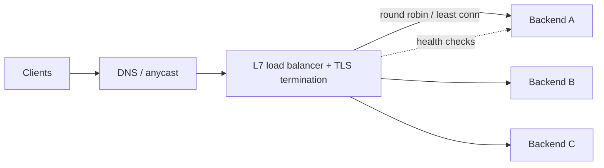

## 1. Core Concept

**Load balancer (LB)** phân phối request tới nhiều backend để tăng **throughput, độ sẵn sàng** và cho phép **scale ngang**; **reverse proxy** đứng trước backend để nhận kết nối thay chúng (TLS termination, cache, nén, routing). Mental model: *LB là "người điều phối cửa vào" — nó phải nhanh, không được là điểm chết duy nhất, và phải biết backend nào còn khoẻ.*

## 2. How It Works

- **Layer 4 (transport)**: chuyển tiếp TCP/UDP theo IP/port, rất nhanh, không hiểu HTTP. **Layer 7 (application)**: hiểu HTTP, định tuyến theo **host/path/header/cookie**, TLS termination, rewrite, WAF. Ví dụ: **Nginx, HAProxy, Envoy**, cloud ALB/NLB.
- **Thuật toán**: **round robin**, **weighted** (backend mạnh nhận nhiều hơn), **least connections** (ít kết nối đang mở), **least response time**, **IP hash/consistent hashing** (cùng client/key → cùng backend, tốt cho cache cục bộ).
- **Health check**: **active** (LB chủ động gọi `/health`) và **passive** (theo dõi lỗi thực của traffic); loại backend lỗi, đưa lại khi khoẻ. Tách **liveness** (process còn sống) và **readiness** (sẵn sàng nhận tải).
- **Sticky session** (session affinity) gắn client vào một backend — tiện nhưng cản scale đều; tốt hơn là **stateless**.
- **Connection draining**: khi gỡ backend, cho request đang chạy hoàn tất.
- **Global load balancing**: **DNS-based (GeoDNS)** hoặc **anycast** đưa người dùng tới Region gần/khoẻ nhất; trong Region là LB cục bộ.
- **Chống LB thành SPOF**: cặp active-standby (VRRP/keepalived), nhiều LB sau DNS/anycast, hoặc dùng dịch vụ managed.

## 3. Visual Diagram

## 4. Rules of Thumb & Trade-offs

- HTTP/HTTPS thông thường → **L7** (routing, observability); TCP/UDP độ trễ cực thấp, giao thức tuỳ ý → **L4**.
- Request có **độ dài đồng đều** → round robin; **độ dài chênh lệch lớn** → **least connections**.
- Cần cache cục bộ hiệu quả → **consistent hashing** theo key thay vì round robin.
- Trade-off: **L7 mạnh nhưng tốn CPU và độ trễ hơn L4**; sticky session đơn giản nhưng mất cân bằng.

## 5. Must Remember / Production Pitfalls

- **Kết nối dài/multiplexed (gRPC, HTTP/2, WebSocket) qua L4 LB** dồn mọi request vào vài backend (cân bằng theo kết nối, không theo request) → dùng L7 hoặc client-side balancing.
- Health check **quá nông** (chỉ trả 200) vẫn gửi traffic vào instance hỏng DB; **quá sâu** (gọi cả dependency) làm cả cụm bị loại khi dependency chậm.
- **Thundering herd** khi backend vừa hồi phục bị dội tải: dùng slow start/warm-up.
- Tin `X-Forwarded-For` từ client là sai — chỉ tin giá trị do proxy của bạn gắn.
- **Retry ở LB** có thể nhân tải lên backend đang yếu; giới hạn retry và dùng circuit breaker.
- Interview trap: "LB có phải single point of failure?" → có, nếu chỉ có một; giải bằng HA pair, anycast hoặc managed multi-AZ.

## 6. Search Hooks

- `L4 vs L7 load balancing` — cân bằng ở tầng transport hay application.
- `load balancing algorithms least connections consistent hashing` — các thuật toán chọn backend.
- `health checks liveness readiness` — phân biệt sống và sẵn sàng phục vụ.
- `reverse proxy TLS termination Nginx HAProxy Envoy` — vai trò proxy đứng trước backend.
- `sticky sessions session affinity` — gắn client vào một backend và hệ quả.
- `GeoDNS anycast global load balancing` — đưa người dùng tới Region gần nhất.
