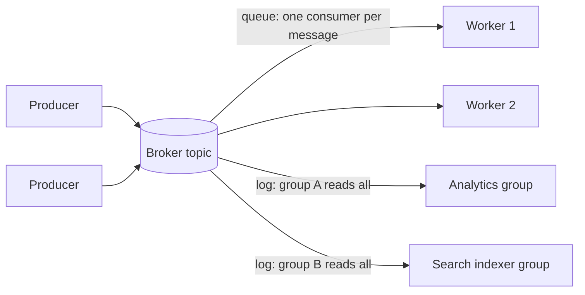

## 1. Core Concept

**Message broker** đứng giữa producer và consumer để **tách rời về thời gian và tốc độ**: producer gửi rồi đi, consumer xử lý khi sẵn sàng. Có hai mô hình: **queue** (mỗi message được xử lý bởi **một** consumer rồi bị xoá) và **log/stream** (message được **giữ lại**, nhiều consumer đọc độc lập và có thể **replay**). Mental model: *queue là "hàng đợi công việc", log là "cuốn sổ cái ghi sự kiện" ai cũng đọc lại được.*

## 2. How It Works

- **Queue (competing consumers)**: nhiều worker cùng lấy từ một hàng đợi để chia việc; broker xoá message sau khi **ack**. Ví dụ **RabbitMQ, Amazon SQS**.
- **Log/stream**: message được **append vào partition**, giữ theo thời gian/dung lượng; consumer theo dõi **offset** của riêng mình; nhiều **consumer group** đọc độc lập. Ví dụ **Kafka, Kinesis, Pulsar**.
- **Pub/Sub**: một message phát tới **nhiều subscriber** (SNS, Redis Pub/Sub, topic RabbitMQ).
- **Ngữ nghĩa giao nhận**: **at-most-once** (ack trước khi xử lý → có thể mất), **at-least-once** (ack sau khi xử lý → có thể trùng), **exactly-once** (thực tế = at-least-once + consumer idempotent).
- **Ack/nack + redelivery**: không ack trong **visibility timeout** thì message được giao lại; vượt số lần thử → **dead-letter queue (DLQ)**.
- **Thứ tự**: thường chỉ đảm bảo **trong một partition/message group**; dùng **key** (ví dụ `orderId`) để cùng key vào cùng partition.
- **Backpressure**: khi consumer chậm hơn producer, hàng đợi dài ra — cần giới hạn, scale consumer hoặc chặn producer.
- **Pull vs push**: pull cho consumer tự điều tốc; push độ trễ thấp nhưng dễ làm tràn consumer.

## 3. Visual Diagram

## 4. Rules of Thumb & Trade-offs

| Cần | Chọn |
| --- | --- |
| Chia việc nền (gửi email, xử lý ảnh), xoá khi xong | **Queue** |
| Nhiều hệ thống cùng nhận một sự kiện, replay, event-driven | **Log/stream** |
| Thông báo nhẹ, mất cũng được | **Pub/Sub đơn giản** |

- Mặc định **at-least-once + consumer idempotent**; đừng dựa vào "exactly-once" của broker.
- Trade-off: broker **tách rời và làm dịu đỉnh tải**, đổi lại **thêm độ trễ, thêm hạ tầng và eventual consistency**.

## 5. Must Remember / Production Pitfalls

- **Poison message** làm consumer crash lặp mãi → giới hạn retry và đẩy sang **DLQ**, có cảnh báo.
- **Dual write** (ghi DB rồi publish) có thể mất event — dùng **outbox pattern**.
- Hàng đợi **tăng không kiểm soát** là dấu hiệu consumer chậm: theo dõi **queue depth / consumer lag** và cảnh báo.
- **Xử lý song song làm mất thứ tự**; nếu thứ tự quan trọng, chia theo key và giữ một consumer/partition.
- **Schema message** là hợp đồng: đổi tuỳ tiện làm vỡ consumer (dùng schema registry, tương thích ngược).
- Interview trap: "Queue và Kafka khác gì?" → queue **xoá sau khi tiêu thụ**, một message một consumer; Kafka **giữ log**, nhiều consumer group, replay được.

## 6. Search Hooks

- `message queue vs event streaming` — hai mô hình broker và khi nào dùng.
- `at-least-once at-most-once exactly-once semantics` — ngữ nghĩa giao nhận message.
- `dead letter queue` — nơi chứa message xử lý thất bại nhiều lần.
- `consumer groups partitions ordering` — cách thứ tự và song song được cân bằng.
- `backpressure in distributed systems` — xử lý khi consumer chậm hơn producer.
- `competing consumers pattern` — nhiều worker chia việc từ một hàng đợi.
