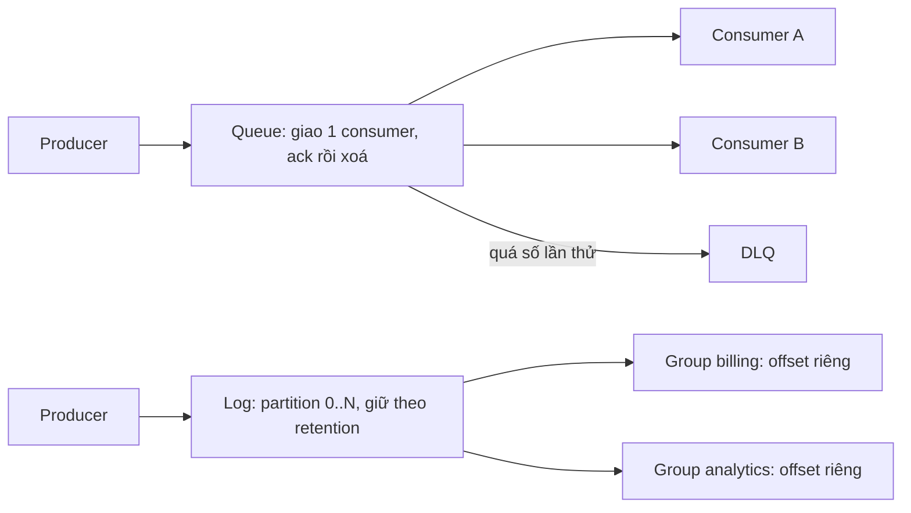

## 1. Core Concept

**Message queue** và **event log (streaming)** đều giúp **tách rời (decouple)** bên gửi và bên nhận, chịu được đột biến tải và cho phép xử lý bất đồng bộ — nhưng chúng là **hai mô hình khác nhau**: queue là **danh sách việc cần làm** (xử lý xong là xoá), log là **cuốn nhật ký chỉ ghi thêm** mà nhiều người có thể đọc đi đọc lại theo tốc độ riêng. Chọn sai mô hình là nguồn gốc của nhiều lỗi thiết kế (mất sự kiện, không replay được, thứ tự sai).

**Mental model:** queue giống **bảng phân việc ở quầy bếp**: mỗi phiếu được **một đầu bếp** nhận, làm xong thì xé đi. Log giống **cuốn sổ ghi chép chung ở phòng họp**: mọi người có thể đọc từ trang nào cũng được, sổ vẫn còn đó sau khi đọc (cho đến khi hết hạn lưu).

## 2. How It Works

**Queue vs Log → Khác nhau cốt lõi**
- **Message queue** (RabbitMQ, SQS, ActiveMQ): message được **giao cho một consumer** (competing consumers), **xác nhận (ack)** từng message rồi **xoá**; hợp **task queue**, tách tải, retry. **Không replay** sau khi đã xoá.
- **Event log** (Kafka, Kinesis, Pulsar): **append-only log chia partition**, **giữ theo retention** (giờ đến ngày), consumer tự quản **offset**; **nhiều consumer group** đọc độc lập, **replay** được; hợp **event streaming**, event sourcing, pipeline dữ liệu.

**Partition, consumer group và thứ tự**
- Thứ tự chỉ đảm bảo **trong một partition**; dùng **partition key** (ví dụ `order_id`) để các sự kiện của một thực thể vào cùng partition. Trong một **consumer group**, mỗi partition do **tối đa một consumer** đọc ⇒ **độ song song bị chặn bởi số partition** (10 partition → tối đa 10 consumer hoạt động).

**Ngữ nghĩa giao hàng**
- **At-most-once** (có thể mất), **at-least-once** (không mất, **có thể trùng**), **exactly-once** (thực tế đạt được bằng **idempotent producer + transaction** trong phạm vi Kafka, hoặc **at-least-once + consumer idempotent** ở biên hệ thống). Mặc định hợp lý: **at-least-once + xử lý idempotent**.

**Dead-letter queue (DLQ)**
- Message vượt số lần thử (**poison message**) được chuyển sang DLQ để điều tra, tránh chặn hàng đợi chính.

**Backpressure → Khi consumer chậm hơn producer**
- Hàng đợi phình, bộ nhớ đầy, độ trễ tăng. Cách xử lý: **queue có giới hạn (bounded)**, **kéo (pull) theo tốc độ consumer**, **rate limit producer**, **thêm consumer**, **giám sát consumer lag**; tuyệt đối không để hàng đợi vô hạn trong bộ nhớ.

**Competing consumers**
- Nhiều consumer cùng đọc một queue để **scale ngang** xử lý; thứ tự giữa các message không được đảm bảo nếu không có phân nhóm.

```python
# Consumer Kafka: at-least-once, idempotent, commit offset sau khi xử lý
for msg in consumer:                         # group.id = "billing"
    if already_processed(msg.key, msg.offset):
        continue                             # khử trùng
    handle(msg)                              # tác dụng phụ
    consumer.commit()                        # chỉ commit sau khi xong
```

## 3. Visual Diagram



## 4. Rules of Thumb & Trade-offs

| Tình huống / Nhu cầu | Chọn gì |
| --- | --- |
| Tách tải, mỗi tác vụ một worker, retry | Message queue |
| Nhiều hệ thống cùng đọc một dòng sự kiện, cần replay | Event log (Kafka) |
| Thứ tự theo thực thể | Partition key = id thực thể |
| Message lỗi lặp | DLQ |
| Consumer chậm hơn producer | Backpressure, bounded queue, thêm consumer |
| Không được mất message | At-least-once + idempotent consumer |

- **Được gì:** decoupling, chịu đột biến, xử lý bất đồng bộ. **Mất gì:** eventual consistency, phải xử lý trùng/thứ tự, thêm hạ tầng; log đánh đổi **độ phức tạp vận hành** lấy khả năng replay và nhiều consumer.

## 5. Must Remember / Production Pitfalls

- **Xử lý trùng gây tác dụng phụ lặp (trừ tiền hai lần) → at-least-once → consumer idempotent theo id/business key**.
- **Thêm consumer mà không nhanh hơn → vượt số partition → tăng partition (cẩn thận thứ tự) hoặc xử lý song song trong consumer**.
- **Thứ tự bị lẫn giữa các sự kiện của một đơn → không có partition key → key theo id thực thể**.
- **Một message lỗi chặn cả hàng đợi → poison message → DLQ, giới hạn retry, cảnh báo DLQ**.
- **Hàng đợi/lag tăng dần rồi sập → không có backpressure → giám sát consumer lag, giới hạn tốc độ producer, scale consumer**.
- Interview trap: "queue khác log thế nào?" → **queue xoá sau ack và không replay; log giữ theo retention, nhiều consumer group và replay được**; "exactly-once có thật không?" → **thực tế là at-least-once + idempotent (hoặc transaction trong Kafka)**; "thứ tự được đảm bảo ở đâu?" → **trong một partition**.

## 6. Search Hooks

- `message queue vs event log Kafka` — hai mô hình messaging.
- `at-least-once vs exactly-once delivery` — ngữ nghĩa giao hàng.
- `dead-letter queue` — nơi chứa message không xử lý được.
- `Kafka consumer groups partitions ordering` — song song và thứ tự.
- `backpressure` — xử lý khi consumer chậm hơn producer.
- `competing consumers pattern` — nhiều worker cùng xử lý một queue.
