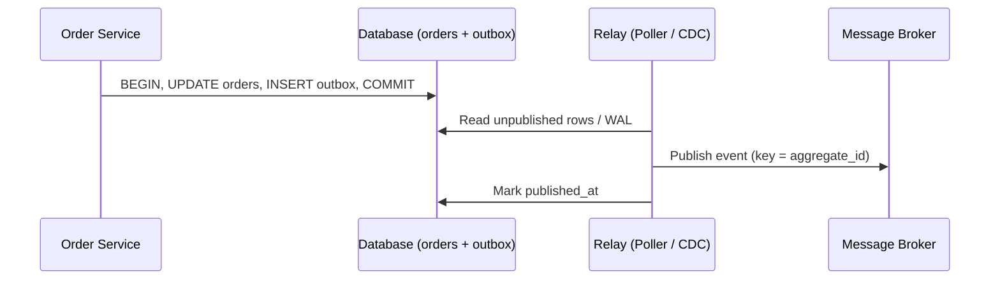

## 1. Core Concept

**Transactional Outbox** ghi business data và event cần publish vào **cùng một local transaction** của Database, sau đó một tiến trình riêng (**Relay**) đọc bảng `outbox` và publish lên Message Broker. Nó giải quyết **Dual-Write Problem** mà không cần **Two-Phase Commit (2PC)**. Mental model: *Database là source of truth duy nhất; Broker chỉ là bản sao eventually consistent của bảng outbox.*

## 2. How It Works

- Service mở transaction → `INSERT/UPDATE` bảng nghiệp vụ → `INSERT` một dòng vào `outbox` (aggregate_id, event_type, payload, created_at) → `COMMIT`. Cả hai cùng thành công hoặc cùng rollback.
- **Message Relay** chuyển dòng outbox lên Broker theo một trong hai cách:
  - **Polling Publisher**: định kỳ `SELECT ... WHERE published_at IS NULL ORDER BY id LIMIT n FOR UPDATE SKIP LOCKED`, publish, rồi đánh dấu `published_at`.
  - **Change Data Capture (CDC)**: Debezium đọc WAL/binlog, stream thay đổi của bảng outbox thẳng vào Kafka (Outbox Event Router).
- Relay có thể crash **sau khi publish nhưng trước khi đánh dấu** → delivery là **at-least-once**, consumer bắt buộc phải **idempotent**.
- Thứ tự chỉ được đảm bảo **theo từng aggregate**: dùng `aggregate_id` làm partition key.

```sql
BEGIN;
UPDATE orders SET status = 'PAID' WHERE id = :orderId;
INSERT INTO outbox (id, aggregate_id, event_type, payload)
VALUES (gen_random_uuid(), :orderId, 'OrderPaid', :payloadJson);
COMMIT;
```

## 3. Visual Diagram



## 4. Rules of Thumb & Trade-offs

- **Dùng khi**: một thao tác vừa đổi state trong DB vừa phải phát event (Saga, CQRS read model, integration event giữa microservices).
- **Không dùng khi**: event chỉ mang tính best-effort (analytics, log) — publish thẳng đơn giản hơn; hoặc DB không hỗ trợ transaction.
- **Polling vs CDC**: Polling dễ triển khai, nhưng thêm latency (≈ polling interval) và tải DB. CDC latency thấp, không query DB, nhưng thêm hạ tầng (Kafka Connect, Debezium) và phụ thuộc định dạng log.
- **Trade-off cốt lõi**: đổi *latency* (eventually consistent) lấy *atomicity* và độc lập khỏi availability của Broker.

## 5. Must Remember / Production Pitfalls

- **Exactly-once là ảo tưởng**: thiết kế consumer idempotent (bảng `processed_messages` hoặc upsert theo business key).
- **Bảng outbox phình to**: cần job xoá/partition theo thời gian; thiếu index trên `published_at` sẽ làm polling chậm dần.
- **Nhiều relay instance**: dùng `FOR UPDATE SKIP LOCKED` hoặc leader election, nếu không sẽ publish trùng và sai thứ tự.
- **Payload versioning**: event là public contract — thêm `schema_version`, không publish entity nội bộ nguyên vẹn.
- **Interview trap**: "Publish sau khi commit là đủ" → sai, process crash giữa commit và publish là mất event. "Dùng 2PC/XA" → Kafka không hỗ trợ XA, và 2PC giảm availability.

## 6. Search Hooks

- `Transactional Outbox Pattern` — lưu event cùng local transaction rồi relay sang Broker.
- `Dual-Write Problem` — ghi hai hệ thống không chung transaction gây lệch dữ liệu.
- `Debezium Outbox Event Router` — CDC connector route bảng outbox thành Kafka topic.
- `Polling Publisher SKIP LOCKED` — relay bằng polling an toàn khi chạy nhiều instance.
- `Idempotent Consumer` — xử lý trùng message vẫn ra cùng kết quả.
- `Transactional Inbox Pattern` — phía consumer lưu message đã nhận để chống xử lý trùng.
