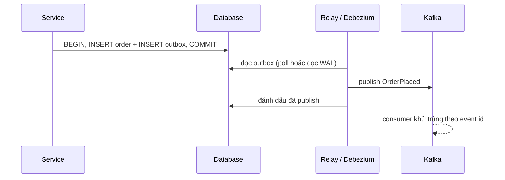

## 1. Core Concept

Khi một service vừa **ghi database** vừa **phát sự kiện** (ví dụ lưu đơn hàng rồi gửi `OrderPlaced` lên Kafka), hai thao tác này nằm ở **hai hệ thống không chung transaction** — gọi là **dual-write problem**: ghi DB xong mà publish thất bại thì mất sự kiện, publish xong mà DB rollback thì có sự kiện "ma". **Transactional Outbox** giải quyết bằng cách **ghi sự kiện vào một bảng `outbox` cùng transaction với dữ liệu nghiệp vụ**, rồi một **relay** đọc bảng đó và publish lên message broker.

**Mental model:** như **gửi thư qua hộp thư nội bộ có phiếu ghi sổ**: bạn bỏ thư vào hộp thư công ty **cùng lúc** với việc ký sổ giao dịch (một hành động nguyên tử); nhân viên bưu điện (relay) sau đó đến lấy thư trong hộp và chuyển đi, có thể lấy lại nhiều lần nhưng **không bao giờ làm mất thư**.

## 2. How It Works

**Ghi nguyên tử → Dữ liệu và sự kiện cùng một transaction**
- Trong một transaction DB: `INSERT` đơn hàng **và** `INSERT` một dòng vào bảng `outbox` (`id`, `aggregate_id`, `type`, `payload`, `created_at`, `published_at`). Cùng commit hoặc cùng rollback, nên **không bao giờ có dữ liệu mà thiếu sự kiện, hay sự kiện mà thiếu dữ liệu**.

```sql
BEGIN;
INSERT INTO orders (id, customer_id, total) VALUES ('o-1001', 'c-42', 250000);
INSERT INTO outbox (id, aggregate_id, type, payload)
VALUES (gen_random_uuid(), 'o-1001', 'OrderPlaced', '{"orderId":"o-1001","total":250000}');
COMMIT;
```

**Relay → Hai cách chuyển sự kiện ra broker**
- **Polling publisher**: tiến trình định kỳ `SELECT ... WHERE published_at IS NULL ORDER BY created_at LIMIT 100 FOR UPDATE SKIP LOCKED`, publish rồi đánh dấu `published_at`. Đơn giản, nhưng **có độ trễ theo chu kỳ poll** và tải lên DB.
- **CDC (Change Data Capture)**: công cụ như **Debezium** đọc **transaction log** (WAL/binlog) của DB và đẩy thay đổi bảng `outbox` lên Kafka (có **Outbox Event Router**). Độ trễ thấp, không poll, nhưng thêm hạ tầng cần vận hành.

**Giao hàng at-least-once → Consumer phải idempotent**
- Relay có thể **publish xong rồi chết trước khi đánh dấu** → gửi lại → **sự kiện bị giao trùng**. Vì vậy hệ thống là **at-least-once**, và **consumer phải idempotent**: khử trùng theo `event id` (bảng `processed_events`/inbox) hoặc upsert theo business key.

**Thứ tự → Theo khoá tổng hợp**
- Dùng `aggregate_id` làm **partition key** để mọi sự kiện của cùng một đơn hàng vào cùng partition và giữ thứ tự. **Thứ tự toàn cục không được bảo đảm**.

**Dọn dẹp và quan sát**
- Xoá hoặc archive các dòng đã publish (hoặc phân vùng bảng theo thời gian) để bảng không phình; theo dõi **outbox lag** (số dòng chưa publish, tuổi dòng cũ nhất).

## 3. Visual Diagram



## 4. Rules of Thumb & Trade-offs

| Tình huống / Nhu cầu | Chọn gì |
| --- | --- |
| Cần ghi DB và phát sự kiện đáng tin cậy | Transactional Outbox |
| Hệ thống nhỏ, chấp nhận độ trễ vài giây | Polling publisher |
| Độ trễ thấp, khối lượng lớn | CDC (Debezium) |
| Consumer nhận sự kiện lặp | Idempotent consumer |
| Cần thứ tự theo thực thể | Partition key = aggregate id |
| Cần giao dịch phân tán nhiều service | Saga (kết hợp Outbox cho từng bước) |

- **Được gì:** không mất/không sinh sự kiện ma mà **không cần 2PC**. **Mất gì:** thêm bảng và relay, độ trễ nhỏ (eventual), giao hàng at-least-once buộc consumer idempotent, thêm gánh nặng vận hành CDC.

## 5. Must Remember / Production Pitfalls

- **Mất hoặc sinh sự kiện ma → publish Kafka bên trong `@Transactional` (dual-write) → ghi sự kiện vào bảng outbox cùng transaction rồi để relay publish**.
- **Consumer xử lý trùng gây tác dụng phụ lặp (trừ tiền hai lần) → at-least-once → khử trùng theo event id hoặc thao tác idempotent**.
- **Sự kiện đến sai thứ tự cho cùng một đơn → partition key không theo aggregate → dùng `aggregate_id` làm key**.
- **Bảng outbox phình, truy vấn chậm → không dọn dẹp → xoá/archive theo lịch hoặc phân vùng theo thời gian**.
- **Sự kiện kẹt không ai biết → thiếu giám sát relay → cảnh báo outbox lag và tuổi sự kiện cũ nhất**.
- Interview trap: "vì sao không publish Kafka trong transaction DB?" → **DB và Kafka không chung transaction nên là dual-write**; "outbox có bảo đảm exactly-once không?" → **không, at-least-once, cần idempotent consumer**; "polling hay CDC?" → **polling đơn giản nhưng trễ, CDC trễ thấp nhưng thêm hạ tầng**.

## 6. Search Hooks

- `transactional outbox pattern` — ghi sự kiện cùng transaction với dữ liệu.
- `dual write problem` — vì sao ghi DB và broker riêng gây mất đồng bộ.
- `change data capture Debezium` — đọc log DB để phát thay đổi.
- `idempotent consumer` — xử lý an toàn khi nhận sự kiện lặp.
