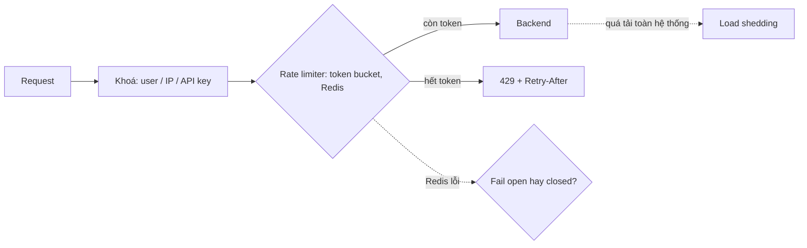

## 1. Core Concept

**Rate limiting** giới hạn số request một client (người dùng, IP, API key, tenant) được phép gửi trong một khoảng thời gian, để **bảo vệ hệ thống khỏi quá tải và lạm dụng**, bảo đảm **công bằng** giữa các client và **kiểm soát chi phí**. Quan trọng là chọn đúng **thuật toán** (cho phép bùng nổ hay làm mượt, chính xác hay xấp xỉ) và cài đặt **đúng khi phân tán** (nguyên tử, không thành điểm lỗi đơn).

**Mental model:** **token bucket** giống **cái ví đựng vé vào cửa**: mỗi giây có thêm vài vé nhưng ví chỉ chứa tối đa một số vé; mỗi request tiêu một vé. Bạn có thể **tiêu dồn** khi ví đầy (bùng nổ có kiểm soát) nhưng về lâu dài không vượt tốc độ nạp vé.

## 2. How It Works

**Các thuật toán**
- **Fixed window counter**: đếm theo cửa sổ cố định (ví dụ 100/phút). Đơn giản nhưng có **lỗi biên**: 100 request ở giây cuối phút trước + 100 ở giây đầu phút sau = **200 trong ~2 giây**.
- **Sliding window log**: lưu timestamp từng request, **chính xác** nhưng tốn bộ nhớ (O(số request)).
- **Sliding window counter**: kết hợp hai cửa sổ liền kề với **trọng số theo vị trí** (xấp xỉ, rẻ, thực dụng).
- **Token bucket**: tốc độ nạp `r` token/giây, **dung lượng tối đa `b`**; mỗi request lấy 1 token; **cho phép bùng nổ tối đa `b`**. Ví dụ `r = 10/s, b = 20`: có thể gửi 20 request liên tiếp, rồi bị giới hạn ở 10/s.
- **Leaky bucket**: request vào hàng đợi, **chảy ra với tốc độ cố định** (làm mượt); hàng đầy thì từ chối. Hợp bảo vệ backend cần tải đều.

**Cài đặt phân tán với Redis → Phải nguyên tử**
- Mẫu "đọc rồi ghi" `GET` → so sánh → `SET` **không nguyên tử**: nhiều request đồng thời cùng đọc `99` rồi cùng ghi `100`, **vượt hạn mức**. Dùng **`INCR` (nguyên tử) + `EXPIRE` khi key mới tạo**, hoặc **Lua script** để token bucket/sliding window chạy trọn vẹn trong Redis. Lưu ý `SET ... EX` mỗi lần còn **làm mới TTL** và kéo dài cửa sổ vô hạn.

```python
def allow(user_id, limit=100, window=60):
    key = f"rl:{user_id}:{int(time.time()) // window}"
    pipe = redis.pipeline()
    pipe.incr(key); pipe.expire(key, window + 1)     # INCR nguyên tử, TTL khi cần
    count, _ = pipe.execute()
    return count <= limit
```

**Giao thức HTTP và vị trí**
- Trả **`429 Too Many Requests`** kèm **`Retry-After`** (và header `RateLimit-*`) để client lùi lại hợp lý. Đặt ở **edge/API gateway** (chặn sớm, rẻ) và/hoặc ứng dụng (theo ngữ cảnh nghiệp vụ); phân tầng theo **gói khách hàng**.

**Load shedding vs rate limiting**
- **Rate limiting**: ép **công bằng theo từng client**. **Load shedding**: khi **cả hệ thống quá tải**, chủ động **bỏ bớt request** (ưu tiên request quan trọng) bất kể client nào. Cần cả hai.

**Fail open vs fail closed**
- Khi kho đếm (Redis) **chết**: **fail open** (cho qua, ưu tiên khả dụng, rủi ro quá tải) hay **fail closed** (chặn, ưu tiên an toàn, rủi ro tự gây downtime). Thường chọn **fail open có giới hạn cục bộ** cho API thường và **fail closed** cho thao tác nhạy cảm.

## 3. Visual Diagram



## 4. Rules of Thumb & Trade-offs

| Tình huống / Nhu cầu | Chọn gì |
| --- | --- |
| Cho phép bùng nổ ngắn, giữ tốc độ trung bình | Token bucket |
| Làm mượt tải ra backend | Leaky bucket |
| Giới hạn đơn giản, chấp nhận lỗi biên | Fixed window |
| Chính xác cao, bộ nhớ không quan trọng | Sliding window log |
| Cân bằng độ chính xác và chi phí | Sliding window counter |
| Nhiều instance dùng chung hạn mức | Redis (INCR/Lua) |
| Hệ thống quá tải chung | Load shedding |

- **Được gì:** bảo vệ hệ thống, công bằng, kiểm soát chi phí. **Mất gì:** thêm độ trễ một lần gọi kho đếm (có thể cache token cục bộ), độ phức tạp phân tán, rủi ro chặn nhầm khách hợp lệ.

## 5. Must Remember / Production Pitfalls

- **Vượt hạn mức khi nhiều instance → đọc rồi ghi không nguyên tử → `INCR` + `EXPIRE` hoặc Lua script**.
- **Gấp đôi hạn mức quanh ranh giới cửa sổ → fixed window → sliding window counter hoặc token bucket**.
- **Cửa sổ không bao giờ reset → set lại TTL mỗi request → đặt TTL một lần khi tạo key**.
- **Redis chết kéo cả API chết (hoặc mở toang) → chưa chọn fail open/closed → quyết định có chủ đích, dự phòng giới hạn cục bộ**.
- **Client retry dồn dập sau 429 → thiếu `Retry-After`/backoff → trả `Retry-After`, client backoff + jitter**.
- Interview trap: "token bucket khác leaky bucket?" → **token bucket cho bùng nổ tới dung lượng, leaky bucket làm mượt đầu ra**; "vì sao `GET` rồi `SET` sai?" → **không nguyên tử, nhiều request cùng qua**; "rate limiting khác load shedding?" → **công bằng theo client vs bảo vệ khi quá tải toàn hệ thống**.

## 6. Search Hooks

- `token bucket vs leaky bucket` — hai thuật toán làm mượt/cho bùng nổ.
- `sliding window counter rate limiting` — xấp xỉ cửa sổ trượt rẻ và chính xác.
- `distributed rate limiter Redis Lua` — giới hạn nguyên tử qua nhiều instance.
- `HTTP 429 Retry-After` — chuẩn báo vượt hạn mức.
- `load shedding vs rate limiting` — hai cơ chế bảo vệ khác nhau.
- `fail open vs fail closed` — hành vi khi kho đếm lỗi.
